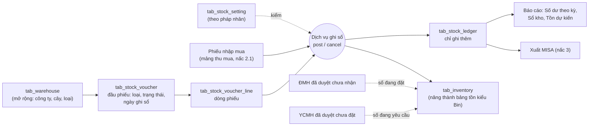
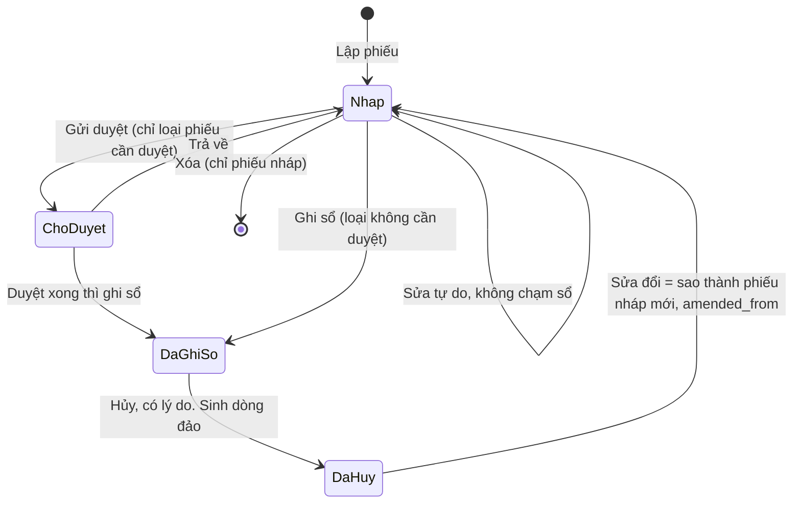

# NGHIÊN CỨU KHO LÕI: ERPNEXT V16 SO VỚI ERP DEGO, VÀ ĐỀ XUẤT KIẾN TRÚC KHO

| | |
|---|---|
| Phiên bản | **1.0** — 02/11/2026 |
| Mảng | **Kho lõi** (Inventory / Stock): danh mục kho, sổ kho, tồn, định giá, chứng từ kho, cài đặt kho, bổ sung hàng, báo cáo kho |
| Trạng thái | Tài liệu nghiên cứu để lập kế hoạch, **chưa phải** tài liệu yêu cầu. Chưa sửa mã, chưa ghi dữ liệu |
| Mốc so sánh | ERPNext **v16** bản chuẩn: mã nguồn `frappe/erpnext` nhánh `version-16` đọc trực tiếp trên trang học (container `erpnext-hoc-backend-1`, site `frontend`), cộng docs.erpnext.com |
| Mốc ERP DEGO | Nhánh `erp-v2`, commit `601ec718` (02/11/2026) |
| Cùng cụm | [`nghien-cuu/01` Luồng chuẩn mua hàng, kho, sản xuất](../../nghien-cuu/01-luong-chuan-mua-hang-kho-san-xuat.md) · [`nghien-cuu/10` Nghiệp vụ kho](../../nghien-cuu/10-nghiep-vu-kho.md) · [`nghien-cuu/11` Độ phủ thu mua và kho](../../thu-mua/nghien-cuu/11-do-phu-thu-mua-kho-so-voi-erpnext.md) · [`nghien-cuu/erpnext/01` Hướng dẫn trang học](../../thu-mua/nghien-cuu/erpnext-01-huong-dan-mua-hang-den-thanh-toan-va-kho.md) |

**Ngoài phạm vi tài liệu này** (đã hoặc sẽ có mảng riêng): phiếu nhập mua và kiểm chất lượng (Purchase Receipt, Quality Inspection), trả hàng nhà cung cấp, hóa đơn và công nợ, lô và số sê-ri, chi tiết lệnh sản xuất. Tài liệu chỉ nhắc tới các phần đó ở chỗ chúng chạm vào sổ kho.

---

## Mục lục

1. [Đọc nhanh](#1-đọc-nhanh)
2. [ERPNext v16 làm kho thế nào](#2-erpnext-v16-làm-kho-thế-nào)
3. [ERP DEGO hiện có gì](#3-erp-dego-hiện-có-gì)
4. [Bảng fit-gap và tỷ lệ phủ](#4-bảng-fit-gap-và-tỷ-lệ-phủ)
5. [Đề xuất kiến trúc kho cho DEGO](#5-đề-xuất-kiến-trúc-kho-cho-dego)
6. [Kế hoạch theo nấc](#6-kế-hoạch-theo-nấc)
7. [Câu hỏi chủ dự án cần chốt](#7-câu-hỏi-chủ-dự-án-cần-chốt)
8. [Nguồn](#8-nguồn)

---

## 1. Đọc nhanh

- Chấm trên **36 chức năng** của kho lõi, ERP DEGO đạt **7,0 / 36 = 19 %** so với ERPNext v16. Bản chấm thô hơn ở tài liệu 11 (8 chức năng, 38 %) không mâu thuẫn: bản này tách nhỏ và tính cả các chức năng ERPNext có mà bên mình chưa đụng tới (giữ chỗ, kho tạm, phiếu lấy hàng, tuổi tồn).
- Bên mình **đã có nền dùng được**: bảng tồn theo cặp *pháp nhân, kho, mã hàng* (`tab_inventory`), sổ phát sinh (`tab_inventory_move`), danh mục kho (`tab_warehouse`), màn v2 Tổng quan kho, Tồn kho, Danh mục kho, biểu đồ giá trị tồn theo kho.
- **Ba chỗ hở lớn nhất:**
  1. **Sổ kho sửa và xóa được, không có ngày ghi sổ, không khóa kỳ.** Mọi con số tồn quá khứ có thể đổi âm thầm. ERPNext coi sổ kho là bất biến: hủy là ghi đảo, có ngày giờ ghi sổ, có ngày khóa sổ.
  2. **Chưa có chứng từ kho**: không có phiếu xuất, chuyển kho, kiểm kê, số dư đầu kỳ. Tồn chỉ tăng. Mọi thứ khác đi qua *điều chỉnh tay* với đơn giá tùy ý.
  3. **Chỉ có một con số tồn.** Không có số đang đặt mua, đang yêu cầu, đã giữ chỗ, tồn dự kiến, nên không làm được mức đặt hàng lại hay tự đề nghị mua.
- **Đề xuất chính:** dựng lại lõi kho theo mô hình của ERPNext nhưng **gọn hơn một bậc**: sổ kho chỉ ghi thêm, chứng từ *Nháp → Đã ghi sổ → Đã hủy*, bảng tồn đệm kiểu `Bin`, **bình quân di động tính tại thời điểm ghi**, ngày khóa sổ theo pháp nhân, **chặn ghi lùi** thay vì tính lại quá khứ (không làm `Repost Item Valuation`), bốn chứng từ *nhập khác, xuất, chuyển, kiểm kê*. **Không** làm bút toán sổ cái (kế toán dùng MISA) nhưng mỗi dòng sổ giữ đủ giá trị để xuất sang MISA. Chuyển đổi bằng **kiểm kê chốt số dư đầu kỳ** tại một ngày cắt.

---

## 2. ERPNext v16 làm kho thế nào

Số liệu trên trang học (đọc ngày 02/11/2026, chỉ đọc): **75 kho** (8 kho nhóm gốc, 8 kho *Goods In Transit*, còn lại là kho lá) cho 7 pháp nhân DEGO cộng công ty mẫu; **521 dòng sổ kho** (517 từ Biên nhận mua hàng, 3 từ phiếu kho, 1 từ kiểm kê); **433 dòng `Bin`**; 365 Biên nhận đã gửi; 8 lượt `Repost Item Valuation` (7 hoàn tất, 1 bỏ qua). Cài đặt kho đang để mặc định: phương pháp định giá **FIFO**, **không** cho tồn âm, **có** bật tự sinh yêu cầu vật tư, chưa đặt ngày khóa sổ, chưa có mức đặt hàng lại nào.

### 2.1. Warehouse — danh mục kho

**Là gì.** Mỗi kho là một nút trên **cây kho** (`is_tree`). Kho nhóm (`is_group = 1`) chỉ để gom, **không được ghi sổ vào** (`block_transactions_against_group_warehouse`). Kho lá mới chứa hàng.

| Trường chính | Ý nghĩa |
|---|---|
| `warehouse_name`, `parent_warehouse`, `is_group`, `lft`/`rgt` | Cây kho. Báo cáo lọc theo kho nhóm thì cộng mọi kho lá bên dưới |
| `company` | **Mỗi kho thuộc đúng một công ty.** Tên kho tự gắn hậu tố viết tắt công ty (`Stores - DGH`) |
| `warehouse_type` | Loại kho, danh mục mở. Bản chuẩn chỉ có sẵn `Transit` |
| `default_in_transit_warehouse` | Kho đang chuyển mặc định khi chuyển hai bước |
| `is_rejected_warehouse` | Đánh dấu kho hàng lỗi; Biên nhận mua hàng đưa số lượng từ chối vào đây |
| `account` | Tài khoản kho riêng cho kho này (nếu bỏ trống thì dùng tài khoản kho mặc định của công ty) |
| `customer` | Kho giữ hàng của khách |
| `disabled` | Ngừng dùng |

**Dùng khi nào.** Lập một lần khi dựng công ty. Mỗi công ty mới được ERPNext tạo sẵn bốn kho: `Stores`, `Work In Progress`, `Finished Goods`, `Goods In Transit`.

**Lưu ý từ trang học.** Danh mục kho của ERP DEGO là danh mục **chung, không gắn công ty**, nên khi nạp sang ERPNext phải **nhân bản mỗi kho theo từng công ty có chứng từ dùng nó** (script `erpnext_nap_nghiep_vu.py`, hàm `warehouse_usage`). Kết quả là pháp nhân DGH có 19 kho, trong đó nhiều kho mang **tên công ty khác** (*Cty TNHH SX TM DV Thu Loan*, *Hóa chất nông nghiệp Hà Long*, *Agama*...). Đây là các điểm giao hàng hoặc kho đặt tại nhà gia công, nhà cung cấp. Ở ERPNext, những kho này lẽ ra mang loại *kho tại nhà gia công* hoặc *kho bên thứ ba*.

### 2.2. Stock Ledger Entry — sổ kho

**Là gì.** Mỗi dòng là **một biến động của một mặt hàng ở một kho** do một chứng từ đã gửi sinh ra. Đây là **nguồn sự thật duy nhất** về số lượng và giá trị tồn. Không ai lập dòng sổ bằng tay.

| Trường chính | Ý nghĩa |
|---|---|
| `item_code`, `warehouse`, `company` | Mặt hàng, kho, công ty |
| `posting_date`, `posting_time`, `posting_datetime` | **Ngày giờ ghi sổ** của chứng từ, khác giờ tạo bản ghi. Sổ sắp theo trường này rồi tới `creation` |
| `voucher_type`, `voucher_no`, `voucher_detail_no` | Chứng từ và dòng chứng từ sinh ra dòng sổ |
| `actual_qty` | Biến động số lượng, dương là nhập, âm là xuất |
| `incoming_rate` / `outgoing_rate` | Đơn giá nhập (từ chứng từ) / đơn giá xuất (do hệ thống tính) |
| `qty_after_transaction` | Tồn **sau** dòng này, tại kho này |
| `valuation_rate` | Đơn giá định giá **sau** dòng này |
| `stock_value`, `stock_value_difference` | Giá trị tồn sau dòng, và phần giá trị dòng này làm tăng hoặc giảm. Bút toán kế toán dựa trên `stock_value_difference` |
| `stock_queue` | Hàng đợi lớp giá (FIFO, LIFO) dạng JSON |
| `is_cancelled` | Cờ hủy |
| `fiscal_year`, `project` | Năm tài chính, dự án |

**Luật chính, đọc từ mã nguồn:**

- **Chỉ ghi thêm.** Chính DocType chặn hủy từng dòng: `on_cancel` ném lỗi *Individual Stock Ledger Entry cannot be cancelled. Please cancel related transaction.*
- **Hủy chứng từ = ghi dòng đảo.** Hàm `make_sl_entries` khi nhận cờ `is_cancelled`: đánh dấu các dòng gốc của chứng từ là đã hủy (`set_as_cancel`), rồi ghi thêm dòng mới với `actual_qty` **đổi dấu** và đơn giá lấy lại từ dòng gốc (`get_incoming_outgoing_rate_for_cancel`). Cả dòng gốc lẫn dòng đảo đều còn trong sổ, báo cáo bỏ qua cặp có cờ hủy.
- **Sửa = Hủy rồi Sửa đổi (Amend)**: tạo bản mới `amended_from` trỏ về bản đã hủy, số chứng từ thêm hậu tố `-1`.
- **Không ghi vào kho nhóm**, không ghi vào kỳ đã khóa (mục 2.8), kiểm tồn âm (mục 2.8).
- **Chỉ mục**: `(item_code, warehouse, posting_datetime, creation)` để đọc tồn tại một thời điểm nhanh, và `(voucher_no, voucher_type)` để tìm theo chứng từ.

Ví dụ thật trên trang học, mặt hàng `CPT0234`, kho `Stores - DGH`, ngày 31/10:

| Chứng từ | `actual_qty` | `valuation_rate` | `qty_after` | `stock_value` | `stock_value_difference` |
|---|---:|---:|---:|---:|---:|
| Biên nhận MAT-PRE-2026-00369 | +20.000 | 3.500 | 20.000 | 70.000.000 | +70.000.000 |
| Xuất vật tư MAT-STE-2026-00005 | −5.000 | 3.500 | 15.000 | 52.500.000 | −17.500.000 |
| Chuyển kho MAT-STE-2026-00006 (dòng kho đi) | −2.000 | 3.500 | 13.000 | 45.500.000 | −7.000.000 |
| Biên nhận trả hàng MAT-PRE-2026-00370 | −100 | 3.500 | 12.900 | 45.150.000 | −350.000 |
| Biên nhận MAT-PRE-2026-00371 | +3.000 | 3.500 | 15.900 | 55.650.000 | +10.500.000 |

Chuyển kho sinh **hai dòng**: dòng âm ở kho đi, dòng dương ở `KHO B18 - DGH` cùng đơn giá 3.500. Kiểm kê thiếu 10 chai ở B18 sinh một dòng `actual_qty = 0`, `qty_after = 1.990`, `stock_value_difference = −35.000` (kiểm kê ghi **số tồn mới**, không ghi chênh lệch).

### 2.3. Bin — bảng tồn đệm

**Là gì.** Một dòng cho mỗi cặp *mặt hàng, kho*, cập nhật mỗi khi có chứng từ liên quan. `Bin` **không phải** sổ, chỉ là bảng đệm để đọc nhanh và để tính tồn dự kiến. Có thể dựng lại từ sổ và từ các chứng từ đang mở.

| Trường | Nghĩa | Ai làm nó đổi |
|---|---|---|
| `actual_qty` | Tồn thực tế | Mọi dòng sổ kho |
| `ordered_qty` | Đang đặt mua: Đơn mua hàng đã gửi, chưa nhận | Purchase Order, Purchase Receipt |
| `indented_qty` | Đang yêu cầu: Yêu cầu vật tư đã gửi, chưa thành đơn | Material Request |
| `planned_qty` | Sắp sản xuất ra: lệnh sản xuất chưa xong | Work Order |
| `reserved_qty` | Đã hứa cho đơn bán chưa giao | Sales Order |
| `reserved_qty_for_production`, `..._for_sub_contract`, `..._for_production_plan` | Đã dành cho sản xuất, gia công, kế hoạch sản xuất | Work Order, Subcontracting Order, Production Plan |
| `reserved_stock` | Số đã giữ chỗ cứng bằng `Stock Reservation Entry` | Mục 2.12 |
| `projected_qty` | **Tồn dự kiến** | Tính lại mỗi lần đổi |
| `valuation_rate`, `stock_value` | Đơn giá, giá trị tồn hiện tại | Dòng sổ cuối |

Công thức trong `bin.py` (`set_projected_qty`):

```
projected_qty = actual_qty + ordered_qty + indented_qty + planned_qty
              − reserved_qty − reserved_qty_for_production
              − reserved_qty_for_sub_contract − reserved_qty_for_production_plan
```

**Dùng khi nào.** Thu mua nhìn `projected_qty` để quyết có cần mua thêm. Job mức đặt hàng lại (mục 2.9) cũng so trên `projected_qty`, không so trên tồn thực.

### 2.4. Định giá

**Ba phương pháp** (`Stock Settings.valuation_method`, ghi đè được trên từng Mặt hàng `Item.valuation_method`):

| Phương pháp | Cách tính trong mã (`stock_ledger.py`) | Khi nào chọn |
|---|---|---|
| **Moving Average** (bình quân di động) | `get_moving_average_values`: nhập thì `rate mới = (tồn cũ × rate cũ + SL nhập × giá nhập) / tồn mới`; xuất thì lấy `rate` hiện tại, rate không đổi; nếu tồn trước đó ≤ 0 mà có nhập thì rate = giá nhập (đặt lại) | Phổ biến ở doanh nghiệp Việt Nam (*bình quân gia quyền tức thời*), đơn giản, dễ giải thích |
| **FIFO** (nhập trước xuất trước, mặc định ERPNext) | `FIFOValuation` giữ hàng đợi lớp giá trong `stock_queue`; xuất lấy từ lớp cũ nhất | Hàng có hạn dùng, giá biến động mạnh, cần tuổi tồn chính xác |
| **LIFO** | `LIFOValuation`, lấy lớp mới nhất | Hiếm dùng, chuẩn mực Việt Nam không cho phép |

**Định giá theo từng cặp *mặt hàng, kho*.** Cùng mã hàng ở hai kho có thể có hai đơn giá. Chuyển kho mang đơn giá của kho đi sang kho đến.

**Giá tại thời điểm ghi.** Mỗi dòng sổ chốt `valuation_rate` và `stock_value` **sau** chính nó. Đơn giá xuất là đơn giá ngay trước thời điểm ghi sổ của phiếu xuất.

**Ghi lùi và Repost Item Valuation.** Khi chứng từ mang ngày giờ ghi sổ **sớm hơn** các dòng sổ đã có (ghi lùi, hoặc hủy chứng từ cũ), mọi dòng sau đó phải tính lại đơn giá và giá trị. ERPNext không tính ngay mà xếp một phiếu `Repost Item Valuation` (trạng thái `Queued → In Progress → Completed / Failed`); job **hằng giờ** (`repost_entries`, nhóm `hourly_maintenance`) chạy lại `update_entries_after` cho từng cặp mặt hàng, kho, rồi tính lại bút toán sổ cái. Có màn cài đặt riêng `Stock Reposting Settings` (khung giờ chạy, chạy song song). Trên trang học đã có 8 lượt như vậy. Đây là phần **phức tạp và hay lỗi nhất** của ERPNext: dữ liệu lớn thì repost chạy hàng giờ, lỗi giữa chừng để lại sổ cái lệch.

**Điều chỉnh giá trị sau khi nhập**: `Landed Cost Voucher` cộng cước, thuế nhập khẩu vào giá của Biên nhận, rồi kích repost. Mảng nhập khẩu xem riêng; ở đây chỉ cần biết nó **đổi giá trị dòng sổ đã có** thông qua repost.

### 2.5. Stock Entry — phiếu kho

**Là gì.** Một chứng từ chung cho mọi biến động kho **không** đi qua mua hoặc bán. Có thể gửi (`is_submittable`), vòng đời *Nháp → Đã gửi → Đã hủy → Sửa đổi*. Loại phiếu đặt ở `stock_entry_type` (danh mục, tự thêm được) trỏ về một trong 13 `purpose` cố định:

| `purpose` | Kho nguồn / đích | Dùng khi | Ghi chú |
|---|---|---|---|
| **Material Receipt** (nhập vật tư) | – / đích | Nhập không qua mua: hàng biếu, hàng tìm thấy, nhập lại | Nhập đơn giá tay (`basic_rate`) |
| **Material Issue** (xuất vật tư) | nguồn / – | Xuất dùng nội bộ, hao hụt, hủy, xuất cho sản xuất khi chưa dùng lệnh | Giá trị vào *tài khoản chênh lệch* (`expense_account`) và trung tâm chi phí |
| **Material Transfer** (chuyển vật tư) | nguồn / đích | Chuyển giữa hai kho | Bật `add_to_transit` thì thành chuyển hai bước (mục 2.6) |
| **Material Transfer for Manufacture** | kho vật tư / kho bán thành phẩm | Cấp vật tư cho lệnh sản xuất | Gắn `work_order` |
| **Material Consumption for Manufacture** | kho bán thành phẩm / – | Ghi tiêu hao riêng khi bật chế độ tách | |
| **Manufacture** (sản xuất) | vật tư ra, thành phẩm vào | Hoàn thành lệnh: trừ vật tư, nhập thành phẩm, cộng `additional_costs` | Giá thành phẩm = tổng giá vật tư + chi phí thêm |
| **Repack** (đóng gói lại) | mã A ra, mã B vào | Đổi quy cách: tách bao 50 kg thành túi 1 kg, phối trộn đơn giản | Không cần BOM, giá trị dồn sang mã ra |
| **Send to Subcontractor** | kho mình / kho nhà gia công | Gửi vật tư cho nhà gia công | Gắn Subcontracting Order |
| **Disassemble** | thành phẩm ra, linh kiện vào | Tháo dỡ | |
| **Receive from Customer**, **Return Raw Material to Customer**, **Subcontracting Delivery**, **Subcontracting Return** | | Gia công nhận (mình gia công cho khách), mới ở v16 | |

**Trường chính của dòng** (`Stock Entry Detail`): `s_warehouse`, `t_warehouse`, `item_code`, `qty`, `uom` + `conversion_factor` + `transfer_qty` (quy về đơn vị kho), `basic_rate` (đơn giá cơ sở, hệ thống tự điền theo định giá), `additional_cost`, `valuation_rate`, `amount`, `expense_account`, `cost_center`, `batch_no`, `serial_no`, `material_request` (truy về yêu cầu), `quality_inspection`.

**Trường chính của đầu phiếu**: `company`, `posting_date`, `posting_time`, `set_posting_time` (phải tick mới được đổi ngày giờ khác hiện tại), `from_warehouse`, `to_warehouse` (mặc định cho mọi dòng), `is_opening`, `remarks`, `total_outgoing_value`, `total_incoming_value`, `value_difference`, `per_transferred`, `outgoing_stock_entry`, `pick_list`, `apply_putaway_rule`.

Trên trang học: phiếu xuất mẫu `MAT-STE-2026-00005` (5.000 chai cho xưởng) và phiếu chuyển `MAT-STE-2026-00006` (2.000 chai sang KHO B18).

### 2.6. Chuyển kho hai bước (Goods In Transit)

**Là gì.** Hàng rời kho đi một ngày, tới kho đến một ngày khác (xe chạy hai ngày từ Hà Nội vào nhà máy). Trong lúc trên xe, hàng **không** thuộc kho nào để dùng.

**Cách ERPNext làm:**

1. Phiếu *Material Transfer* bật `add_to_transit`, kho đích là kho loại `Transit` (`Goods In Transit - DGH`). Gửi phiếu: kho đi giảm, kho đang chuyển tăng.
2. Khi hàng tới, bấm **End Transit** trên phiếu thứ nhất: sinh phiếu chuyển thứ hai, `outgoing_stock_entry` trỏ về phiếu đầu, kho nguồn là kho đang chuyển, kho đích là kho đến thật. Số nhận có thể ít hơn số gửi.
3. `per_transferred` trên phiếu đầu cho biết đã nhận bao nhiêu phần trăm.

**Dùng khi nào.** Chuyển giữa hai địa điểm cách xa, cần biết hàng đang trên đường, cần người kho đến xác nhận số thực nhận. Chuyển trong cùng một khu thì dùng một bước.

### 2.7. Stock Reconciliation — kiểm kê và số dư đầu kỳ

**Là gì.** Chứng từ ghi **số tồn đúng** (và tùy chọn **đơn giá đúng**) cho từng cặp mặt hàng, kho tại một thời điểm. Hệ thống tự so với số trên sổ và sinh dòng sổ cho phần chênh.

| `purpose` | Dùng khi |
|---|---|
| **Opening Stock** | Nạp số dư đầu kỳ khi bắt đầu dùng hệ thống. Chênh lệch ghi vào tài khoản *Temporary Opening* |
| **Stock Reconciliation** | Kiểm kê định kỳ, thừa thiếu ghi vào tài khoản chênh lệch kho |
| **Adjustment Entry** | Điều chỉnh giá trị do hệ thống sinh khi so định giá |

**Dòng** (`Stock Reconciliation Item`): `item_code`, `warehouse`, `qty` (số đếm), `valuation_rate` (để trống thì giữ giá hiện tại), và các ô hệ thống tự điền `current_qty`, `current_valuation_rate`, `current_amount`, `quantity_difference`, `amount_difference`. Đầu phiếu có `expense_account`, `difference_amount`, `set_warehouse`, chế độ quét mã vạch.

**Luật đáng học:** kiểm kê **ghi số mới, không ghi chênh lệch**; đổi được cả đơn giá (cách duy nhất để sửa đơn giá bình quân bị sai mà không đi vòng). Mẫu trên trang học: `MAT-RECO-2026-00002`, KHO B18 đếm 1.990, sổ 2.000, thiếu 10 chai, giá trị −35.000.

### 2.8. Stock Settings — cài đặt kho

| Trường | Ý nghĩa | Trên trang học |
|---|---|---|
| `valuation_method` | Phương pháp định giá mặc định (FIFO, Moving Average, LIFO) | FIFO |
| `allow_negative_stock` | Cho phép tồn âm. Tắt thì xuất vượt tồn bị chặn bằng `NegativeStockError` (*Insufficient Stock*) | Tắt |
| `stock_frozen_upto` + `stock_auth_role` | **Khóa sổ đến ngày**: chứng từ có ngày ghi sổ ≤ ngày này bị chặn (`check_stock_frozen_date`), trừ vai trò được phép | Chưa đặt |
| `stock_frozen_upto_days` | Khóa trượt: không cho ghi chứng từ cũ hơn N ngày so với hôm nay | 0 |
| `role_allowed_to_create_edit_back_dated_transactions` | Nếu đặt, chỉ vai trò này được ghi chứng từ **trước** dòng sổ cuối cùng của cùng cặp mặt hàng, kho (`validate_with_last_transaction_posting_time`) | Chưa đặt |
| `over_delivery_receipt_allowance` + `role_allowed_to_over_deliver_receive` | Dung sai nhận, giao vượt (%), vai trò được vượt. Ghi đè được trên Mặt hàng | 0 |
| `mr_qty_allowance` | Dung sai đặt vượt số trên yêu cầu vật tư | 0 |
| `auto_indent` + `reorder_email_notify` | Tự sinh Yêu cầu vật tư theo mức đặt hàng lại, gửi thư báo | **Bật** |
| `enable_stock_reservation`, `allow_partial_reservation`, `auto_reserve_stock` | Bật giữ chỗ tồn (mục 2.12) | Tắt |
| `action_if_quality_inspection_is_not_submitted` / `_is_rejected` | Chặn hay chỉ cảnh báo khi thiếu phiếu kiểm chất lượng | Chặn |
| `over_picking_allowance` | Dung sai lấy vượt trên phiếu lấy hàng | |
| `validate_material_transfer_warehouses` | Chặn chuyển kho có kho nguồn trùng kho đích | |

Ngoài ra v16 có **`Stock Closing Entry`**: đóng kỳ kho cho một công ty và một khoảng ngày, chụp số dư cuối kỳ vào `Stock Closing Balance`; sau đó mọi dòng sổ có ngày trong kỳ đã đóng bị chặn (`validate_stock_frozen_by_closing_entry`). Muốn ghi lại thì phải hủy phiếu đóng kỳ.

### 2.9. Item Reorder và tự sinh Material Request

**Là gì.** Bảng con trên Mặt hàng (`Item Reorder`): mỗi dòng một kho (hoặc một kho nhóm qua `warehouse_group`), `warehouse_reorder_level` (mức tồn tối thiểu), `warehouse_reorder_qty` (số đề nghị), `material_request_type` (*Purchase, Transfer, Material Issue, Manufacture*).

**Chạy thế nào.** Job **hằng ngày** `erpnext.stock.reorder_item.reorder_item`, chỉ chạy khi `auto_indent` bật. Với mỗi dòng mức đặt hàng lại, nếu `projected_qty ≤ reorder_level` thì sinh **Yêu cầu vật tư nháp** cho đúng loại. Vì so trên **tồn dự kiến**, hàng đã có đơn mua đang về sẽ không bị đề nghị lại.

**Dùng khi nào.** Vật tư dùng đều, mua lặp lại: bao bì, nhãn, hóa chất cơ bản.

### 2.10. Putaway Rule — luật cất hàng

**Là gì.** Bảng `Putaway Rule`: `item_code`, `warehouse`, `capacity` (sức chứa theo đơn vị kho), `priority`, `company`. Khi Biên nhận hoặc phiếu kho bật `apply_putaway_rule`, hệ thống **tự chia dòng nhập** vào các kho theo ưu tiên cho tới khi đầy.

**Dùng khi nào.** Một mặt hàng có nhiều kho hoặc nhiều khu chứa có sức chứa giới hạn (silo, bồn). Doanh nghiệp vừa ít khi cần.

### 2.11. Pick List — phiếu lấy hàng

**Là gì.** Chứng từ gửi được, `purpose` là *Material Transfer for Manufacture*, *Material Transfer* hoặc *Delivery*. Đọc từ lệnh sản xuất, yêu cầu vật tư hoặc đơn bán, **gợi ý lấy ở kho nào, lô nào** (theo FIFO, LIFO hoặc hạn dùng), người kho nhập `picked_qty` thực lấy, rồi từ đó sinh phiếu chuyển hoặc phiếu giao. Trạng thái *Draft, Open, Partly Delivered, Partially Transferred, Completed, Cancelled*.

**Dùng khi nào.** Kho nhiều vị trí, nhiều lô, cần đưa người kho một danh sách đi lấy. Trên trang học chưa có phiếu nào.

### 2.12. Stock Reservation Entry — giữ chỗ tồn

**Là gì.** Chứng từ gửi được, **giữ cứng** một số lượng của một mặt hàng ở một kho cho một chứng từ cụ thể (`voucher_type` là *Sales Order, Work Order, Production Plan, Subcontracting Order...*). Trường `reserved_qty`, `delivered_qty`, `consumed_qty`, `transferred_qty`, trạng thái *Reserved → Partially Delivered → Delivered / Closed / Cancelled*. Phải bật `enable_stock_reservation`.

**Luật.** Số đã giữ không cho chứng từ khác xuất (kể cả khi tồn thực còn), cộng vào `Bin.reserved_stock`.

**Dùng khi nào.** Nhiều lệnh sản xuất tranh cùng vật tư; cần cam kết với khách lớn. Với DEGO, chỉ cần khi có lệnh sản xuất.

### 2.13. Báo cáo kho chính

| Báo cáo | Cho thấy | Dữ liệu |
|---|---|---|
| **Stock Balance** (Số dư kho) | Theo mặt hàng, kho, trong khoảng ngày: tồn đầu, nhập, xuất, tồn cuối, cả số lượng và giá trị | Sổ kho |
| **Stock Ledger** (Sổ kho) | Từng dòng sổ: chứng từ, biến động, tồn sau, đơn giá, giá trị | Sổ kho |
| **Stock Projected Qty** | Tồn thực, đang đặt, đang yêu cầu, đã giữ, tồn dự kiến, mức đặt hàng lại, **số thiếu** | `Bin` + `Item Reorder` |
| **Stock Ageing** (Tuổi tồn) | Tồn chia theo khoảng tuổi 0–30, 31–60, 61–90, trên 90 ngày | Hàng đợi FIFO dựng lại từ sổ |
| **Stock Analytics** | Số lượng hoặc giá trị tồn theo tuần, tháng, quý, dạng bảng và biểu đồ | Sổ kho |
| **Warehouse-wise Stock Value** | Giá trị tồn theo từng kho, biểu đồ | Sổ kho |
| Thêm | *Stock Value and Account Value Comparison* (so giá trị sổ kho với sổ cái), *Batch-Wise Balance History*, *Itemwise Recommended Reorder Level*, *Total Stock Summary* | |

### 2.14. Hạch toán kho vĩnh viễn (perpetual inventory) — mức khái niệm

- Bật ở Công ty (`enable_perpetual_inventory`, trên trang học **cả 8 công ty đều bật**). Mỗi dòng sổ có `stock_value_difference ≠ 0` sinh **ngay** một bút toán sổ cái: Nợ hoặc Có *tài khoản kho* (`Stock In Hand`, tương ứng 152, 153, 155, 156), đối ứng với tài khoản do chứng từ quyết định: *Stock Received But Not Billed* (hàng về chưa có hóa đơn) cho Biên nhận, *Stock Adjustment* hoặc tài khoản chi phí cho phiếu xuất và kiểm kê, *Temporary Opening* cho số dư đầu kỳ.
- Vì thế sổ kho và sổ cái luôn khớp, và mọi lượt repost giá kho kéo theo repost sổ cái.
- Chuyển kho giữa hai kho cùng tài khoản thì **không có bút toán**; khác tài khoản thì Nợ kho đến, Có kho đi.
- Tắt chế độ này (*periodic*) thì sổ kho chỉ là số lượng và giá trị quản trị, kế toán tự kết chuyển cuối kỳ. **Đây đúng là vị trí của ERP DEGO**: kế toán làm trên MISA.

---

## 3. ERP DEGO hiện có gì

### 3.1. Bản đồ mã

| Thành phần | Ở đâu | Trạng thái |
|---|---|---|
| Danh mục kho | `tab_warehouse` (`backend/app/modules/catalog/model.py`, lớp `Warehouse`): `code` `String(25)` duy nhất toàn hệ, `name`, `address`, `is_active`. Đường API `/api/warehouses`, entity quyền `warehouse` (phạm vi `PUBLIC`) | **Có**, phẳng |
| Bảng tồn | `tab_inventory` (`backend/app/modules/inventory/model.py`, lớp `Inventory`): `company_id`, `warehouse_code`, `product_code`, `product_name`, `unit`, `qty` `Numeric(18,3)`, `avg_cost` `Numeric(18,4)`, `value` `Numeric(18,2)` | **Có**, một con số tồn |
| Sổ phát sinh | `tab_inventory_move` (cùng tệp, lớp `InventoryMove`): `company_id`, `warehouse_code`, `product_code`, `qty` (dương nhập, âm giảm), `unit_price`, `ref_type` **chỉ `gr` hoặc `adjust`**, `ref_id` (= `delivery_id` khi `gr`), `note` | **Một phần** |
| Nghiệp vụ | `backend/app/modules/inventory/service.py`: `apply_delivery`, `remove_delivery`, `adjust`, `_recompute` | Xem 3.2 |
| Đường API | `backend/app/modules/inventory/controller.py`: `GET /api/inventory` (lọc kho, mã, nhóm hàng, còn hàng / hết / âm), `GET /api/inventory/moves`, `POST /api/inventory/adjust` | Ba đường |
| Phiếu nhập kho | `tab_goods_receipt` (`backend/app/modules/goods_receipt/`): **sinh ngầm** mỗi lần giao trên ĐMH, mã `GR` + id, không trạng thái, không màn riêng | **Một phần** |
| Nối với ĐMH | `purchase_order/service.py`, hàm `recompute_effects` gọi `gr_service.upsert_for_delivery` và `inv_service.apply_delivery` mỗi lần lưu ĐMH; `_cleanup_delivery` gọi `remove_delivery` khi xóa lần giao | Xem tài liệu 01 mục 7.0 |
| Quyền | Entity `inventory` (đọc, ghi), phạm vi theo `company_id` (`core/scoping.py`); `_writable_company` chặn ghi tồn sang pháp nhân ngoài phạm vi | **Có** |
| Giao diện v2 | `frontend-v2/src/modules/inventory/`: **Tổng quan** (`inventory-dashboard-page.tsx`: tổng giá trị tồn, số mã hết hoặc tồn thấp, biểu đồ giá trị tồn theo kho, danh sách 8 mã tồn thấp nhất kèm nút tạo YCMH), **Tồn kho** (`inventory-list-page.tsx` + hộp thoại điều chỉnh, hộp thoại chi tiết phát sinh), **Danh mục Kho** (`warehouse-crud.tsx`) | **Có** |
| Nơi khác đọc tồn | `dashboard/controller.py` (thẻ tồn trang chủ), `report/controller.py` (tab Tồn kho của Báo cáo mua hàng), `company/merge_service.py` (gộp công ty gọi `_recompute`), `product/service.py` (chặn xóa sản phẩm còn tồn) | |

### 3.2. Sổ kho đang chạy thế nào

- `apply_delivery` tìm dòng sổ theo `ref_type = "gr"` và `ref_id = delivery_id`, **ghi đè** số lượng và đơn giá (đơn giá ĐMH × tỷ giá). Đổi kho trên lần giao thì tính lại cả cặp cũ.
- `remove_delivery` **xóa** dòng sổ khi xóa lần giao hoặc đưa số nhận về 0.
- `adjust` thêm dòng `ref_type = "adjust"` với `qty` âm hoặc dương; đơn giá lấy từ người gọi nếu có, không thì lấy `avg_cost` hiện tại. **Không kiểm tồn âm**, không có người duyệt, chỉ cần ghi chú.
- `_recompute` mỗi lần **cộng lại toàn bộ** dòng sổ của cặp *pháp nhân, kho, mã*: `qty = Σ qty`, `value = Σ qty × unit_price`, `avg_cost = value / qty`.

**Nhận xét quan trọng về công thức giá.** Về toán, `Σ qty × đơn giá` **trùng** với bình quân di động **nếu** (1) mọi dòng xuất được ghi đúng bằng `avg_cost` tại lúc ghi và (2) không ai sửa dòng cũ. Hàm `adjust` đang làm đúng (1). Cái hỏng là (2): khi một lần nhập cũ bị sửa hoặc xóa, `avg_cost` của hiện tại đổi theo, còn các dòng giảm đã chốt giá cũ không đổi, nên **tổng giá trị không còn bằng nhập trừ xuất** và không truy được vì không còn dấu vết dòng cũ. Thêm nữa, thứ tự dòng là thứ tự `id`, không phải ngày ghi sổ. Vậy việc cần làm ở nấc 2 **không phải đổi công thức** mà là **đóng băng lịch sử và chốt giá tại từng dòng**.

### 3.3. Những điểm phụ thấy khi soát mã

| # | Điểm | Hệ quả |
|---|---|---|
| p1 | `tab_inventory` ghi chú *key duy nhất* nhưng chỉ có ba chỉ mục rời, **không có ràng buộc duy nhất** trên `(company_id, warehouse_code, product_code)` | Hai lượt lưu ĐMH cùng lúc có thể sinh hai dòng tồn cho một cặp |
| p2 | Kho trên tồn, sổ, phiếu nhập, ĐMH là **chuỗi** `warehouse_code` `String(50)`, danh mục là `String(25)`, không khóa ngoại | Kho gõ sai vẫn ghi được; đổi mã kho làm đứt liên kết |
| p3 | `tab_warehouse` **không có `company_id`**, không cây, không loại kho | Không biết kho của pháp nhân nào; phải nhân bản khi sang ERPNext (mục 2.1) |
| p4 | Danh mục kho trộn kho của mình với **điểm giao tại nhà cung cấp, nhà gia công** (thấy rõ trên trang học) | Tồn tại kho đó thực ra là hàng mình gửi bên ngoài, cần loại kho riêng |
| p5 | Số học bằng `float` trong `_recompute` rồi làm tròn | Lệch lẻ cộng dồn khi sổ dài |
| p6 | Tổng quan *tồn thấp* = 8 mã có `qty` nhỏ nhất, **không** có mức tồn tối thiểu | Cảnh báo không phân biệt hàng hết thật với hàng ít dùng |
| p7 | `tab_inventory_move` không có `posting_date`; chỉ có `created_at` | Không dựng được tồn tại một ngày trong quá khứ |

### 3.4. Bảng Có / Một phần / Chưa theo khái niệm ERPNext

| Khái niệm ERPNext | ERP DEGO | Tệp / bảng |
|---|---|---|
| Warehouse (cây, công ty, loại, kho lỗi, kho đang chuyển) | **Một phần**: danh mục phẳng, không công ty, không loại | `tab_warehouse` |
| Stock Ledger Entry chỉ ghi thêm | **Chưa**: sửa, xóa được | `tab_inventory_move`, `inventory/service.py` |
| Ngày giờ ghi sổ | **Chưa** | |
| Vòng đời chứng từ Nháp, Gửi, Hủy, Sửa đổi | **Chưa** với kho (ĐMH có duyệt nhưng phiếu nhập ngầm không có trạng thái) | `tab_goods_receipt` |
| Bin: tồn thực, giá trị | **Có** | `tab_inventory` |
| Bin: đang đặt, đang yêu cầu, giữ chỗ, dự kiến | **Chưa** | |
| Moving Average tại thời điểm | **Một phần**: công thức đúng khi sổ không bị sửa | `_recompute` |
| FIFO, LIFO, chọn theo mặt hàng | **Chưa** | |
| Ghi lùi có kiểm soát / Repost | **Chưa**: mọi sửa đều thành *ghi lùi không dấu vết* | |
| Landed Cost vào giá kho | **Một phần**: chi phí đã chia về dòng hàng nhưng không vào sổ kho | `tab_po_cost`, `allocate_import_costs` |
| Material Receipt (nhập khác) | **Một phần**: điều chỉnh dương có đơn giá, không phiếu | `POST /api/inventory/adjust` |
| Material Issue, Material Transfer, chuyển hai bước, Repack, gửi gia công | **Chưa** | |
| Stock Reconciliation (kiểm kê), Opening Stock | **Một phần**: điều chỉnh tay theo **chênh lệch**, không phiếu, không duyệt | `adjust` |
| Stock Settings: khóa sổ, tồn âm, dung sai, phương pháp giá | **Chưa** | |
| Item Reorder + tự sinh yêu cầu | **Chưa** (chỉ có nút tạo YCMH tay từ danh sách tồn thấp) | `inventory-dashboard-page.tsx` |
| Putaway Rule, Pick List, Stock Reservation | **Chưa** | |
| Stock Balance theo kỳ | **Một phần**: chỉ tồn hiện tại | `GET /api/inventory`, tab Tồn kho báo cáo |
| Stock Ledger báo cáo | **Một phần**: danh sách phát sinh có người thao tác, không có tồn sau từng dòng, không lọc theo ngày ghi sổ | `GET /api/inventory/moves` |
| Stock Projected Qty, Stock Ageing, Stock Analytics | **Chưa** | |
| Warehouse-wise Stock Value | **Có** | biểu đồ *Giá trị tồn theo kho* |
| Perpetual inventory | **Không làm, có chủ đích** (MISA); giá trị từng dòng còn **Một phần** vì dòng sửa được | |

---

## 4. Bảng fit-gap và tỷ lệ phủ

Cách chấm giống tài liệu 11: **1** = làm được trên màn, có dữ liệu hoặc chứng từ riêng; **0,5** = làm được nhưng thiếu mảnh quan trọng hoặc phải đi vòng; **0** = chưa có. Không tính bút toán sổ cái (ngoài phạm vi có chủ đích), lô và số sê-ri, chi tiết sản xuất.

| # | ERPNext | ERP DEGO | Mức | Ghi chú |
|---|---|---|---:|---|
| **A** | **Danh mục kho** | | | |
| A1 | Cây kho nhóm và lá, cấm ghi vào kho nhóm | Danh mục phẳng | 0,5 | Có danh mục, có màn; thiếu cây |
| A2 | Kho thuộc một công ty | Danh mục không công ty; tồn và sổ thì có `company_id` | 0,5 | Sổ đã tách pháp nhân, danh mục chưa |
| A3 | Loại kho, kho đang chuyển | Chưa | 0 | |
| A4 | Kho hàng lỗi (`is_rejected_warehouse`) | Chưa | 0 | Nối với mảng kiểm chất lượng |
| **B** | **Sổ kho và tồn** | | | |
| B1 | Sổ chỉ ghi thêm, hủy bằng dòng đảo | Sửa, xóa được | 0 | Chỗ hở số 1 |
| B2 | Ngày giờ ghi sổ riêng | Chỉ có giờ tạo | 0 | |
| B3 | Vòng đời chứng từ Nháp, Gửi, Hủy, Sửa đổi | Chưa | 0 | |
| B4 | Bin: tồn thực, đơn giá, giá trị theo cặp kho, mã | `tab_inventory` | 1 | Thiếu ràng buộc duy nhất (p1) nhưng chạy được |
| B5 | Bin: đang đặt, đang yêu cầu, giữ chỗ, dự kiến | Chưa | 0 | Chỗ hở số 3 |
| B6 | Khóa sổ theo ngày, khóa trượt N ngày, đóng kỳ | Chưa | 0 | |
| **C** | **Định giá** | | | |
| C1 | Bình quân di động chốt tại từng dòng | Công thức đúng nhưng tính lại toàn lịch sử | 0,5 | Mục 3.2 |
| C2 | FIFO, LIFO, chọn theo công ty hoặc mặt hàng | Chưa | 0 | |
| C3 | Ghi lùi có kiểm soát (chặn hoặc repost) | Chưa | 0 | |
| C4 | Chi phí sau nhập vào giá kho (Landed Cost) | Đã chia về dòng hàng, chưa vào sổ | 0,5 | Như F3 tài liệu 11 |
| **D** | **Chứng từ kho** | | | |
| D1 | Material Receipt, nhập khác | Điều chỉnh dương có đơn giá | 0,5 | |
| D2 | Material Issue, xuất có mục đích | Chưa | 0 | Chỗ hở số 2 |
| D3 | Material Transfer một bước | Chưa | 0 | |
| D4 | Chuyển hai bước qua kho đang chuyển | Chưa | 0 | |
| D5 | Repack, đổi quy cách | Chưa | 0 | |
| D6 | Gửi gia công (Send to Subcontractor) | Chưa | 0 | Đang dùng *kho mang tên nhà gia công* thay thế (p4) |
| D7 | Stock Reconciliation, kiểm kê | Điều chỉnh tay theo chênh lệch | 0,5 | |
| D8 | Opening Stock, số dư đầu kỳ | Điều chỉnh tay | 0,5 | |
| **E** | **Cài đặt và luật** | | | |
| E1 | Cho hoặc chặn tồn âm | Không có luật; điều chỉnh âm đi qua tự do | 0 | |
| E2 | Dung sai nhận, giao vượt | Chưa | 0 | Như điểm h tài liệu 01 |
| E3 | Phương pháp định giá mặc định, ghi đè theo mặt hàng | Chưa (cứng một cách) | 0 | |
| **F** | **Bổ sung hàng và kho vận** | | | |
| F1 | Mức đặt hàng lại + job tự sinh yêu cầu | Chưa; chỉ có nút tạo YCMH tay | 0 | |
| F2 | Putaway Rule | Chưa | 0 | Ưu tiên thấp |
| F3 | Pick List | Chưa | 0 | Chờ Sản xuất |
| F4 | Stock Reservation | Chưa | 0 | Chờ Sản xuất |
| **G** | **Báo cáo** | | | |
| G1 | Stock Balance theo kỳ (đầu, nhập, xuất, cuối) | Chỉ tồn hiện tại | 0,5 | |
| G2 | Stock Ledger có tồn sau từng dòng | Danh sách phát sinh | 0,5 | |
| G3 | Stock Projected Qty | Chưa | 0 | |
| G4 | Stock Ageing | Chưa | 0 | |
| G5 | Stock Analytics theo kỳ | Chưa | 0 | |
| G6 | Warehouse-wise Stock Value | Biểu đồ giá trị theo kho | 1 | |
| **H** | **Giá trị cho kế toán** | | | |
| H1 | Giá trị từng dòng sổ đủ để hạch toán (ERPNext: perpetual) | Có `unit_price` từng dòng nhưng dòng sửa được | 0,5 | Bút toán sổ cái không tính, có chủ đích |

**Tỷ lệ phủ:**

| Nhóm | Số chức năng | Có | Một phần | Chưa | Điểm | Tỷ lệ |
|---|---:|---:|---:|---:|---:|---:|
| A. Danh mục kho | 4 | 0 | 2 | 2 | 1,0 | 25 % |
| B. Sổ kho và tồn | 6 | 1 | 0 | 5 | 1,0 | 17 % |
| C. Định giá | 4 | 0 | 2 | 2 | 1,0 | 25 % |
| D. Chứng từ kho | 8 | 0 | 3 | 5 | 1,5 | 19 % |
| E. Cài đặt và luật | 3 | 0 | 0 | 3 | 0,0 | 0 % |
| F. Bổ sung hàng, kho vận | 4 | 0 | 0 | 4 | 0,0 | 0 % |
| G. Báo cáo | 6 | 1 | 2 | 3 | 2,0 | 33 % |
| H. Giá trị cho kế toán | 1 | 0 | 1 | 0 | 0,5 | 50 % |
| **Chung** | **36** | **2** | **10** | **24** | **7,0** | **19 %** |

Đọc theo giá trị: các việc của **nấc 2 đề xuất** (mục 6.2) chạm tới 26 chức năng (A1–A4, B1–B6, C1, C3, C4, D1–D4, D7–D8, E1–E3, F1, G1–G3, H1). Làm xong nấc 2 thì độ phủ lên khoảng **27,5 / 36 = 76 %** (E3 tính nửa điểm vì bản đầu chỉ có một phương pháp giá). Tám chức năng còn lại (C2 FIFO, D5 đổi quy cách, D6 gửi gia công, F2 luật cất hàng, F3 phiếu lấy hàng, F4 giữ chỗ, G4 tuổi tồn, G5 phân tích theo kỳ) chỉ cần khi có Sản xuất hoặc khi kế toán chốt FIFO, nằm ở nấc 3.

---

## 5. Đề xuất kiến trúc kho cho DEGO

### 5.1. Nguyên tắc

1. **Sổ kho là sự thật, chỉ ghi thêm.** Không đường mã nào được `UPDATE` số lượng hay giá trị của dòng sổ, không đường nào `DELETE`.
2. **Chứng từ mới sinh sổ.** Mọi biến động đi qua một chứng từ có trạng thái; chỉ lúc *Ghi sổ* mới chạm sổ và bảng tồn.
3. **Định giá tại thời điểm ghi, không tính lại quá khứ.** Giữ bình quân di động (đúng thứ bên mình đang tính), nhưng chốt `valuation_rate` và `stock_value` sau từng dòng.
4. **Chặn ghi lùi thay vì repost.** Đây là chỗ cắt giảm lớn nhất so với ERPNext, đổi lấy độ đơn giản và độ tin cậy. Ghi lùi chỉ được trong khung hẹp và chỉ khi không làm đổi giá của dòng đã có (mục 5.5).
5. **Không làm sổ cái.** Kế toán ở MISA. Nhưng mỗi dòng sổ mang đủ *số lượng, đơn giá, giá trị, mục đích, chứng từ gốc* để xuất cho MISA.
6. **Theo đúng luật nền của ERP:** trạng thái và loại là `SMALLINT` + `IntEnum` khai ở `core/status_catalog.py`; `product_code` là hạt dữ liệu (không đổi khóa sang id); số học dùng `Decimal`; quyền đi qua `require` + `apply_scope`, lấy một dòng qua `get_scoped`.

### 5.2. Mô hình dữ liệu đề xuất



**`tab_warehouse` mở rộng** (giữ `code` và mọi chỗ đang trỏ bằng chuỗi):

| Cột mới | Kiểu | Ghi chú |
|---|---|---|
| `company_id` | `BigInteger` | Pháp nhân chủ quản. Xem câu Q4 về kho dùng chung |
| `parent_code`, `is_group` | `String(25)`, `Boolean` | Cây hai, ba tầng là đủ (Pháp nhân → Địa điểm → Kho, Khu) |
| `warehouse_type` | `SMALLINT` (`WarehouseType`) | 1 Thường · 2 Chờ kiểm · 3 Hàng lỗi, cách ly · 4 Đang chuyển · 5 Tại nhà gia công, bên thứ ba · 6 Ký gửi, giữ hộ |
| `transit_code` | `String(25)` | Kho đang chuyển mặc định khi chuyển hai bước |
| `allow_posting` | tính từ `is_group` và `is_active` | Không ghi vào kho nhóm, kho ngừng |

Thủ kho gắn qua bảng phụ `tab_warehouse_keeper (warehouse_code, employee_id, role SMALLINT)` để làm phạm vi *kho của tôi* (mục 5.7).

**`tab_stock_voucher` + `tab_stock_voucher_line`** — một cặp bảng cho mọi phiếu kho, giống `Stock Entry`:

| Cột đầu phiếu | Ghi chú |
|---|---|
| `code` | Theo loại: `PN-`, `PX-`, `PC-`, `KK-`, `DK-` + năm + số |
| `voucher_type` `SMALLINT` | 1 Nhập khác · 2 Xuất · 3 Chuyển kho · 4 Kiểm kê · 5 Số dư đầu kỳ · 6 Nhận chuyển (bước hai) · về sau: 7 Nhập mua (từ phiếu nhập mua), 8 Trả NCC, 9 Xuất cho lệnh sản xuất, 10 Nhập thành phẩm |
| `purpose` `SMALLINT` | Bắt buộc với phiếu xuất: sản xuất, dùng nội bộ, hao hụt, hủy, mẫu thử, khác. Dùng để xuất MISA vào đúng tài khoản chi phí |
| `status` `SMALLINT` | 0 Nháp · 1 Đã ghi sổ · 2 Đã hủy (tùy chọn 3 Chờ duyệt nếu loại phiếu cần duyệt, dùng bộ máy `approval/` sẵn có) |
| `company_id`, `posting_date`, `posting_time` | Ngày giờ ghi sổ, mặc định lúc bấm *Ghi sổ* |
| `from_warehouse`, `to_warehouse` | Mặc định cho dòng |
| `ref_type`, `ref_id`, `ref_code` | Chứng từ gốc: ĐMH, YCMH, phiếu chuyển bước một, lệnh sản xuất về sau |
| `amended_from_id`, `cancel_reason`, `posted_by/at`, `cancelled_by/at` | Dấu vết |

| Cột dòng phiếu | Ghi chú |
|---|---|
| `product_code`, `product_name`, `unit` | Giữ chuỗi như mọi bảng khác |
| `qty` `Numeric(18,3)` | Kiểm kê: số đếm; phiếu khác: số biến động (dương) |
| `from_warehouse`, `to_warehouse` | Ghi đè đầu phiếu nếu cần |
| `rate` `Numeric(18,4)` | Nhập khác, số dư đầu kỳ: người lập nhập. Xuất, chuyển: **hệ thống điền** lúc ghi sổ |
| `current_qty`, `current_rate` | Kiểm kê: số sổ tại lúc ghi, để in biên bản |
| `amount` | `qty × rate` lúc ghi sổ |

**`tab_stock_ledger`** — sổ kho mới, **chỉ ghi thêm**:

| Cột | Ghi chú |
|---|---|
| `id` | Tăng dần, cũng là thứ tự ghi |
| `company_id`, `warehouse_code`, `product_code` | Khóa tồn |
| `posting_date`, `posting_time` | Lấy từ chứng từ |
| `voucher_type`, `voucher_id`, `voucher_line_id`, `voucher_code` | Truy ngược |
| `qty` `Numeric(18,3)` | Biến động, có dấu |
| `rate` `Numeric(18,4)` | Đơn giá nhập (nhập) hoặc đơn giá xuất đã tính (xuất) |
| `value_diff` `Numeric(18,2)` | Phần giá trị dòng này làm đổi. Đây là con số xuất sang MISA |
| `qty_after`, `valuation_rate_after`, `stock_value_after` | Tồn, đơn giá, giá trị **sau** dòng |
| `is_cancelled` `Boolean` | Bật cho cả dòng gốc lẫn dòng đảo khi hủy chứng từ. Là **thay đổi duy nhất** được phép trên một dòng đã ghi |
| `reverses_id` | Dòng đảo trỏ về dòng gốc |
| `created_by`, `created_at` | |

Chỉ mục: `(company_id, warehouse_code, product_code, posting_date, posting_time, id)` và `(voucher_type, voucher_id)`. Trên MySQL nên thêm một trigger hoặc quyền DB chặn `UPDATE` các cột số và `DELETE` trên bảng này, để luật chỉ ghi thêm không phụ thuộc kỷ luật viết mã.

**`tab_inventory` nâng thành bảng tồn kiểu `Bin`** (giữ tên bảng để Tổng quan, trang chủ, báo cáo không phải sửa):

| Cột | Hiện có | Mới |
|---|---|---|
| `qty`, `avg_cost`, `value` | Có | Chỉ dịch vụ ghi sổ được viết, bằng giá trị *sau* của dòng sổ cuối |
| `ordered_qty` | | ĐMH đã duyệt, chưa nhận |
| `requested_qty` | | YCMH đã duyệt, chưa thành ĐMH |
| `reserved_qty` | | Để chỗ cho giữ chỗ về sau, mặc định 0 |
| `projected_qty` | | `qty + ordered_qty + requested_qty − reserved_qty` |
| `last_posting_at` | | Ngày giờ ghi sổ của dòng sổ cuối, phục vụ luật chặn ghi lùi |
| Ràng buộc duy nhất `(company_id, warehouse_code, product_code)` | Chưa có | Vá p1 |

`ordered_qty` và `requested_qty` có thể tính lại hằng đêm bằng job Celery thay vì cập nhật theo từng sự kiện; chỉ `qty`, `avg_cost`, `value` bắt buộc cập nhật trong cùng giao dịch với dòng sổ.

**`tab_stock_setting`** (một dòng mỗi pháp nhân, cộng một dòng mặc định `company_id = 0`):

| Cột | Mặc định đề xuất |
|---|---|
| `valuation_method` `SMALLINT` | 1 Bình quân di động (chỉ làm phương pháp này ở nấc 2) |
| `frozen_upto` `Date` | Trống; kế toán đặt sau khi chốt tháng |
| `backdate_days` `Integer` | 3 ngày |
| `allow_negative` `Boolean` | Tắt |
| `over_receipt_pct` `Numeric` | 0 |
| `auto_reorder` `Boolean` | Tắt |

### 5.3. Vòng đời chứng từ



- **Nháp**: sửa, xóa tự do. Không đụng tồn.
- **Ghi sổ**: trong **một giao dịch DB**: khóa dòng tồn của mọi cặp liên quan (`SELECT ... FOR UPDATE`, sắp theo khóa để tránh khóa chéo), kiểm luật (mục 5.5), tính giá, ghi dòng sổ, cập nhật `tab_inventory`, chốt `rate` và `amount` vào dòng phiếu, đổi trạng thái.
- **Hủy**: ghi dòng đảo cho từng dòng sổ của phiếu, đơn giá **lấy lại đúng đơn giá dòng gốc**, bật `is_cancelled` cho cả hai, cập nhật tồn. Chịu cùng luật khóa sổ và ghi lùi như ghi sổ (hủy phiếu cũ là một dạng ghi lùi). Chặn hủy nếu làm tồn âm khi không cho tồn âm.
- **Sửa đổi**: chỉ từ phiếu đã hủy, sao thành nháp mới.

### 5.4. Bình quân di động tại thời điểm ghi

Với mỗi dòng sổ của cặp *pháp nhân, kho, mã*, đọc trạng thái hiện tại `(Q, R, V)` từ `tab_inventory` đã khóa:

| Trường hợp | Đơn giá dòng | Sau dòng |
|---|---|---|
| Nhập `q > 0` giá `p`, `Q > 0` | `rate = p` | `Q' = Q + q`, `V' = V + q × p`, `R' = V' / Q'` |
| Nhập khi `Q ≤ 0` | `rate = p` | `R' = p` (đặt lại như ERPNext), `V' = Q' × R'` |
| Xuất `q < 0` | `rate = R` (không cho người dùng gõ) | `Q' = Q + q`, `V' = V + q × R`, `R' = R`. Nếu `Q' = 0` thì `V' = 0`, phần lẻ dồn vào `value_diff` của chính dòng này |
| Chuyển kho | Dòng âm ở kho đi lấy `R` của kho đi; dòng dương ở kho đến **dùng đúng đơn giá đó** làm giá nhập | Giá trị đi bằng giá trị đến, tổng pháp nhân không đổi |
| Kiểm kê số đếm `c`, đơn giá `r` (tùy chọn) | `q = c − Q`; nếu `r` trống thì `r = R` | `Q' = c`, `V' = c × r`, `value_diff = V' − V` (đổi được cả đơn giá, có duyệt) |
| Số dư đầu kỳ | Như kiểm kê, trên cặp chưa có dòng sổ nào | |

Mọi phép tính bằng `Decimal`, làm tròn theo cột (đơn giá 4 số lẻ, giá trị 2 số lẻ). Có job đêm **đối soát** `tab_inventory` với dòng sổ cuối của từng cặp và `Σ value_diff`; lệch thì báo quản trị, không tự sửa.

### 5.5. Luật ghi sổ: khóa sổ, ghi lùi, tồn âm

Thứ tự kiểm khi ghi sổ hoặc hủy, theo pháp nhân của phiếu:

1. **Khóa sổ cứng**: `posting_date ≤ frozen_upto` → chặn. Chỉ kế toán (quyền `stock_setting.write`) mở khóa bằng cách lùi ngày khóa, có nhật ký.
2. **Khung ghi lùi**: `posting_date < hôm nay − backdate_days` → chặn, trừ vai trò có quyền `inventory.approve` (trưởng kho), và vẫn không vượt được ngày khóa.
3. **Không đè lên dòng đã có**: với từng cặp *kho, mã* trong phiếu, nếu `posting datetime < tab_inventory.last_posting_at` → **chặn** và báo dòng sổ cuối là chứng từ nào, lúc nào. Người dùng chọn ghi với ngày giờ hiện tại, hoặc hủy chứng từ sau trước. Đây là thay thế cho `Repost Item Valuation`: vì không bao giờ có dòng chen vào giữa, giá đã chốt của mọi dòng cũ luôn đúng.
4. **Tồn âm**: nếu `allow_negative` tắt và `Q' < 0` ở bất kỳ dòng nào → chặn, báo thiếu bao nhiêu.

**Phương án nới luật 3** (nếu kho thấy quá cứng, câu Q3): cho phép ghi lùi trong khung `backdate_days` nhưng **định giá theo thứ tự ghi** (`id`) chứ không theo ngày chứng từ. Báo cáo theo ngày vẫn đúng về số lượng; đơn giá của dòng chen chỉ lệch rất ít trong khung vài ngày. Đổi lại, *tồn tại ngày D* tính từ sổ có thể khác chút với `stock_value_after` của dòng cuối ngày D. Đề xuất **giữ luật 3 cứng** ở bản đầu.

### 5.6. Bốn chứng từ của nấc 2

| Phiếu | Ai lập | Ai duyệt (đề xuất) | Luật riêng |
|---|---|---|---|
| **Nhập khác** (Material Receipt) | Thủ kho | Trưởng kho nếu giá trị vượt hạn mức | Bắt buộc lý do và đơn giá. Không dùng cho hàng mua (hàng mua đi qua phiếu nhập mua) |
| **Xuất** (Material Issue) | Thủ kho, hoặc người có nhu cầu lập đề nghị rồi thủ kho xác nhận | Không cần nếu theo lệnh hoặc đề nghị đã duyệt; tự phát thì trưởng kho | Bắt buộc `purpose`; đơn giá do hệ thống điền; thủ kho không thấy giá |
| **Chuyển kho** (Material Transfer) | Thủ kho kho đi | Trưởng kho | Một bước: hai dòng sổ cùng lúc. Hai bước: phiếu đi chuyển vào kho loại *Đang chuyển*; thủ kho kho đến lập *Nhận chuyển* từ phiếu đi, số nhận ≤ số còn trên đường; chênh lệch thiếu thì phiếu xuất hao hụt có duyệt |
| **Kiểm kê** (Stock Reconciliation) | Thủ kho, hội đồng kiểm kê | Theo hạn mức giá trị chênh lệch (tài liệu 10 mục 7.2) | Nhập **số đếm**, hệ thống tính chênh. Nên có chế độ *đếm mù* (ẩn số sổ khi đếm). Mục đích *Số dư đầu kỳ* dùng cho chuyển đổi |

Phiếu nhập mua (từ ĐMH) và trả NCC thuộc mảng thu mua, nhưng **phải ghi sổ qua đúng dịch vụ này** (`voucher_type` 7, 8). Khi mảng thu mua làm phiếu nhập thật (tài liệu 01, việc 2.1), `apply_delivery` / `remove_delivery` không còn được gọi.

### 5.7. Quyền và phân vai

| Vai | Entity, hành động | Phạm vi |
|---|---|---|
| Thủ kho | `stock_voucher.read/create/write`, ghi sổ phiếu của kho mình | Pháp nhân **và** kho mình giữ (`tab_warehouse_keeper`) |
| Trưởng kho | Thêm `stock_voucher.approve` (duyệt, ghi lùi trong khung), `cancel` | Các kho của địa điểm |
| Kế toán kho | `inventory.read` có giá, `stock_setting.write` (ngày khóa), `export` | Pháp nhân |
| Thu mua | `inventory.read` (tồn, tồn dự kiến), không ghi | Theo phạm vi hiện có |
| Người có nhu cầu | Lập đề nghị xuất (về sau), xem tồn khả dụng | |

- Entity mới cần khai đủ bảy sổ (dùng skill `them-entity-moi`): đề xuất `stock_voucher` và `stock_setting`. `SCOPE_FIELDS` hiện chỉ lọc `inventory` theo `company_id`; phạm vi theo kho là chiều mới, cần thêm điều kiện qua bảng thủ kho.
- **Ẩn giá với thủ kho**: đường API trả `rate`, `amount`, `avg_cost`, `value` chỉ khi người gọi có quyền xem giá (đề xuất một entity riêng `inventory_value.read`, theo mẫu `employee_sensitive`).
- Tách người: người mua không lập phiếu kho; người lập phiếu kiểm kê không tự duyệt chênh lệch của mình.

### 5.8. Giữ giá trị cho MISA, không làm sổ cái

- Mỗi dòng sổ có `value_diff`, `voucher_type`, `purpose`, `company_id`, ngày ghi sổ. Từ đó dựng được **bảng kê nhập, xuất theo mẫu MISA** (mỗi phiếu một dòng chứng từ, mỗi dòng phiếu một dòng hàng) và **bảng đối chiếu tồn cuối tháng** theo pháp nhân, kho, mã.
- Gợi ý ánh xạ mục đích sang tài khoản (kế toán chốt): xuất sản xuất → 621, dùng nội bộ → 627/641/642, hao hụt trong định mức → 632, hủy → 811 hoặc 632, kiểm kê thiếu → 1381, thừa → 3381, số dư đầu kỳ → không sinh bút toán.
- **Không** sinh bút toán trong ERP, **không** giữ tài khoản. Bảng ánh xạ chỉ dùng khi xuất tệp.
- Giá trị trên ERP là **giá quản trị**. Nếu MISA tính *bình quân cuối kỳ* (câu K3 tài liệu 01) thì giá xuất hai bên sẽ khác nhau trong tháng, khớp lại ở tổng tồn cuối kỳ chỉ khi cả hai cùng dữ liệu nhập. Phải chốt mức lệch chấp nhận được.

### 5.9. Chuyển đổi dữ liệu cũ

Sổ cũ chỉ có nhập (98 dòng `gr` và 4 dòng `adjust` trên máy local; trên prod khoảng 360 lần nhận) và tồn chỉ tăng, nên **không chuyển sổ cũ sang sổ mới**. Cách làm:

1. **Chốt ngày cắt D** cho từng pháp nhân (câu Q2), nên là ngày đầu tháng để khớp kỳ kế toán.
2. **Dọn danh mục kho trước**: gắn `company_id`, loại kho, cây; tách các *kho mang tên nhà cung cấp, nhà gia công* thành loại 5; gộp kho trùng. Việc này làm được ngay, không ảnh hưởng tồn.
3. **Kiểm kê thực tế** tại D ở mọi kho có hàng. Lập phiếu **Số dư đầu kỳ** (`voucher_type` 5) ngày D 00:00 cho từng kho: số đếm, đơn giá lấy theo thứ tự ưu tiên **đơn giá tồn cuối kỳ trên MISA** → `avg_cost` hiện tại của ERP → đơn giá ĐMH gần nhất. Kế toán duyệt.
4. **Đóng băng sổ cũ**: `tab_inventory_move` giữ nguyên làm lịch sử chỉ đọc (đổi tên màn thành *Lịch sử nhập trước ngày D*). Từ D, `recompute_effects` **không** gọi `apply_delivery` cho lần giao có ngày nhận ≥ D; lần giao này phải đi qua phiếu nhập (nấc 2.1) hoặc, nếu phiếu nhập thật chưa xong, qua một bộ chuyển tạm *lần giao → dòng sổ nhập mua* ghi đúng một lần lúc lưu và **không sửa được** (sửa thì hủy và ghi lại).
5. **Chặn sửa** số nhận của lần giao có ngày nhận < D (chỉ cho xem), để sổ cũ không trôi sau ngày cắt.
6. Dựng lại `tab_inventory` từ sổ mới; chạy đối soát; khóa sổ ngày D − 1.

Nên **chạy thử trên dev** với dữ liệu prod sao chép, và có thể **diễn tập trên trang học ERPNext** (đã có cùng 7 pháp nhân, cùng kho) để kế toán so cách tính.

---

## 6. Kế hoạch theo nấc

Khớp với ba nấc của [tài liệu 01 mục 8](../../nghien-cuu/01-luong-chuan-mua-hang-kho-san-xuat.md#8-lộ-trình-đề-xuất-ba-nấc). Mã việc dùng tiền tố **KHO-** để không trùng với TM-GN của sổ kế hoạch.

### 6.1. Nấc 1 — Vá trong mô hình cũ (không đổi cấu trúc)

| # | Việc | Độ lớn | Phụ thuộc |
|---|---|---|---|
| KHO-1.1 | Thêm ràng buộc duy nhất `(company_id, warehouse_code, product_code)` cho `tab_inventory`, kèm migration gộp dòng trùng nếu có | Nhỏ | Không |
| KHO-1.2 | Điều chỉnh tay: bắt buộc lý do; đơn giá chỉ người có quyền duyệt mới được gõ, còn lại dùng `avg_cost`; chặn làm tồn âm | Nhỏ | Không |
| KHO-1.3 | Kiểm `warehouse_code` có trong danh mục khi lưu lần giao và khi điều chỉnh | Nhỏ | Không |
| KHO-1.4 | Danh mục kho: thêm `company_id`, `warehouse_type`, `parent_code`, `is_group` (chưa ép dùng); màn Danh mục kho v2 hiện ba trường | Vừa | Không |
| KHO-1.5 | Dọn danh mục kho thật: gắn pháp nhân, tách kho tại nhà cung cấp và nhà gia công | Nhỏ (vận hành) | KHO-1.4, người kho trả lời |
| KHO-1.6 | Nhật ký thay đổi số nhận (trùng việc 1.5 tài liệu 01, làm một lần) | Vừa | Không |

### 6.2. Nấc 2 — Kho đúng chuẩn

| # | Việc | Độ lớn | Phụ thuộc |
|---|---|---|---|
| KHO-2.1 | Bộ mã: `StockVoucherType`, `StockVoucherStatus`, `StockPurpose`, `WarehouseType`, `ValuationMethod` ở `core/status_catalog.py`, chạy `gen_status_ts.py` | Nhỏ | Không |
| KHO-2.2 | Bảng `tab_stock_ledger` (chỉ ghi thêm, có trigger chặn sửa xóa) + cột mới `tab_inventory` (`ordered_qty`, `requested_qty`, `reserved_qty`, `projected_qty`, `last_posting_at`) | Vừa | KHO-1.1 |
| KHO-2.3 | **Dịch vụ ghi sổ** `post` / `cancel`: khóa dòng tồn, bình quân di động `Decimal`, dòng đảo, cập nhật tồn. Bộ bài kiểm cho mọi ca mục 5.4 và 5.5 | Lớn | KHO-2.2 |
| KHO-2.4 | `tab_stock_setting` + màn cài đặt kho (ngày khóa, số ngày ghi lùi, cho tồn âm, dung sai) | Nhỏ | KHO-2.1 |
| KHO-2.5 | Khung chứng từ kho `tab_stock_voucher` + dòng, vòng đời Nháp → (Chờ duyệt) → Đã ghi sổ → Đã hủy → Sửa đổi; nối bộ máy duyệt sẵn có | Lớn | KHO-2.3 |
| KHO-2.6 | Màn v2: danh sách phiếu kho, lập và xem phiếu, in phiếu (dùng skill `them-man-v2`) | Lớn | KHO-2.5 |
| KHO-2.7 | Phiếu **Nhập khác** và **Xuất** | Vừa | KHO-2.5, 2.6 |
| KHO-2.8 | Phiếu **Chuyển kho** một bước và hai bước (kho đang chuyển, phiếu nhận chuyển) | Vừa | KHO-2.7, KHO-1.4 |
| KHO-2.9 | Phiếu **Kiểm kê** (đếm mù, in biên bản, duyệt theo hạn mức) và **Số dư đầu kỳ** | Vừa | KHO-2.7 |
| KHO-2.10 | Quyền: entity `stock_voucher`, `stock_setting`, `inventory_value`; bảng thủ kho và phạm vi theo kho; ẩn giá với thủ kho (dùng skill `them-entity-moi`) | Vừa | KHO-2.5 |
| KHO-2.11 | **Nối phiếu nhập mua** vào dịch vụ ghi sổ (`voucher_type` 7); tắt `apply_delivery` / `remove_delivery` cho lần giao từ ngày cắt | Lớn | KHO-2.3; mảng thu mua việc 2.1 tài liệu 01 (phiếu nhập do thủ kho lập) hoặc bộ chuyển tạm mục 5.9 bước 4 |
| KHO-2.12 | **Chuyển đổi**: chốt ngày cắt, kiểm kê thật, nạp số dư đầu kỳ, đóng băng sổ cũ, chặn sửa lần giao trước ngày cắt, đối soát | Vừa (+ vận hành nhiều) | KHO-2.9, KHO-2.11, câu Q1–Q4 |
| KHO-2.13 | Báo cáo **Số dư kho theo kỳ** (đầu, nhập, xuất, cuối, theo số lượng và giá trị) và **Sổ kho chi tiết** (tồn sau từng dòng, lọc theo ngày ghi sổ); xuất Excel; gắn khóa báo cáo `ReportKey` | Vừa | KHO-2.3 |
| KHO-2.14 | Số **đang đặt, đang yêu cầu, tồn dự kiến** (job đêm) + báo cáo Tồn dự kiến | Vừa | KHO-2.2 |
| KHO-2.15 | **Mức đặt hàng lại** theo mã, kho + job hằng ngày sinh YCMH nháp khi `projected_qty ≤ mức`; thay khối *tồn thấp* ở Tổng quan | Vừa | KHO-2.14 |
| KHO-2.16 | Job đêm đối soát `tab_inventory` với sổ | Nhỏ | KHO-2.3 |
| KHO-2.17 | Chi phí thu mua vào giá kho bằng phiếu điều chỉnh giá trị (việc 2.9 tài liệu 01): chỉ ghi vào phần **còn tồn**, phần đã xuất báo kế toán | Vừa | KHO-2.3, câu K6 tài liệu 01 |

Đường găng: KHO-2.2 → 2.3 → 2.5 → 2.7 → 2.9 → 2.12. Có thể làm song song nhánh báo cáo (2.13, 2.14) và nhánh quyền (2.10) sau khi 2.3 xong.

### 6.3. Nấc 3 — Nối MISA và mở rộng theo Sản xuất

| # | Việc | Độ lớn | Phụ thuộc |
|---|---|---|---|
| KHO-3.1 | Xuất **bảng kê nhập, xuất kho theo mẫu MISA** và bảng đối chiếu tồn cuối tháng, ánh xạ mục đích sang tài khoản | Vừa | Nấc 2; câu K1, K3 tài liệu 01 |
| KHO-3.2 | **Đóng kỳ kho** theo tháng: chụp số dư cuối kỳ (giống `Stock Closing Entry`) làm mốc đối chiếu và để báo cáo đọc nhanh | Vừa | KHO-2.4 |
| KHO-3.3 | Báo cáo **tuổi tồn** (dựng hàng đợi FIFO từ sổ, không cần đổi phương pháp giá) và **phân tích tồn theo kỳ** | Vừa | KHO-2.13 |
| KHO-3.4 | Phiếu **xuất cho lệnh sản xuất**, **nhập thành phẩm**, **đổi quy cách** (Repack) | Lớn | Mảng Sản xuất, câu B1, B4 |
| KHO-3.5 | **Giữ chỗ** tồn cho lệnh sản xuất (`reserved_qty`), tồn khả dụng | Vừa | KHO-3.4 |
| KHO-3.6 | **Gửi gia công**: kho loại 5 cho từng nhà gia công, phiếu chuyển sang và nhận về | Vừa | KHO-2.8, mảng Sản xuất |
| KHO-3.7 | Phiếu lấy hàng (Pick List), luật cất hàng (Putaway) | Vừa mỗi việc | Chỉ khi có vị trí kho và lô |
| KHO-3.8 | FIFO (nếu kế toán chốt K3 là FIFO) | Lớn | KHO-2.3 |

---

## 7. Câu hỏi chủ dự án cần chốt

| # | Câu hỏi | Vì sao chặn | Đề nghị |
|---|---|---|---|
| Q1 | **Phương pháp tính giá xuất**: bình quân di động, hay theo đúng cách MISA từng pháp nhân đang dùng (bình quân cuối kỳ, FIFO)? Trùng câu K3 tài liệu 01 | Quyết định dịch vụ ghi sổ (KHO-2.3) | **Bình quân di động** cho mọi pháp nhân; chấp nhận lệch đơn giá trong tháng với MISA nếu MISA dùng bình quân cuối kỳ |
| Q2 | **Ngày cắt** chuyển sang sổ mới, có cùng một ngày cho cả 7 pháp nhân không? | Kiểm kê thật phải lên lịch theo ngày này | Ngày đầu tháng ngay sau khi KHO-2.11 chạy ổn trên dev; làm thí điểm **một pháp nhân** trước |
| Q3 | **Cho tồn âm** không? Và có giữ luật cứng *không ghi chen trước dòng sổ cuối* không? | Kho thật hay xuất trước, lập phiếu nhập sau | **Không** cho tồn âm; giữ luật cứng; khung ghi lùi 3 ngày cho trưởng kho |
| Q4 | Kho vật lý **dùng chung nhiều pháp nhân** thì sao: tách mỗi pháp nhân một kho như ERPNext, hay một kho chung và sổ chia theo pháp nhân như hiện nay? | Thiết kế `tab_warehouse.company_id` | **Giữ như hiện nay** (sổ đã theo pháp nhân), `company_id` trên kho là pháp nhân chủ quản, cho phép trống với kho dùng chung |
| Q5 | Ai là **thủ kho, trưởng kho** từng kho? Có kho nào hàng giao thẳng công trình, nhà gia công không qua kho? (câu Đ3 tài liệu 01) | Phân quyền KHO-2.10, loại kho 5 | |
| Q6 | Đơn giá **số dư đầu kỳ** lấy từ MISA hay từ ERP? | Chuyển đổi KHO-2.12 | Từ MISA, kế toán xuất bảng tồn cuối kỳ |
| Q7 | Phiếu xuất dùng nội bộ có phải duyệt không, hạn mức duyệt kiểm kê bao nhiêu? | Cấu hình duyệt | Theo bảng hạn mức tài liệu 10 mục 7.2 |
| Q8 | Có theo dõi **lô, hạn dùng** từ nấc 2 không? (câu S2 / A3) | Làm sau thì phải sửa lại sổ và phiếu nhập | Chốt trước KHO-2.2; nếu có, thêm `batch_no` vào dòng sổ ngay từ đầu |
| Q9 | Ưu tiên nấc 2 kho trước hay nấc 3 công nợ trước (câu Đ2 tài liệu 01)? | Lịch làm | Kho trước nếu Sản xuất là ưu tiên năm nay |

---

## 8. Nguồn

- Mã nguồn ERPNext v16 trên trang học (`/home/frappe/frappe-bench/apps/erpnext/erpnext/`): DocType JSON ở `stock/doctype/{warehouse, stock_ledger_entry, bin, stock_entry, stock_entry_type, stock_entry_detail, stock_reconciliation, stock_reconciliation_item, stock_settings, item_reorder, putaway_rule, pick_list, stock_reservation_entry, repost_item_valuation, stock_closing_entry, stock_reposting_settings}`; logic ở `stock/stock_ledger.py` (`make_sl_entries`, `get_moving_average_values`, `validate_stock_frozen_by_closing_entry`, `NegativeStockError`), `stock/doctype/stock_ledger_entry/stock_ledger_entry.py` (`check_stock_frozen_date`, `validate_with_last_transaction_posting_time`, `on_cancel`), `stock/doctype/bin/bin.py` (`set_projected_qty`), `stock/reorder_item.py`, `hooks.py` (lịch job).
- Dữ liệu trang học, đọc bằng câu `SELECT` ngày 02/11/2026: số kho, dòng sổ, `Bin`, cài đặt kho, bộ chứng từ mẫu MAT-PRE-2026-00369/00370/00371, MAT-STE-2026-00005/00006, MAT-RECO-2026-00002.
- docs.erpnext.com: Warehouse, Stock Ledger, Stock Entry, Stock Reconciliation, Stock Settings, Item Valuation, Repost Item Valuation, Auto Re-order, Putaway Rule, Pick List, Stock Reservation, Perpetual Inventory.
- ERP DEGO nhánh `erp-v2` commit `601ec718`: `backend/app/modules/inventory/`, `backend/app/modules/goods_receipt/`, `backend/app/modules/catalog/model.py`, `backend/app/modules/purchase_order/service.py` (`recompute_effects`, `_cleanup_delivery`), `backend/app/core/scoping.py`, `frontend-v2/src/modules/inventory/`; script nạp trang học `erpnext_nap_nghiep_vu.py`.
- Tài liệu trong repo: [`nghien-cuu/01`](../../nghien-cuu/01-luong-chuan-mua-hang-kho-san-xuat.md) mục 7, 8, 9 · [`nghien-cuu/10`](../../nghien-cuu/10-nghiep-vu-kho.md) mục 4–7, 11, 12 · [`nghien-cuu/11`](../../thu-mua/nghien-cuu/11-do-phu-thu-mua-kho-so-voi-erpnext.md) mục F, 6 · [`nghien-cuu/erpnext/01`](../../thu-mua/nghien-cuu/erpnext-01-huong-dan-mua-hang-den-thanh-toan-va-kho.md) mục 0.4, C · [`00-ke-hoach-theo-module.md`](../../../plans/00-ke-hoach-theo-module.md) TM-GN-2..5.
