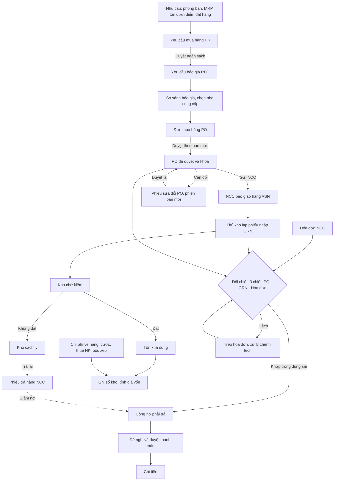
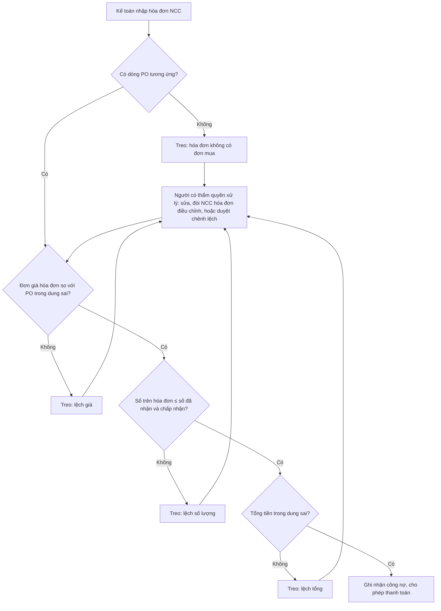
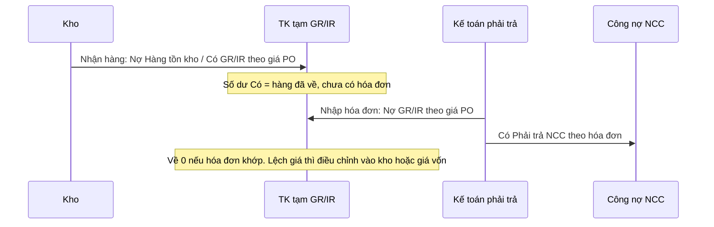
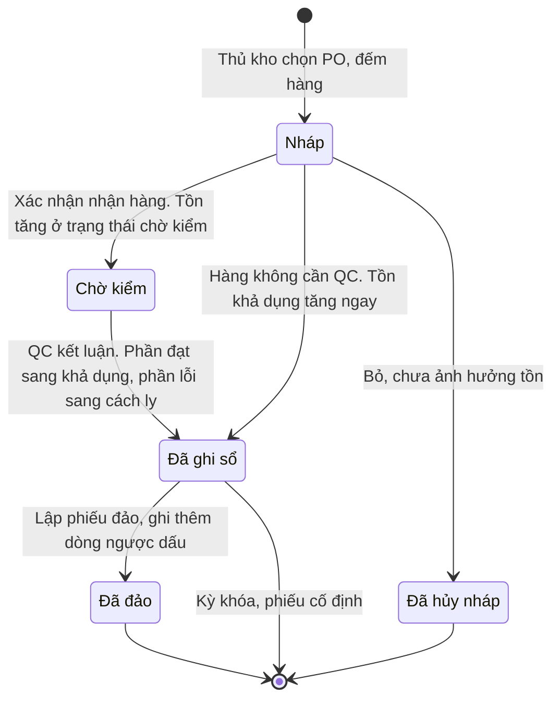
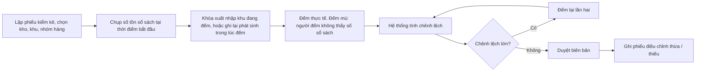
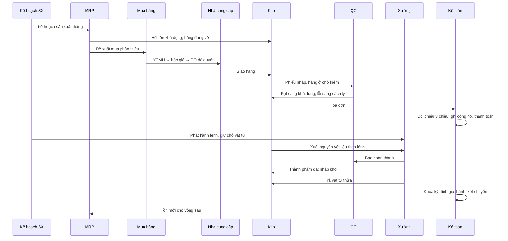
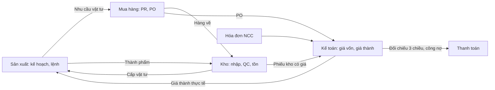
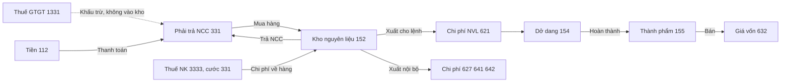
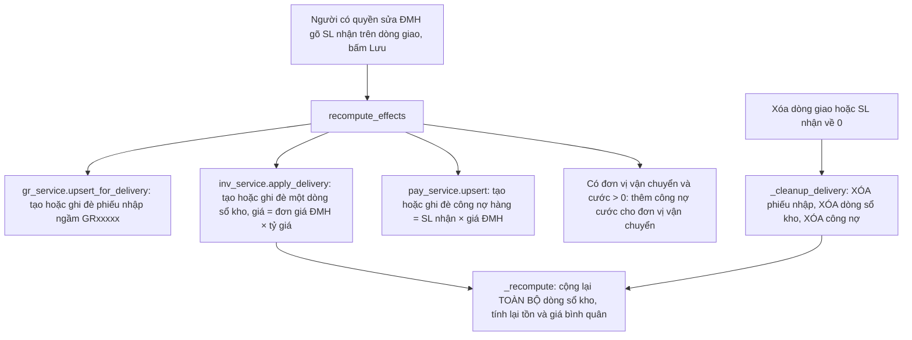
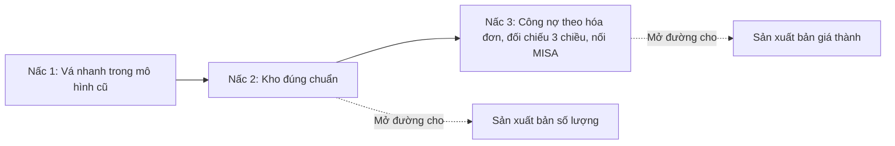

# LUỒNG CHUẨN MUA HÀNG, KHO VÀ SẢN XUẤT — SO VỚI ERP DEGO

| | |
|---|---|
| Phiên bản | **1.0** — 23/10/2026 |
| Người viết | A5 Nghiên cứu nghiệp vụ |
| Trạng thái | **Tài liệu nghiên cứu**, chưa phải tài liệu yêu cầu. Không đổi mã nguồn |
| Đối chiếu mã | Nhánh `erp-v2` tại `767ffab9` (23/10/2026) |
| Căn cứ | Cách SAP S/4HANA, Oracle Fusion, Odoo, Microsoft Dynamics 365 làm · Chuẩn mực kế toán số 02 *Hàng tồn kho* · IAS 2 *Inventories* · Thông tư 99/2025/TT-BTC |
| Đọc kèm | [`san-xuat/00-tong-quan-nghiep-vu.md`](../san-xuat/00-tong-quan-nghiep-vu.md) — hạch toán giá thành, dở dang, phân bổ chi phí chung, hàng lỗi trong sản xuất. Tài liệu này **không viết lại** các phần đó, chỉ nối vào |

---

## Mục lục

1. [Đọc nhanh trong 2 phút](#1-đọc-nhanh-trong-2-phút)
2. [Thuật ngữ](#2-thuật-ngữ)
3. [Luồng chuẩn Procure-to-Pay](#3-luồng-chuẩn-procure-to-pay)
4. [Kho chuẩn](#4-kho-chuẩn)
5. [Liên kết sang Sản xuất](#5-liên-kết-sang-sản-xuất)
6. [Bút toán kế toán chính, cho người không chuyên](#6-bút-toán-kế-toán-chính-cho-người-không-chuyên)
7. [So với hiện trạng ERP DEGO](#7-so-với-hiện-trạng-erp-dego)
8. [Lộ trình đề xuất ba nấc](#8-lộ-trình-đề-xuất-ba-nấc)
9. [Câu hỏi cần chốt](#9-câu-hỏi-cần-chốt)
10. [Nguồn](#10-nguồn)

---

## 1. Đọc nhanh trong 2 phút

**Chuẩn quốc tế dựa trên năm nguyên tắc:**

1. **Mỗi việc một chứng từ, mỗi chứng từ một người chịu trách nhiệm.** Người mua lập đơn. Thủ kho lập phiếu nhập. Kế toán nhập hóa đơn. Không ai làm cả ba.
2. **Đơn mua đã duyệt thì khóa.** Muốn đổi phải lập phiếu sửa đổi, có số phiên bản, duyệt lại.
3. **Sổ kho chỉ ghi thêm, không sửa, không xóa.** Ghi sai thì lập chứng từ đảo.
4. **Công nợ phải trả sinh từ hóa đơn nhà cung cấp**, sau khi đã đối chiếu đơn mua, phiếu nhập và hóa đơn. Ba bên khớp trong dung sai thì mới được trả.
5. **Giá vốn hàng nhập gồm đủ mọi chi phí để đưa hàng về kho**: giá mua, thuế nhập khẩu, cước, bốc xếp. Thuế giá trị gia tăng được khấu trừ thì không tính vào.

**ERP DEGO hiện làm khác ở bảy chỗ** (chi tiết ở mục 7):

| # | Hiện trạng | Rủi ro lớn nhất |
|---|---|---|
| a | Công nợ sinh ngay lúc gõ số nhận hàng, theo giá trên đơn mua | Trả tiền theo đơn mua, không theo hóa đơn thật |
| b | Hàng QC *Lỗi* vẫn vào tồn và vẫn sinh công nợ | Trả tiền cho hàng hỏng, xuất hàng hỏng cho sản xuất |
| c | Sổ kho sửa và xóa được, sửa xong tính lại cả quá khứ | Số tháng trước đã báo cáo tự thay đổi |
| d | Phiếu nhập kho do hệ thống tự sinh khi lưu đơn mua, không có thủ kho xác nhận | Người mua tự khai mình đã nhận hàng |
| e | Giá vốn = đơn giá trên đơn mua × tỷ giá | Hàng nhập khẩu bị định giá thấp, giá thành sản xuất sai |
| f | Chưa có xuất kho, chuyển kho, kiểm kê, trả hàng nhà cung cấp | Tồn trên máy chỉ tăng, không phản ánh kho thật |
| g | Chặn nhận hàng khi đơn chưa duyệt mới có ở giao diện | Gọi thẳng API vẫn tạo được tồn và nợ trên đơn nháp |

**Đề xuất làm ba nấc**: vá nhanh trong mô hình hiện có (nấc 1), làm kho đúng chuẩn (nấc 2), rồi chuyển công nợ sang theo hóa đơn, có đối chiếu 3 chiều, nối với MISA (nấc 3). Câu hỏi quan trọng nhất cần đại ca và kế toán trả lời trước: **sổ kho chính thức nằm ở ERP hay ở MISA** (câu K1, mục 9).

---

## 2. Thuật ngữ

| Viết tắt | Tên đầy đủ | Nghĩa |
|---|---|---|
| **P2P** | Procure-to-Pay | Toàn bộ chuỗi từ yêu cầu mua đến lúc trả tiền nhà cung cấp |
| **PR** | Purchase Requisition | Yêu cầu mua hàng (YCMH ở DEGO). Chứng từ nội bộ, chưa ràng buộc với nhà cung cấp |
| **RFQ** | Request for Quotation | Yêu cầu báo giá (YCBG ở DEGO) |
| **PO** | Purchase Order | Đơn mua hàng (ĐMH ở DEGO). Cam kết pháp lý với nhà cung cấp |
| **ASN** | Advance Shipping Notice | Thông báo giao hàng trước: nhà cung cấp báo sẽ giao gì, bao nhiêu, ngày nào, số xe, số lô |
| **GRN / GR** | Goods Receipt Note | Phiếu nhập kho. Chứng từ của kho, ghi số thực nhận |
| **QC / IQC** | Quality Control / Incoming QC | Kiểm tra chất lượng, chặng đầu vào |
| **Landed cost** | | Giá vốn hàng về tới kho: giá mua cộng mọi chi phí đưa hàng về |
| **IR / Vendor invoice** | Invoice Receipt | Hóa đơn nhà cung cấp, kế toán nhập vào hệ thống |
| **3-way match** | | Đối chiếu ba chiều: đơn mua, phiếu nhập, hóa đơn |
| **GR/IR** | Goods Receipt / Invoice Receipt clearing | Tài khoản trung gian chờ hóa đơn. Mục 3.10 |
| **AP** | Accounts Payable | Công nợ phải trả |
| **RTV** | Return to Vendor | Trả hàng nhà cung cấp |
| **SoD** | Segregation of Duties | Tách người làm, để một người không tự tạo và tự duyệt được cả chuỗi |
| **ROP** | Reorder Point | Điểm đặt hàng lại |

Thuật ngữ sản xuất (BOM, Routing, MRP, MO, WIP) đã có ở [`san-xuat/00` mục 2](../san-xuat/00-tong-quan-nghiep-vu.md#2-thuật-ngữ).

---

## 3. Luồng chuẩn Procure-to-Pay

### 3.1. Sơ đồ toàn cảnh



Ba nhánh chạy song song và gặp nhau ở **đối chiếu 3 chiều**: nhánh đơn mua (người mua), nhánh hàng (thủ kho, QC), nhánh hóa đơn (kế toán). Đây là chỗ kiểm soát chính của cả chuỗi.

### 3.2. Yêu cầu mua hàng (PR)

- Do người có nhu cầu lập, hoặc do MRP và quy tắc tồn tối thiểu sinh ra (mục 4.7, 5.2).
- Duyệt theo **ngân sách** và **thẩm quyền của phòng**. Chưa ràng buộc với nhà cung cấp nào.
- Một PR có thể tách ra nhiều PO, nhiều PR có thể gộp vào một PO. Hệ thống phải giữ được dấu vết dòng PR nào đi vào dòng PO nào.

### 3.3. Yêu cầu báo giá và chọn nhà cung cấp (RFQ)

- Gửi cho nhiều nhà cung cấp, nhận báo giá, lập bảng so sánh.
- Ghi lại **lý do chọn**: giá, thời hạn giao, điều kiện thanh toán, chất lượng lần trước.
- Đơn giá thấp không phải tiêu chí duy nhất. Odoo và SAP đều giữ bảng giá theo nhà cung cấp (*vendor pricelist*, *purchasing info record*) để lần sau không phải hỏi lại.

### 3.4. Đơn mua hàng: duyệt theo hạn mức, khóa sau duyệt, sửa đổi có phiên bản

**Duyệt theo hạn mức.** SAP gọi là *release strategy*, Oracle gọi là *approval rules*. Đơn càng lớn càng nhiều cấp duyệt.

| Giá trị đơn (ví dụ) | Cấp duyệt |
|---|---|
| Dưới 50 triệu | Trưởng phòng thu mua |
| 50 đến 500 triệu | Thêm Giám đốc tài chính |
| Trên 500 triệu | Thêm Tổng giám đốc |

Hạn mức tính trên **tổng giá trị đơn sau quy đổi tiền**, không tính trên từng dòng. Nếu không thì người lập sẽ chia nhỏ dòng để lách.

**Khóa sau duyệt.** Đơn đã duyệt thì không sửa được giá, số lượng, nhà cung cấp, điều kiện thanh toán. Chỉ mở các ô thuần hành chính (ngày dự kiến, ghi chú, số tờ khai).

**Sửa đổi có phiên bản.** SAP gọi là *version management*: đơn gốc là phiên bản 0, mỗi lần sửa có phiên bản mới kèm lý do. Nếu thay đổi làm tăng giá trị thì đơn phải duyệt lại.

```
PO-0123  phiên bản 0   1.000 kg × 50.000 = 50.000.000   duyệt 01/10
PO-0123  phiên bản 1   1.200 kg × 50.000 = 60.000.000   lý do: thêm nhu cầu nhà máy B
                       tăng 10 triệu → duyệt lại cấp trưởng phòng
```

Giá trị của cách này: khi hóa đơn về, kế toán biết đối chiếu với **phiên bản nào**. Nhà cung cấp cũng nhận đúng bản đã sửa.

### 3.5. Thông báo giao hàng (ASN)

- Nhà cung cấp báo trước: mã hàng, số lượng, ngày giao, số xe, số lô, hạn dùng.
- Kho dùng ASN để chuẩn bị chỗ và nhân lực. Lúc nhận chỉ việc xác nhận, không phải gõ lại.
- Doanh nghiệp vừa và nhỏ thường không có ASN điện tử. Thay bằng **lịch giao dự kiến** trên từng dòng PO.

### 3.6. Nhận hàng: phiếu nhập kho là chứng từ riêng

Đây là chỗ khác lớn nhất so với DEGO.

| Đặc điểm | Chuẩn |
|---|---|
| Ai lập | **Thủ kho**, tại kho, khi hàng tới |
| Lập từ đâu | Chọn PO, hệ thống gợi ý số còn phải nhận. Thủ kho gõ **số thực đếm được** |
| Trạng thái | Nháp → Đã ghi sổ. Chỉ khi ghi sổ mới cộng tồn |
| Mang theo | Ngày ghi sổ, kho, vị trí, số lô, hạn dùng, số phiếu giao của NCC, biển số xe |
| Nhận vượt | Có **dung sai nhận vượt** trên từng dòng PO. Ví dụ hàng rời cho vượt 2%. Vượt hơn thì chặn |
| Nhận khi PO chưa duyệt | **Chặn ở máy chủ**, không chỉ ở giao diện |
| Sửa sau khi ghi sổ | Không sửa. Lập **phiếu đảo** (SAP: loại di chuyển 102 đảo cho 101) rồi lập phiếu mới |

Microsoft Dynamics mô tả đúng cách tách vai này: người ở bộ phận nhận hàng nhập số trên phiếu nhập, người ở công nợ phải trả nhập và kiểm hóa đơn. Hai người khác nhau.

### 3.7. Kho chờ kiểm và QC

Hàng mới nhận chưa dùng được ngay. SAP chia tồn thành ba loại trạng thái:

| Trạng thái tồn | Nghĩa | Dùng được không |
|---|---|---|
| **Chờ kiểm** (quality inspection) | Đã nhận, chưa có kết quả QC | Không. Không tính vào số khả dụng, không giữ chỗ được |
| **Khả dụng** (unrestricted) | Đã đạt | Có |
| **Cách ly** (blocked) | Không đạt, chờ xử lý | Không |

```
Nhận 100 bao → 100 bao chờ kiểm
QC kết luận: 92 đạt, 8 rách
→ chuyển 92 bao sang khả dụng
→ chuyển 8 bao sang cách ly, lập biên bản
→ 8 bao: trả lại NCC (mục 3.12) hoặc nhận có giảm giá
```

Oracle có thêm mức **đối chiếu 4 chiều**: số trên hóa đơn phải khớp với **số được chấp nhận sau kiểm**, không chỉ số đã nhận. Mục 3.9.

### 3.8. Ghi sổ kho và tính giá vốn

**Sổ kho chỉ ghi thêm.** Mỗi lần hàng ra vào là một dòng mới: ngày ghi sổ, chứng từ gốc, số lượng có dấu, đơn giá, thành tiền. Không có lệnh sửa hay xóa dòng. Muốn bỏ một phiếu thì ghi thêm một dòng ngược dấu, trỏ về phiếu gốc.

Lý do:

- Báo cáo tháng đã gửi kế toán không bao giờ tự thay đổi.
- Kiểm toán lần ngược được từ số dư về từng chứng từ.
- Kỳ đã khóa thì không ai ghi lùi ngày vào được.

**Ba cách tính giá xuất kho** được Chuẩn mực 02 và IAS 2 cho phép (bỏ qua giá bán lẻ, không hợp với DEGO):

| Cách | Làm thế nào | Hợp khi |
|---|---|---|
| **Bình quân gia quyền** — di động hoặc cuối kỳ | Giá xuất = tổng giá trị tồn / tổng số tồn | Hàng đồng nhất, nhập nhiều lần. Phổ biến nhất ở Việt Nam |
| **Nhập trước xuất trước** (FIFO) | Xuất theo giá của lô nhập sớm nhất còn lại | Hàng có hạn dùng, giá biến động mạnh |
| **Thực tế đích danh** | Xuất đúng giá của lô cụ thể | Hàng giá trị lớn, theo dõi từng lô hoặc từng chiếc |

**Giá chuẩn** (*standard cost*, SAP gọi là *price control S*) là kỹ thuật quản trị: nhập kho theo giá định sẵn, chênh lệch ghi riêng. Báo cáo tài chính vẫn phải quy về giá gốc. Xem [`san-xuat/00` mục 8](../san-xuat/00-tong-quan-nghiep-vu.md#8-giá-thành-chuẩn-giá-thành-thực-tế-và-cách-tính-giá-xuất-kho).

**Ví dụ bình quân di động:**

| Ngày | Việc | Số lượng | Đơn giá | Tồn sau | Giá trị tồn | Đơn giá bình quân |
|---|---|---:|---:|---:|---:|---:|
| 01/10 | Nhập | 1.000 | 50.000 | 1.000 | 50.000.000 | 50.000 |
| 05/10 | Xuất sản xuất | −400 | 50.000 | 600 | 30.000.000 | 50.000 |
| 10/10 | Nhập | 1.000 | 54.000 | 1.600 | 84.000.000 | 52.500 |
| 15/10 | Xuất sản xuất | −800 | 52.500 | 800 | 42.000.000 | 52.500 |

Lần xuất ngày 05/10 đã chốt ở 50.000. Nếu ngày 20/10 ai đó sửa phiếu nhập 01/10 thành 48.000 thì **lần xuất cũ không tự sửa theo**. Đó là lý do phải dùng phiếu đảo và phiếu điều chỉnh giá, không sửa thẳng (mục 7.3).

**Landed cost — giá vốn hàng về tới kho.** Chuẩn mực 02 và IAS 2 cùng quy định: giá gốc gồm giá mua, **thuế nhập khẩu và các loại thuế không được hoàn lại**, chi phí vận chuyển, bốc xếp và các chi phí trực tiếp khác để đưa hàng về đúng chỗ và đúng trạng thái. Trừ đi chiết khấu thương mại và giảm giá. Thuế GTGT được khấu trừ **không** nằm trong giá gốc.

Odoo phân bổ chi phí về hàng cho từng mã theo năm cách: chia đều, theo số lượng, theo giá trị, theo khối lượng, theo thể tích. Chi phí về hàng chỉ áp được khi hàng tính giá bằng bình quân hoặc FIFO.

**Ví dụ một lô nhập khẩu** (số giả định, chỉ để minh họa):

| Khoản | Số tiền (VNĐ) | Vào giá vốn? |
|---|---:|---|
| Giá hàng 20 tấn × 600 USD × 25.000 | 300.000.000 | Có |
| Thuế nhập khẩu, giả định 3% | 9.000.000 | Có |
| Phí hải quan, nâng hạ, kéo container về kho | 6.000.000 | Có |
| Thuế GTGT hàng nhập khẩu, 10% × (giá hàng + thuế NK) | 30.900.000 | **Không** — được khấu trừ |
| Phí lưu kho sau khi đã nhập kho | 2.000.000 | **Không** — chi phí bảo quản sau nhập |
| **Giá gốc lô hàng** | **315.000.000** | |
| **Giá gốc một tấn** | **15.750.000** | So với 15.000.000 nếu chỉ lấy giá mua × tỷ giá |

Chênh lệch 5% này đi thẳng vào giá thành sản phẩm và lãi gộp.

**Chi phí về sau khi hàng đã xuất.** Hóa đơn cước thường về muộn hơn hàng vài tuần. Lúc đó một phần hàng có thể đã xuất. Odoo và SAP chia phần chi phí đến muộn theo tỷ lệ: phần của hàng còn tồn thì cộng vào giá tồn, phần của hàng đã xuất thì ghi vào giá vốn hoặc chi phí sản xuất của kỳ đó.

### 3.9. Hóa đơn nhà cung cấp và đối chiếu ba chiều

**Hai, ba, bốn chiều** (theo cách Oracle chia):

| Mức | So cái gì | Dùng cho |
|---|---|---|
| **2 chiều** | PO và hóa đơn: giá, số lượng | Dịch vụ, hàng không qua kho |
| **3 chiều** | Thêm phiếu nhập: số trên hóa đơn ≤ số đã nhận | Hàng hóa, vật tư thông thường |
| **4 chiều** | Thêm số được chấp nhận sau kiểm | Nguyên liệu có QC bắt buộc |

**Dung sai.** Không ai đòi khớp từng đồng. Microsoft Dynamics cho đặt dung sai theo **đơn giá** (ví dụ ±2%) và theo **tổng tiền dòng** (ví dụ ±5% hoặc tối đa 500.000 đồng), riêng cho từng pháp nhân, từng nhà cung cấp, từng mặt hàng. Vượt dung sai thì hóa đơn bị **treo** (Oracle gọi là *matching hold*), phải có người duyệt mới được ghi nhận và trả.



**Ví dụ:**

| | Số lượng | Đơn giá | Thành tiền |
|---|---:|---:|---:|
| PO phiên bản 0 | 1.000 kg | 50.000 | 50.000.000 |
| Phiếu nhập: nhận 1.000, QC đạt 980, cách ly 20 | 980 kg chấp nhận | | |
| Hóa đơn NCC | 1.000 kg | 50.500 | 50.500.000 |

- Đơn giá lệch +1%. Dung sai giá 2% → **đạt**.
- Số hóa đơn 1.000 > số chấp nhận 980 → **treo vì lệch số lượng**.
- Cách xử lý: đòi NCC hóa đơn điều chỉnh giảm 20 kg, hoặc lập phiếu trả hàng 20 kg (mục 3.12) để số nợ tự giảm.
- Kết quả đúng: nợ 980 × 50.500 = 49.490.000 trước thuế, không phải 50.500.000.

Odoo làm nhẹ hơn: không chặn cứng, chỉ gắn cờ *Should Be Paid* là *Yes*, *No* hay *Exception* để kế toán biết hóa đơn nào cần xem lại trước khi trả.

**Hóa đơn tự sinh từ phiếu nhập** (SAP gọi là *Evaluated Receipt Settlement*). Hệ thống tự lập nợ từ phiếu nhập theo giá PO, không chờ hóa đơn. Chỉ dùng khi **có thỏa thuận bằng văn bản** với nhà cung cấp rằng giá PO là giá thanh toán, và thường đi kèm hóa đơn tự lập. Đây gần với cách DEGO đang làm, nhưng DEGO chưa có thỏa thuận đó và vẫn nhận hóa đơn giấy từ NCC (mục 7.1).

### 3.10. Tài khoản trung gian GR/IR

Hàng và hóa đơn hiếm khi về cùng ngày. SAP và Oracle dùng một tài khoản tạm để giữ khoảng hở:



- Số dư GR/IR **bên Có** = hàng đã về, chưa có hóa đơn. Cuối kỳ phải ước tính nợ.
- Số dư GR/IR **bên Nợ** = hóa đơn đã về, hàng chưa về.
- Số dư treo lâu = có vấn đề: nhận thiếu, hóa đơn thiếu, nhập nhầm đơn. SAP có hẳn màn đối chiếu GR/IR để soát định kỳ.

**Ở Việt Nam không có tài khoản GR/IR trong hệ thống tài khoản.** Cách làm tương đương:

| Tình huống | Cách hạch toán thường dùng | Ghi chú |
|---|---|---|
| Hàng về trước, hóa đơn về sau, trong cùng tháng | Lưu phiếu nhập vào hồ sơ *hàng chưa có hóa đơn*. Hóa đơn về thì ghi bình thường | |
| Hàng về, hết tháng chưa có hóa đơn | Ghi nhập kho và nợ phải trả theo **giá tạm tính**. Hóa đơn về thì điều chỉnh chênh lệch | Tương đương số dư Có GR/IR |
| Hóa đơn về trước, hàng còn trên đường | Ghi vào **TK 151 Hàng mua đang đi đường**. Hàng về thì chuyển sang 152, 156 | Tương đương số dư Nợ GR/IR |

Kế toán cần xác nhận lại cách làm này với Thông tư 99 (câu K4, mục 9). ERP vẫn nên giữ một **sổ quản trị "hàng về chưa có hóa đơn"** để biết đang treo bao nhiêu, dù không phải tài khoản chính thức.

### 3.11. Công nợ phải trả và thanh toán

- Công nợ sinh **từ hóa đơn đã đối chiếu**, mang hạn trả theo điều kiện thanh toán của PO.
- Đề nghị thanh toán chọn các khoản nợ đến hạn, duyệt, chi.
- Ứng trước cho nhà cung cấp là **khoản trả trước** (TK 331 dư Nợ), đối trừ khi có hóa đơn.
- Người duyệt chi **không phải** người lập PO và **không phải** người nhập hóa đơn.

### 3.12. Trả hàng nhà cung cấp (RTV)

```
Hàng cách ly 20 kg → Phiếu trả hàng NCC (chứng từ kho, trừ tồn)
                  → Hóa đơn điều chỉnh giảm của NCC, hoặc giấy báo Có
                  → Công nợ giảm, hoặc nợ phải thu NCC nếu đã trả tiền
```

Phiếu trả hàng **trỏ về phiếu nhập gốc** để lấy đúng đơn giá đã ghi vào kho. Nếu hàng đã nằm trong bình quân thì trả ra theo giá nhập gốc, phần chênh với bình quân hiện tại ghi điều chỉnh.

### 3.13. Tách người làm

| Việc | Người mua | Thủ kho | QC | Kế toán phải trả | Thủ quỹ / Kế toán ngân hàng |
|---|:---:|:---:|:---:|:---:|:---:|
| Lập PO | **Làm** | | | | |
| Duyệt PO | Cấp trên duyệt | | | | |
| Lập phiếu nhập | | **Làm** | | | |
| Kết luận QC | | | **Làm** | | |
| Nhập hóa đơn, đối chiếu | | | | **Làm** | |
| Duyệt chênh lệch đối chiếu | | | | Trưởng kế toán duyệt | |
| Chi tiền | | | | | **Làm** |
| Sửa danh mục NCC, tài khoản ngân hàng NCC | Không | Không | Không | Không | Không — **người thứ sáu** |

**Ba cặp tuyệt đối không cho trùng một người:**

1. Lập PO và nhập phiếu nhập kho — nếu trùng thì tự đặt, tự khai đã nhận.
2. Nhập hóa đơn và chi tiền — nếu trùng thì tự tạo nợ giả, tự chi.
3. Sửa tài khoản ngân hàng của NCC và chi tiền — đây là kiểu gian lận phổ biến nhất.

---

## 4. Kho chuẩn

### 4.1. Bảng loại phiếu kho

Mọi biến động kho là một **phiếu**, mỗi phiếu có loại riêng:

| Loại phiếu | Tăng / giảm | Chứng từ gốc | Tài khoản đối ứng (đơn giản) |
|---|:---:|---|---|
| Nhập mua | + | PO | 331 |
| Nhập thành phẩm từ sản xuất | + | Lệnh sản xuất | 154 |
| Nhập trả lại từ sản xuất | + | Lệnh sản xuất | 621 |
| Nhập hàng bán bị trả lại | + | Đơn bán | 632 |
| Xuất cho sản xuất | − | Lệnh sản xuất | 621 |
| Xuất bán | − | Đơn bán, phiếu giao | 632 |
| Xuất dùng nội bộ | − | Phiếu đề nghị lĩnh vật tư | 627, 641, 642 |
| Xuất trả NCC | − | Phiếu nhập gốc | 331 |
| Xuất hủy | − | Biên bản hủy | 632, 811 |
| Chuyển kho | − kho đi, + kho đến | Phiếu chuyển | Không đổi giá trị nếu cùng pháp nhân |
| Chuyển trạng thái (chờ kiểm → khả dụng) | Không đổi tổng | Kết luận QC | Không có bút toán |
| Kiểm kê thừa / thiếu | + / − | Biên bản kiểm kê | 3381 / 1381 |
| Điều chỉnh giá (chi phí về muộn) | Chỉ giá trị | Hóa đơn chi phí | 331 |

### 4.2. Vòng đời một phiếu nhập kho



Phiếu ở **Đã ghi sổ** không bao giờ quay về **Nháp**. Muốn sửa thì đảo rồi lập phiếu mới.

### 4.3. Xuất kho

| Xuất cho | Ai đề nghị | Ai duyệt | Ai xuất | Đặc điểm |
|---|---|---|---|---|
| **Sản xuất** | Kế hoạch sản xuất, theo lệnh | Tự động theo lệnh đã phát hành | Thủ kho | Số lượng gợi ý theo BOM. Xuất vượt định mức phải có lý do. Mục 5.4 |
| **Bán** | Bán hàng, theo đơn bán | Đơn bán đã duyệt | Thủ kho | Có thể xuất theo lô gần hết hạn trước (FEFO) |
| **Dùng nội bộ** | Phòng có nhu cầu | Trưởng phòng | Thủ kho | Bắt buộc chọn **mục đích chi phí** để kế toán biết ghi vào đâu |
| **Hủy** | Kho hoặc QC | Hội đồng | Thủ kho | Kèm biên bản |

### 4.4. Chuyển kho

- **Một bước**: trừ kho đi, cộng kho đến ngay. Hợp với hai kho cùng khuôn viên.
- **Hai bước**: kho đi xuất, hàng nằm ở **kho đang chuyển**, kho đến xác nhận mới cộng. Hợp với chuyển giữa các nhà máy, có xe chạy vài ngày. Lệch số giữa hai đầu thì lộ ra ngay.
- Chuyển giữa **hai pháp nhân khác nhau** không phải chuyển kho. Đó là mua bán nội bộ, phải có hóa đơn.

### 4.5. Kiểm kê



- **Kiểm kê toàn bộ** cuối năm, bắt buộc theo luật kế toán.
- **Kiểm kê xoay vòng** (*cycle count*): hàng giá trị cao (nhóm A) đếm hằng tháng, nhóm B hằng quý, nhóm C nửa năm. Không phải đóng kho cả ngày.
- Chênh lệch thiếu chưa rõ nguyên nhân ghi vào **chờ xử lý** (1381), không ghi thẳng vào chi phí.

### 4.6. Vị trí kho, lô và hạn dùng

**Vị trí kho** chia nhiều cấp: Kho → Khu → Dãy → Kệ → Ô. Doanh nghiệp vừa thường chỉ cần **Kho → Khu**. Khu đặc biệt: *chờ kiểm*, *cách ly*, *hàng gửi gia công*, *đang chuyển*.

**Lô và hạn dùng:**

- Số lô **phải có từ lúc nhận hàng**. Thêm sau là phải sửa cả phân hệ nhận hàng ([`san-xuat/00` câu A3](../san-xuat/00-tong-quan-nghiep-vu.md#nhóm-a--sản-xuất-cái-gì)).
- Mỗi phiếu xuất ghi rõ xuất **lô nào**. Nhờ vậy truy được: thành phẩm lô X dùng nguyên liệu lô nào, của nhà cung cấp nào, nhập ngày nào.
- **FEFO** (hết hạn trước xuất trước): hệ thống gợi ý lô gần hết hạn nhất.
- Báo cáo **hàng sắp hết hạn** trước 30, 60, 90 ngày.

Với phân bón, hóa chất: lô và hạn dùng gần như bắt buộc. Khách lớn và cơ quan quản lý có thể đòi truy xuất.

### 4.7. Tồn tối thiểu và điểm đặt hàng lại

```
Điểm đặt hàng lại (ROP) = Mức dùng bình quân mỗi ngày × Thời gian chờ hàng (ngày) + Tồn an toàn
```

**Ví dụ:** dùng 2 tấn mỗi ngày, NCC giao sau 15 ngày, tồn an toàn 10 tấn.
ROP = 2 × 15 + 10 = **40 tấn**. Khi tồn khả dụng cộng hàng đang về rơi xuống dưới 40 tấn thì sinh đề xuất mua.

Odoo gọi là *reordering rules* với hai ngưỡng **Min** và **Max**: tồn dự báo xuống dưới Min thì hệ thống tự gợi ý hoặc tự lập đơn mua (hoặc lệnh sản xuất) để kéo lên Max. Có hai chế độ: tự động và thủ công (chỉ hiện trong báo cáo bổ sung hàng).

Lưu ý: so sánh với **tồn dự báo** = tồn khả dụng + hàng đang về − hàng đã giữ chỗ. Không so với tồn trên sổ, nếu không sẽ đặt trùng.

---

## 5. Liên kết sang Sản xuất

Phần hạch toán giá thành, đánh giá dở dang, phân bổ chi phí chung, hàng lỗi trong sản xuất đã viết đủ ở [`san-xuat/00`](../san-xuat/00-tong-quan-nghiep-vu.md). Mục này chỉ nói **chỗ nối** giữa Sản xuất với Kho, Mua hàng và Kế toán.

### 5.1. Dữ liệu gốc cần chung

| Dữ liệu | Sản xuất dùng | Kho dùng | Mua hàng dùng |
|---|---|---|---|
| Sản phẩm (`product_code`) | BOM, lệnh | Tồn, phiếu | PO |
| BOM có phiên bản | Bung vật tư cho lệnh | Gợi ý số xuất | MRP sinh đề xuất mua |
| Routing, trạm làm việc | Công đoạn, giờ máy | | Công đoạn gia công ngoài thành đơn mua dịch vụ |
| Kho, vị trí | Kho nguyên liệu, kho dở dang, kho thành phẩm | | Kho nhận mặc định |
| Thời gian chờ hàng của NCC | | | MRP lùi ngày đặt hàng |

### 5.2. MRP sinh yêu cầu mua

```
Nhu cầu gộp   = Kế hoạch sản xuất × BOM (cộng tỷ lệ hao hụt định mức)
Nhu cầu ròng  = Nhu cầu gộp − Tồn khả dụng − Hàng đang về (PO đã duyệt chưa nhận) + Tồn an toàn
Ngày đặt hàng = Ngày cần − Thời gian chờ hàng của NCC
```

**Ví dụ:** kế hoạch tháng 11 làm 100 tấn phân NPK. BOM: 0,30 tấn K₂SO₄ một tấn thành phẩm, hao hụt 2%.

| | Tấn |
|---|---:|
| Nhu cầu gộp: 100 × 0,30 × 1,02 | 30,6 |
| Tồn khả dụng | −8,0 |
| PO đã duyệt chưa về | −10,0 |
| Tồn an toàn | +5,0 |
| **Nhu cầu ròng** | **17,6** |

MRP ra **đề xuất mua 17,6 tấn**, cần có hàng ngày 01/11, NCC giao sau 20 ngày → **đặt trước 12/10**. Người mua duyệt đề xuất rồi mới thành YCMH. Không để MRP tự lập PO ([`san-xuat/00` mục 3.2](../san-xuat/00-tong-quan-nghiep-vu.md#32-sản-xuất-và-mua-hàng)).

### 5.3. Lệnh sản xuất và giữ chỗ vật tư

- Phát hành lệnh thì **chụp BOM** tại thời điểm đó. Sửa BOM sau không làm đổi lệnh đang chạy.
- Lệnh giữ chỗ vật tư: **tồn khả dụng giảm, tồn sổ sách chưa giảm**. Người khác không xuất được phần đã giữ.
- Hàng trong kho chờ kiểm và kho cách ly **không** giữ chỗ được.

### 5.4. Xuất nguyên vật liệu cho lệnh

| Cách | Khi nào trừ kho | Ưu | Nhược |
|---|---|---|---|
| **Phiếu xuất theo lệnh** | Trước khi làm | Thấy ngay xuất vượt định mức | Thêm một phiếu mỗi lệnh |
| **Backflush** | Sau khi báo hoàn thành, trừ theo BOM × sản lượng | Nhanh, ít thao tác | Che mất tiêu hao thực tế. Hao hụt thật cao hơn định mức thì tồn sổ sách cao hơn tồn thật, đến kiểm kê mới lộ |

Xuất vượt định mức phải có **lý do** và **người duyệt**. Vật tư thừa phải **nhập trả lại** kho, nếu không giá thành bị đội.

### 5.5. Ghi nhận sản lượng, thành phẩm nhập kho, phế phẩm

```
Lệnh 100 tấn → báo hoàn thành 98 tấn đạt, 1,5 tấn lỗi, 0,5 tấn hao hụt
  98 tấn  → FQC đạt → phiếu nhập kho thành phẩm, mang số lô thành phẩm
  1,5 tấn → kho cách ly + phiếu NCR → làm lại / hạ cấp / hủy
  0,5 tấn → hao hụt. Trong tỷ lệ định mức 2% thì nằm trong giá thành
```

Odoo ghi phế phẩm bằng phiếu *scrap* riêng, chuyển hàng sang **vị trí phế phẩm ảo**. Tồn giảm, giá trị tách ra để báo cáo.

Cách tách hỏng trong và ngoài định mức, cách hạch toán từng loại: [`san-xuat/00` mục 9](../san-xuat/00-tong-quan-nghiep-vu.md#9-hàng-lỗi-quy-trình-và-hạch-toán).

### 5.6. Giá thành

Ba khoản mục: **nguyên vật liệu** (lấy từ phiếu xuất cho lệnh, theo giá vốn kho), **nhân công** (từ bảng lương, chia theo giờ công), **chi phí chung** (khấu hao, điện, quản lý xưởng, phân bổ theo công suất bình thường).

Điểm nối quan trọng với tài liệu này: **giá nguyên vật liệu xuất cho sản xuất lấy từ giá vốn kho**. Giá vốn kho sai (thiếu chi phí về hàng, mục 3.8) thì giá thành sai theo. Kho phải đúng trước khi làm giá thành.

Giá thành chuẩn hay thực tế, kỳ tính giá: xem [`san-xuat/00` mục 5 đến 8](../san-xuat/00-tong-quan-nghiep-vu.md#5-hạch-toán-chi-phí-và-giá-thành).

### 5.7. Vòng khép kín





---

## 6. Bút toán kế toán chính, cho người không chuyên

### 6.1. Đọc bút toán thế nào

Mỗi bút toán có hai vế bằng nhau. **Nợ** là nơi giá trị đi vào. **Có** là nơi giá trị đi ra.
Ví dụ *Nợ 152 / Có 331*: kho nguyên liệu tăng, đồng thời mình nợ nhà cung cấp thêm.

| Tài khoản | Hiểu đơn giản |
|---|---|
| 111, 112 | Tiền mặt, tiền gửi ngân hàng |
| 1331 | Thuế GTGT đầu vào được khấu trừ |
| 151 | Hàng đã mua, đang trên đường, chưa về kho |
| 152 | Kho nguyên liệu, vật liệu |
| 153 | Kho công cụ, dụng cụ |
| 154 | Chi phí sản xuất dở dang |
| 155, 156 | Kho thành phẩm, kho hàng hóa mua về bán |
| 331 | Phải trả nhà cung cấp |
| 3331, 33312, 3333 | Thuế GTGT đầu ra, thuế GTGT hàng nhập khẩu, thuế nhập khẩu |
| 1381, 3381 | Tài sản thiếu chờ xử lý, tài sản thừa chờ xử lý |
| 621, 622, 627 | Chi phí nguyên vật liệu trực tiếp, nhân công trực tiếp, sản xuất chung |
| 632 | Giá vốn hàng bán |
| 641, 642 | Chi phí bán hàng, chi phí quản lý |

Số hiệu theo Thông tư 99/2025 (giữ như Thông tư 200). Kế toán cần soát lại tên tài khoản trước khi dùng chính thức.

### 6.2. Các bút toán của chuỗi mua — kho — sản xuất

| # | Nghiệp vụ | Nợ | Có | Sinh từ chứng từ nào |
|---|---|---|---|---|
| 1 | Nhận hàng trong nước, có hóa đơn | 152 / 156 (giá chưa thuế) · 1331 (thuế) | 331 | Phiếu nhập + hóa đơn |
| 2 | Hàng về, cuối tháng chưa có hóa đơn | 152 / 156 (giá tạm tính) | 331 (giá tạm tính) | Phiếu nhập |
| 2b | Hóa đơn về sau, lệch giá tạm tính | 152 / 156 và 331 ghi bổ sung hoặc ghi giảm phần chênh · 1331 | | Hóa đơn |
| 3 | Hóa đơn về trước, hàng chưa về | 151 · 1331 | 331 | Hóa đơn |
| 3b | Hàng đi đường về kho | 152 / 156 | 151 | Phiếu nhập |
| 4 | Nhập khẩu: giá hàng | 152 / 156 | 331 (theo tỷ giá) | Phiếu nhập + tờ khai |
| 5 | Nhập khẩu: thuế nhập khẩu | 152 / 156 | 3333 | Tờ khai |
| 6 | Nhập khẩu: thuế GTGT hàng nhập khẩu | 1331 | 33312 | Tờ khai. **Không** vào giá hàng |
| 7 | Cước, phí về hàng | 152 / 156 · 1331 | 331 (đơn vị vận chuyển, dịch vụ) | Hóa đơn chi phí, phân bổ theo mục 3.8 |
| 8 | Trả hàng NCC | 331 | 152 / 156 · 1331 | Phiếu xuất trả + hóa đơn điều chỉnh |
| 9 | Thanh toán NCC | 331 | 111 / 112 | Phiếu chi, ủy nhiệm chi |
| 10 | Ứng trước NCC | 331 (dư Nợ) | 112 | Phiếu chi |
| 11 | Xuất cho sản xuất | 621 | 152 | Phiếu xuất theo lệnh |
| 12 | Xuất dùng nội bộ | 627 / 641 / 642 | 152 / 153 | Phiếu xuất nội bộ |
| 13 | Thành phẩm nhập kho | 155 | 154 | Phiếu nhập thành phẩm |
| 14 | Xuất bán | 632 | 155 / 156 | Phiếu xuất bán |
| 15 | Kiểm kê thiếu chưa rõ nguyên nhân | 1381 | 152 / 155 / 156 | Biên bản kiểm kê |
| 16 | Kiểm kê thừa chưa rõ nguyên nhân | 152 / 155 / 156 | 3381 | Biên bản kiểm kê |

Chuyển kho trong cùng pháp nhân **không có bút toán** nếu cùng tài khoản kho. Chỉ đổi chi tiết kho.

### 6.3. Sơ đồ dòng giá trị



Đọc theo chiều mũi tên: tiền đi ra trả nhà cung cấp, hàng đi vào kho, kho đi vào sản xuất, sản xuất ra thành phẩm, thành phẩm bán đi thành giá vốn.

Bút toán chi tiết của khâu sản xuất (lương, chi phí chung, kết chuyển, vượt định mức): [`san-xuat/00` mục 5.2](../san-xuat/00-tong-quan-nghiep-vu.md#52-bút-toán-theo-từng-nghiệp-vụ).

---

## 7. So với hiện trạng ERP DEGO

Soát trên nhánh `erp-v2`, commit `767ffab9`, ngày 23/10/2026. Bảy điểm a đến g theo bản soát đầu, đã kiểm lại từng điểm trong mã.

### 7.0. Hiện trạng chạy thế nào

Toàn bộ hiệu ứng kho và công nợ sinh trong **một hàm**: `recompute_effects` ở `backend/app/modules/purchase_order/service.py`. Hàm chạy **mỗi lần lưu ĐMH**. Với mỗi lần giao có số nhận > 0, hàm làm bốn việc:



So với chuẩn ở mục 3, chuỗi này gộp ba chứng từ (phiếu nhập, sổ kho, công nợ) vào một thao tác của một người, và cả ba đều sửa, xóa được.

Những gì **đã làm tốt**, nên giữ:

| Đã có | Ở đâu |
|---|---|
| Khóa ĐMH sau duyệt: chặn sửa giá, số lượng, NCC, thêm hoặc xóa dòng ở máy chủ | `block_edit_approved_order` |
| Chặn hủy duyệt khi đã nhận hàng, đã có đề nghị thanh toán | `unapprove_po` |
| Chặn gỡ lần giao khi công nợ của nó đã có thanh toán | `payable.service.remove` → `payment_block_reason` |
| Chi phí thu mua ba giai đoạn (dự toán, tạm tính, quyết toán), năm cách phân bổ về dòng hàng | `tab_po_cost`, `allocate_import_costs` (bao-CR-319, 453) |
| Công nợ riêng cho đơn vị vận chuyển và cho từng khoản chi phí thu mua | `source_type` = `shipping`, `import_cost` |
| Đối trừ tự động khoản thanh toán trước gắn đúng đơn | `apply_prepay_offsets` (CR-268) |
| Danh mục kho thật | `tab_warehouse` (`catalog/model.py`), màn danh mục kho ở `frontend-v2/src/modules/inventory` |
| Bộ máy phê duyệt có điều kiện so sánh số | `approval/condition_service.py` — dùng được cho duyệt theo hạn mức |

Lưu ý thêm: phân hệ **Sản xuất** trên giao diện v2 (`frontend-v2/src/modules/production`) hiện chỉ chứa danh mục NCC, sản phẩm, đơn vị tính, phân loại và hợp đồng. **Chưa có** BOM, lệnh sản xuất hay bảng nào của sản xuất.

### 7.1. (a) Công nợ sinh ngay lúc nhận hàng theo giá PO, không theo hóa đơn

**Mã:** `recompute_effects` gọi `pay_service.upsert(source_type="goods", amount = SL nhận × đơn giá ĐMH × tỷ giá, vat = amount × VAT% dòng ĐMH, incur_date = ngày nhận)`. Số hóa đơn chỉ là một ô chữ đi kèm, có thể trống. Không có bảng hóa đơn NCC, không có bước so sánh.

**So với chuẩn:** đây là kiểu *hóa đơn tự sinh từ phiếu nhập* (mục 3.9), nhưng thiếu điều kiện tiên quyết: thỏa thuận với NCC rằng giá ĐMH là giá thanh toán.

**Rủi ro thực tế:**

| Tình huống | Hệ thống ghi | Thực tế phải trả | Hậu quả |
|---|---|---|---|
| NCC xuất hóa đơn giá 50.500, ĐMH ghi 50.000, 1.000 kg | Nợ 50.000.000 | 50.500.000 | Công nợ ERP lệch MISA. Kế toán phải sửa tay hoặc bỏ qua số ERP |
| NCC giao 1.000 kg, hóa đơn chỉ 900 kg (phần còn lại xuất sau) | Nợ đủ 1.000 kg ngay | 900 kg đến khi có hóa đơn sau | Đề nghị thanh toán có thể chi trước cho phần chưa có hóa đơn |
| Hóa đơn có chiết khấu thương mại 2% | Không biết | Giảm 2% | Trả thừa nếu chi theo số ERP |
| ĐMH ngoại tệ, tỷ giá ngày hóa đơn khác tỷ giá trên ĐMH | Theo tỷ giá dòng ĐMH | Theo tỷ giá thực tế | Chênh lệch tỷ giá không ghi nhận |

**Mức độ:** cao. Công nợ là căn cứ chi tiền.

### 7.2. (b) Hàng QC *Lỗi* vẫn vào tồn và sinh công nợ

**Mã:** `qc_result` là ô chữ tự do (`String(20)`, chú thích *Đạt / Thiếu / Lỗi*). Trong `recompute_effects`, `qc_result == "Lỗi"` **chỉ** đổi trạng thái lần giao thành `DELIV_DEFECT`. Phiếu nhập ngầm, dòng sổ kho, công nợ vẫn sinh với **toàn bộ** số nhận. Chính chú thích trong mã cũng ghi `qc_result` không thuộc bộ mã nào.

**Rủi ro thực tế:**

```
Nhận 100 bao, QC phát hiện 30 bao rách, ghi Lỗi
→ Tồn kho: +100 bao, khả dụng 100 bao
→ Công nợ: 100 bao × giá
→ Kế toán lập đề nghị thanh toán đủ 100 bao
→ NCC nhận đủ tiền, không còn động lực đổi 30 bao
→ Kho có thể xuất 30 bao rách cho sản xuất, vì máy không phân biệt
```

Thêm: một lần giao chỉ có **một** kết quả QC cho cả lô. Không ghi được *92 đạt, 8 lỗi*.

**Mức độ:** cao. Mất tiền trực tiếp và rủi ro chất lượng thành phẩm.

### 7.3. (c) Sổ kho sửa và xóa được, rồi tính lại

**Mã:** `inventory/service.py`

- `apply_delivery` tìm dòng sổ kho theo `delivery_id` và **ghi đè** số lượng, đơn giá.
- `remove_delivery` **xóa** dòng sổ kho.
- `_recompute` mỗi lần **cộng lại toàn bộ** dòng sổ kho của cặp kho và mã hàng để tính tồn và bình quân.
- Bảng `tab_inventory_move` không có **ngày ghi sổ** riêng (chỉ có giờ tạo, giờ sửa của bản ghi), không có kỳ, không có khóa kỳ.
- Điều chỉnh tay (`adjust`) nhận **đơn giá tùy ý** từ người gọi.

**Rủi ro thực tế:**

| Tình huống | Hậu quả |
|---|---|
| Ngày 05/11 sửa SL nhận của lần giao tháng 10 từ 1.000 thành 900 | Tồn và giá trị tồn **cuối tháng 10** tự đổi. Báo cáo tồn tháng 10 đã gửi kế toán không còn khớp. Không có dòng nào cho biết đã sửa lúc nào, từ bao nhiêu |
| Xóa nhầm một dòng giao rồi tạo lại | Phiếu nhập GR mới mang số khác. Dấu vết phiếu cũ mất |
| Khi có xuất kho (nấc 2) mà vẫn giữ cách tính này | Giá các lần xuất đã chốt không đổi theo, nhưng bình quân thì đổi. Tổng giá trị tồn không còn bằng *nhập trừ xuất*. Lệch sổ không truy được |
| Điều chỉnh tay với đơn giá gõ sai | Giá bình quân của cả mã hàng lệch theo, không có người duyệt |

Công thức hiện tại thực chất là **bình quân trên toàn bộ lịch sử nhập**. Nó chỉ đúng khi kho chỉ có nhập. Thêm xuất kho thì phải đổi.

**Mức độ:** cao về kiểm soát. Hiện ít hậu quả vì kho chưa có xuất, nhưng chặn đường cho nấc 2.

### 7.4. (d) Phiếu nhập kho là phiếu ngầm, không có người kho xác nhận

**Mã:** `goods_receipt/model.py` ghi rõ *SINH NGẦM khi nhận hàng trên dòng giao của PO*. `goods_receipt/service.py`: *Không có màn nhập riêng*. Một lần giao một phiếu, mã `GR` + số id. Không có trạng thái, không có người xác nhận, không có ngày ghi sổ riêng.

**Rủi ro thực tế:**

- Số nhận do **người có quyền sửa ĐMH** gõ, thường là người mua. Người mua vừa đặt, vừa khai đã nhận. Vi phạm cặp tách người làm số 1 (mục 3.13).
- Thủ kho không có chứng từ của mình. Khi lệch số giữa kho thật và máy, không biết lỗi ở đâu.
- Ví dụ: NCC giao 950 kg, người mua gõ 1.000 kg vì *đơn đặt 1.000*. Công nợ đủ 1.000. Kho thiếu 50 kg đến kiểm kê mới lộ, khi đó đã trả tiền.

**Mức độ:** cao về kiểm soát nội bộ.

### 7.5. (e) Giá vốn = đơn giá ĐMH × tỷ giá, không gồm cước và chi phí nhập khẩu

**Mã:** `recompute_effects` truyền `price = đơn giá dòng × rate_of(it)` vào `apply_delivery`. Chi phí thu mua (`tab_po_cost`) đã có ba giai đoạn số và năm cách chia về dòng hàng (`allocate_import_costs`), nhưng chú thích model ghi rõ: *Việc chia về dòng hàng là chuyện XEM, tính lúc xem/in*. Kết quả chia **không** đi vào sổ kho. Cước của đơn vị vận chuyển cũng chỉ thành công nợ riêng, không vào giá hàng.

**Rủi ro thực tế:** theo ví dụ mục 3.8, lô K₂SO₄ nhập khẩu bị định giá **15.000.000 đồng/tấn thay vì 15.750.000**, thấp 5%.

- Giá trị tồn kho trên ERP thấp hơn sổ MISA.
- Khi có sản xuất: giá thành phân bón thấp hơn thật. Báo giá bán theo giá thành ERP thì lãi gộp thật thấp hơn tưởng.
- Hai lô cùng mã, một lô mua trong nước giao tận kho, một lô nhập khẩu: ERP coi như cùng giá nếu đơn giá ĐMH bằng nhau.

Phần tốt: dữ liệu để làm đúng **đã có gần đủ**. Chỉ thiếu bước *đẩy kết quả phân bổ vào giá kho* và xử lý chi phí về muộn.

**Mức độ:** trung bình bây giờ, cao khi bắt đầu tính giá thành.

### 7.6. (f) Chưa có xuất kho, chuyển kho, kiểm kê, trả hàng NCC

**Mã:** `tab_inventory_move.ref_type` chỉ có `gr` và `adjust`. `inventory/controller.py` có ba đường API: xem tồn, xem phát sinh, điều chỉnh tay. Không có đường nào khác.

**Rủi ro thực tế:**

- Tồn trên ERP **chỉ tăng**. Sau vài tháng, con số tồn không còn nghĩa. Ai dùng nó để quyết mua thêm sẽ không mua, dù kho thật đã hết.
- Mọi lần lấy hàng ra đều phải dùng *điều chỉnh tay*, không phân biệt xuất cho sản xuất, xuất bán hay hao hụt.
- Hàng lỗi trả NCC: không có phiếu. Phải xóa lần giao, mà xóa lần giao lại xóa luôn công nợ và phiếu nhập (điểm c).
- Không có chuyển kho: hàng đi từ kho Hà Nội sang nhà máy phải điều chỉnh âm một bên, dương một bên, giá trị dễ lệch.

**Mức độ:** cao. Đây là khoảng trống chặn mọi việc của phân hệ Sản xuất.

### 7.7. (g) Chặn nhận hàng khi PO chưa duyệt mới có ở giao diện

**Mã:**

- Giao diện v2: bảng lần giao (`purchase-order-deliveries-table.tsx`) chỉ cho nhập khi *Đơn đã duyệt + có quyền ghi*. Giao diện v1 cũng khóa ô SL nhận.
- Máy chủ: `update_po` gọi `_save_items` rồi `recompute_effects` **không xét trạng thái đơn**. `_save_deliveries` cũng không xét. Chỉ phần cập nhật *trạng thái đơn theo tiến độ nhận* là có điều kiện đơn đã duyệt.

**Rủi ro thực tế:** ai có quyền ghi ĐMH và gọi thẳng API (công cụ, bản giao diện cũ lỗi, trợ lý AI có công cụ ghi về sau) có thể lưu SL nhận trên **đơn nháp**. Kết quả: tồn tăng, công nợ sinh, cho một đơn chưa ai duyệt. Đề nghị thanh toán có thể lấy khoản nợ đó.

**Mức độ:** trung bình. Đường tấn công hẹp nhưng sửa rất rẻ.

### 7.8. Các điểm phụ thấy khi soát

| # | Điểm | Ghi chú |
|---|---|---|
| h | Không có dung sai nhận vượt | SL nhận vượt SL đặt không bị chặn ở máy chủ |
| i | Sửa ĐMH đã duyệt chỉ có cách *Hủy duyệt* về Nháp | Không có phiên bản. Mất dấu bản đã duyệt. Đã nhận hàng thì không hủy duyệt được, nên không có cách hợp lệ để sửa giá sau khi nhận |
| j | Kho trên tồn và phiếu là chuỗi `warehouse_code` | Danh mục `tab_warehouse` đã có nhưng không có vị trí, không có loại kho (chờ kiểm, cách ly) |
| k | Không có lô, hạn dùng | Như [`san-xuat/00` mục 13.2](../san-xuat/00-tong-quan-nghiep-vu.md#132-chưa-có) |
| l | Tính toán bằng `float` | Số lượng, đơn giá cộng dồn bằng số thực rồi làm tròn. Với sổ kho chỉ ghi thêm, nên dùng `Decimal` |

---

## 8. Lộ trình đề xuất ba nấc



### 8.1. Nấc 1 — Vá nhanh trong mô hình cũ

Mục tiêu: **chặn mất tiền** mà không đổi cấu trúc. Người dùng gần như không phải học gì mới.

| # | Việc | Vá điểm | Độ lớn |
|---|---|---|---|
| 1.1 | Máy chủ chặn lưu SL nhận > 0 khi ĐMH chưa ở trạng thái đã duyệt | g | Nhỏ |
| 1.2 | Đổi `qc_result` thành bộ mã cố định (`SMALLINT` + `IntEnum`), thêm cột **SL chấp nhận** trên lần giao. Tồn và công nợ tính theo SL chấp nhận, không theo SL nhận | b | Vừa |
| 1.3 | Lần giao QC *Lỗi* chưa có SL chấp nhận thì **không** sinh công nợ hàng | b | Nhỏ |
| 1.4 | Dung sai nhận vượt theo phân loại hàng, mặc định 0%, chặn ở máy chủ | h | Nhỏ |
| 1.5 | Ghi **nhật ký thay đổi số nhận**: ai sửa, lúc nào, từ bao nhiêu thành bao nhiêu, lý do bắt buộc khi sửa lần giao cũ hơn N ngày | c | Vừa |
| 1.6 | Báo cáo **hàng về chưa có hóa đơn**: lần giao đã nhận mà trống số hóa đơn, kèm tuổi | a | Nhỏ |
| 1.7 | Đề nghị thanh toán cảnh báo (hoặc chặn, tùy kế toán chốt) khi chọn khoản nợ chưa có số hóa đơn | a | Nhỏ |

Không vá được ở nấc này: phiếu ngầm (d), sổ kho sửa được (c, chỉ có nhật ký), giá vốn (e), thiếu nghiệp vụ kho (f).

### 8.2. Nấc 2 — Kho đúng chuẩn

Mục tiêu: kho có **chứng từ của kho**, sổ kho tin được, đủ nghiệp vụ cho Sản xuất bản số lượng.

| # | Việc | Vá điểm |
|---|---|---|
| 2.1 | **Phiếu nhập kho thật**: thủ kho lập từ ĐMH, trạng thái Nháp → Chờ kiểm → Đã ghi sổ. Lần giao trên ĐMH chỉ còn là *lịch giao dự kiến* (gần ASN). Quyền lập phiếu nhập tách khỏi quyền sửa ĐMH | d |
| 2.2 | **Trạng thái tồn**: khả dụng, chờ kiểm, cách ly. QC kết luận thì chuyển trạng thái | b |
| 2.3 | **Sổ kho chỉ ghi thêm**: bỏ sửa, xóa dòng sổ. Có ngày ghi sổ, kỳ, **khóa kỳ**. Sai thì phiếu đảo | c |
| 2.4 | Đổi cách tính giá sang **bình quân di động thật** (hoặc theo phương pháp kế toán chốt ở câu K3), tính tại thời điểm ghi sổ, không tính lại quá khứ | c |
| 2.5 | **Phiếu xuất**: cho sản xuất, bán, dùng nội bộ (bắt buộc mục đích chi phí), hủy | f |
| 2.6 | **Chuyển kho** một bước và hai bước | f |
| 2.7 | **Kiểm kê**: phiếu kiểm kê, đếm mù, biên bản, điều chỉnh có duyệt | f |
| 2.8 | **Trả hàng NCC**: từ phiếu nhập gốc, trừ tồn, sinh khoản giảm nợ | f |
| 2.9 | **Đẩy chi phí thu mua vào giá kho**: lúc chi phí sang giai đoạn tạm tính hoặc quyết toán, sinh phiếu điều chỉnh giá. Phần của hàng đã xuất thì ghi vào chi phí kỳ đó | e |
| 2.10 | Vị trí kho cấp Khu, loại kho. Lô và hạn dùng **nếu** Sản xuất chốt câu A3 là có | j, k |
| 2.11 | Tồn tối thiểu, điểm đặt hàng lại, báo cáo đề xuất bổ sung hàng | |

**Việc phải làm trước khi bật nấc 2:** kiểm kê thực tế để chốt **số dư đầu kỳ**. Sổ kho hiện tại chỉ có nhập, không dùng làm số dư được.

Nấc 2 là **điều kiện cần** cho Sản xuất bản số lượng (lệnh, cấp vật tư, nhập thành phẩm).

### 8.3. Nấc 3 — Công nợ theo hóa đơn, đối chiếu 3 chiều, nối MISA

Mục tiêu: công nợ ERP **bằng** công nợ thật, kế toán không phải nhập hai lần.

| # | Việc | Vá điểm |
|---|---|---|
| 3.1 | **Chứng từ hóa đơn NCC**: kế toán nhập (hoặc đọc từ hóa đơn điện tử), gắn với dòng ĐMH và phiếu nhập | a |
| 3.2 | **Công nợ sinh từ hóa đơn** đã đối chiếu, không sinh từ phiếu nhập nữa | a |
| 3.3 | **Đối chiếu 3 chiều có dung sai** theo pháp nhân, NCC, phân loại hàng. Lệch thì treo, có người duyệt chênh lệch | a |
| 3.4 | Đối chiếu 2 chiều cho dịch vụ và chi phí thu mua | a |
| 3.5 | **Sổ quản trị hàng về chưa có hóa đơn** thay cho GR/IR. Cuối tháng xuất danh sách giá tạm tính cho kế toán | a |
| 3.6 | **Phiếu sửa đổi ĐMH có phiên bản**, duyệt lại khi tăng giá trị | i |
| 3.7 | **Nối MISA**: xuất phiếu nhập, phiếu xuất, hóa đơn NCC theo định dạng MISA nhận được, hoặc qua API nếu có. Ranh giới theo câu K1, K2 | |
| 3.8 | Tách quyền nhập hóa đơn khỏi quyền chi tiền, tách quyền sửa tài khoản ngân hàng NCC | |

Nấc 3 là **điều kiện cần** cho Sản xuất bản giá thành, vì giá thành cần giá vốn nguyên liệu đúng và chi phí thật.

### 8.4. Thứ tự gợi ý

```
Nấc 1 (làm ngay, độc lập)
   └─► Chốt câu K1, K3, S1, S2 (mục 9)
         └─► Kiểm kê chốt số dư
               └─► Nấc 2  ──► Sản xuất bản số lượng (nếu B1 = số lượng)
                     └─► Chốt câu K2, K4, K5
                           └─► Nấc 3  ──► Sản xuất bản giá thành
```

Nấc 1 không phụ thuộc câu trả lời nào, làm được ngay.

---

## 9. Câu hỏi cần chốt

### Nhóm Đ — Đại ca

| # | Câu hỏi | Vì sao chặn | Gợi ý |
|---|---|---|---|
| Đ1 | Làm nấc 1 ngay không? | Rẻ, chặn mất tiền ngay, không phụ thuộc câu khác | Nên làm |
| Đ2 | Thứ tự ưu tiên: nấc 2 (kho) trước hay nấc 3 (công nợ theo hóa đơn) trước? | Hai nấc đều lớn. Nấc 2 mở đường cho Sản xuất, nấc 3 chặn sai lệch công nợ | Nấc 2 trước nếu Sản xuất là ưu tiên năm nay |
| Đ3 | Ai là thủ kho ở từng kho, từng nhà máy? Có kho thật nào hàng giao thẳng công trình, không qua kho không? | Nấc 2 cần người lập phiếu nhập khác người mua. Hàng giao thẳng thì cần luồng riêng | |

### Nhóm K — Kế toán

| # | Câu hỏi | Vì sao chặn |
|---|---|---|
| K1 | **Sổ kho chính thức nằm ở đâu: ERP hay MISA?** Nếu MISA thì ERP chỉ là sổ quản trị, có được lệch không, lệch bao nhiêu thì phải soát? | Quyết định toàn bộ ranh giới nấc 2 và nấc 3. Câu quan trọng nhất |
| K2 | Công nợ phải trả chính thức ghi lúc nhận hàng hay lúc có hóa đơn? ERP có cần khớp từng đồng với MISA không? | Quyết định nấc 3 có cần không và làm đến đâu |
| K3 | Từng pháp nhân đang tính giá xuất kho bằng cách nào trên MISA: bình quân cuối kỳ, bình quân di động, FIFO? | ERP phải dùng cùng cách, nếu không giá vốn hai bên không bao giờ khớp |
| K4 | Hàng về chưa có hóa đơn cuối tháng đang làm thế nào: giá tạm tính, hay chờ? Hóa đơn về trước có dùng TK 151 không? Cách làm theo Thông tư 99 có gì khác Thông tư 200 không? | Mục 3.10, nấc 3.5 |
| K5 | Dung sai đối chiếu chấp nhận được: đơn giá bao nhiêu %, tổng tiền bao nhiêu % hoặc bao nhiêu đồng? Ai duyệt khi vượt? | Nấc 3.3 |
| K6 | Chi phí thu mua giai đoạn nào thì được vào giá kho: tạm tính hay chỉ quyết toán? Chi phí về sau khi hàng đã xuất hết thì ghi vào đâu? | Nấc 2.9 |
| K7 | Đề nghị thanh toán khoản nợ chưa có số hóa đơn: cảnh báo hay chặn? | Nấc 1.7 |

### Nhóm S — Sản xuất (nối với [`san-xuat/00` mục 14](../san-xuat/00-tong-quan-nghiep-vu.md#14-câu-hỏi-phải-chốt-trước-khi-viết-yêu-cầu))

| # | Câu hỏi | Vì sao chặn |
|---|---|---|
| S1 = B1 | **Bản đầu chỉ quản lý số lượng hay làm cả giá thành?** (đang chờ) | Số lượng chỉ cần nấc 2. Giá thành cần cả nấc 3 |
| S2 = A3 | Có theo dõi lô và hạn dùng không? | Phải có từ phiếu nhập ở nấc 2. Làm sau thì sửa lại nhận hàng |
| S3 = B4 | Cấp vật tư bằng phiếu xuất hay backflush? | Nấc 2.5 |
| S4 | QC đầu vào do ai làm, ở chặng nào? Có hàng nào miễn QC không? | Nấc 1.2 và 2.2: hàng miễn QC đi thẳng vào khả dụng |
| S5 | Hàng QC lỗi thường xử lý thế nào: trả NCC, đổi hàng, nhận có giảm giá, hay tự hủy? | Quyết định luồng sau kho cách ly |

### Nhóm M — Mua hàng

| # | Câu hỏi | Vì sao chặn |
|---|---|---|
| M1 | Hạn mức duyệt ĐMH theo giá trị hiện đang áp thế nào ngoài đời? Có muốn đưa vào hệ thống không? | Bộ máy phê duyệt đã có điều kiện số, chỉ cần khai |
| M2 | Có NCC nào chịu ghi thỏa thuận *giá ĐMH là giá thanh toán* không? | Với NCC đó, giữ được cách sinh nợ từ phiếu nhập như hiện nay một cách hợp lệ |
| M3 | Dung sai nhận vượt theo loại hàng: hàng rời, hàng bao, hàng chiếc? | Nấc 1.4 |

---

## 10. Nguồn

**Tài liệu chính hãng ERP**

- SAP Help Portal — *Version Management* (phiên bản đơn mua): https://help.sap.com/docs/SAP_S4HANA_ON-PREMISE/af9ef57f504840d2b81be8667206d485/8a80b65334e6b54ce10000000a174cb4.html
- SAP Help Portal — *Movement Types* (101 nhận hàng, 102 đảo): https://help.sap.com/docs/SAP_S4HANA_ON-PREMISE/cc8f759e1b0e4f3b8048c3cf808d4068/674ad2784d654e45ae9e4cea9b5dedcc.html
- SAP Learning — *Invoice Verification in SAP S/4HANA*, phần GR/IR: https://learning.sap.com/courses/invoice-verification-in-sap-s-4hana/using-fiori-apps-for-gr-ir-reconciliation
- SAP Knowledge Base 3769147 — hóa đơn bị chặn khi thiếu phiếu nhập trong đối chiếu 3 chiều: https://userapps.support.sap.com/sap/support/knowledge/en/3769147
- Oracle Help Center — *Match Approval Level Options* (2, 3, 4 chiều): https://docs.oracle.com/en/cloud/saas/procurement/25c/oapro/match-approval-level-options.html
- Oracle Payables — *Two-, Three-, and Four-way Matching*, treo hóa đơn khi lệch: https://docs.oracle.com/cd/A60725_05/html/comnls/us/ap/point04.htm
- Microsoft Learn — *Accounts payable invoice matching overview*: https://learn.microsoft.com/en-us/dynamics365/finance/accounts-payable/accounts-payable-invoice-matching
- Microsoft Learn — *Three-way matching policies* (ví dụ tách người nhận hàng và kế toán phải trả): https://learn.microsoft.com/en-us/dynamics365/finance/accounts-payable/three-way-matching-policies
- Microsoft Learn — *Set up Accounts payable invoice matching validation* (dung sai): https://learn.microsoft.com/en-us/dynamics365/finance/accounts-payable/tasks/set-up-accounts-payable-invoice-matching-validation
- Odoo — *Control policies*, 3-way matching: https://www.odoo.com/documentation/20.0/applications/inventory_and_mrp/purchase/manage_deals/control_bills.html
- Odoo — *Manage vendor bills*: https://www.odoo.com/documentation/20.0/applications/inventory_and_mrp/purchase/manage_deals/manage.html
- Odoo — *Landed costs* (năm cách chia): https://www.odoo.com/documentation/20.0/applications/inventory_and_mrp/inventory/inventory_valuation/landed_costs.html
- Odoo — *Replenishment* và *Reordering rules*: https://www.odoo.com/documentation/20.0/applications/inventory_and_mrp/inventory/warehouses_storage/replenishment.html · https://www.odoo.com/documentation/20.0/applications/inventory_and_mrp/inventory/warehouses_storage/replenishment/reordering_rules.html

**Chuẩn mực và chế độ kế toán**

- IFRS Foundation — *IAS 2 Inventories*: https://www.ifrs.org/issued-standards/list-of-standards/ias-2-inventories/
- KPMG — *Inventory accounting: IFRS vs US GAAP* (2026), phần chi phí vận chuyển và bốc xếp: https://kpmg.com/us/en/articles/2026/inventory-accounting-ifrs-accounting-standards-vs-us-gaap.html
- Chuẩn mực kế toán Việt Nam số 02 *Hàng tồn kho* (Quyết định 149/2001/QĐ-BTC).
- Thông tư 99/2025/TT-BTC, hướng dẫn TK 151: https://thuvienphapluat.vn/phap-luat/ket-cau-tai-khoan-151-theo-thong-tu-99-ra-sao-hach-toan-tai-khoan-151-theo-thong-tu-992025ttbtc-278568.html
- Căn cứ Thông tư 99 cho phần sản xuất: xem [`san-xuat/00` mục 1](../san-xuat/00-tong-quan-nghiep-vu.md#1-phạm-vi-và-căn-cứ).

**Mã nguồn DEGO đã soát** (nhánh `erp-v2`, `767ffab9`)

- `backend/app/modules/purchase_order/service.py` — `recompute_effects`, `_save_deliveries`, `_cleanup_delivery`, `block_edit_approved_order`, `unapprove_po`, `allocate_import_costs`
- `backend/app/modules/purchase_order/model.py` — `POCost` (`tab_po_cost`), `PODelivery.qc_result`
- `backend/app/modules/inventory/service.py`, `model.py`, `controller.py`
- `backend/app/modules/goods_receipt/service.py`, `model.py`
- `backend/app/modules/payable/service.py` (`upsert`, `remove`), `model.py`
- `backend/app/modules/catalog/model.py` — `Warehouse`
- `frontend-v2/src/modules/procurement/components/purchase-order-deliveries-table.tsx`
- `frontend-v2/src/modules/production/`, `frontend-v2/src/modules/inventory/`

Các tình huống và con số trong ví dụ là **giả định để minh họa**, không phải dữ liệu thật của DEGO. Thuế suất nhập khẩu thật của từng mặt hàng phải tra biểu thuế.

---

*Hết tài liệu.*
