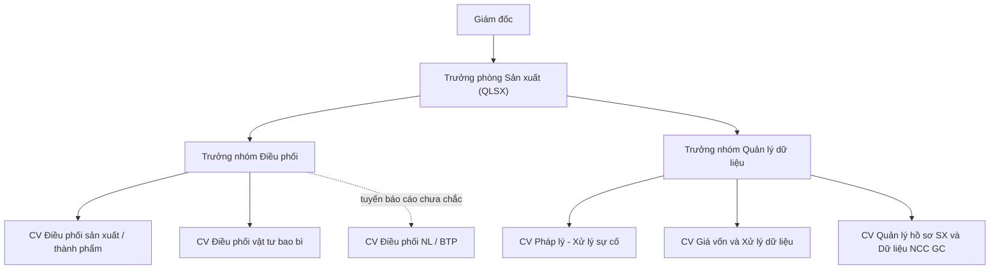
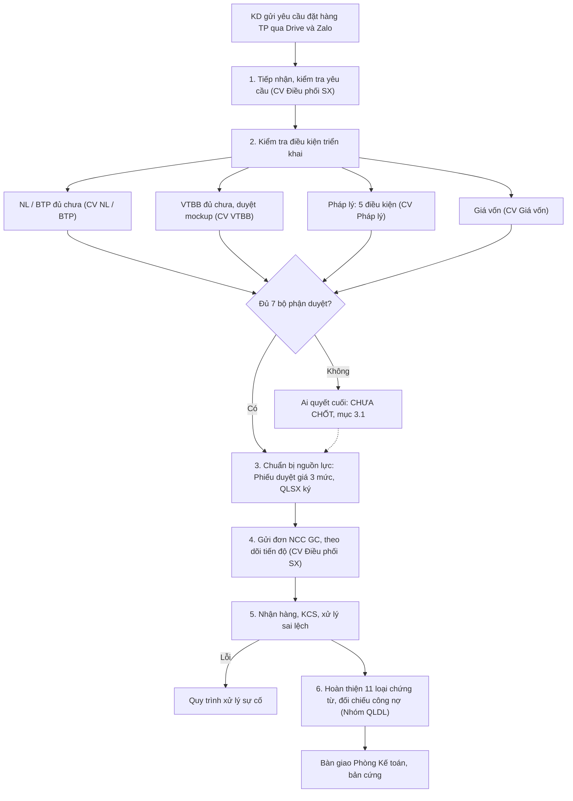

# PHÂN TÍCH KHẢO SÁT HIỆN TRẠNG QUẢN LÝ SẢN XUẤT (19/10/2026)

| | |
|---|---|
| Phiên bản | **1.0** — 24/10/2026 |
| Người viết | A5 Nghiên cứu nghiệp vụ |
| Nguồn | Dự án *Khảo sát hiện trạng Quản lý sản xuất (19/10/2026)* trên ứng dụng khảo sát Make It Clear (mic.degolab.com.vn), Phòng Sản xuất, người khởi tạo là Trưởng phòng |
| Ảnh chụp dữ liệu | 24/10/2026 08:32 giờ Việt Nam. Dự án vẫn đang mở, còn 8 vòng trả lời chưa nộp, nên số liệu có thể đổi |
| Phạm vi | Chỉ đọc. Không ghi, không phân xử gì trên ứng dụng khảo sát. Không dùng tệp âm thanh |
| Đọc kèm | [`01-luong-chuan-mua-hang-kho-san-xuat.md`](./01-luong-chuan-mua-hang-kho-san-xuat.md) · [`san-xuat/00-tong-quan-nghiep-vu.md`](../san-xuat/00-tong-quan-nghiep-vu.md) |

---

## Mục lục

1. [Đọc nhanh](#1-đọc-nhanh)
2. [Khảo sát gồm những gì](#2-khảo-sát-gồm-những-gì)
3. [Mâu thuẫn hệ thống đã đánh dấu](#3-mâu-thuẫn-hệ-thống-đã-đánh-dấu)
4. [Mâu thuẫn hệ thống chưa bắt được](#4-mâu-thuẫn-hệ-thống-chưa-bắt-được)
5. [Các câu trả lời: hiện trạng phòng Sản xuất](#5-các-câu-trả-lời-hiện-trạng-phòng-sản-xuất)
6. [Lỗ hổng thông tin còn mở](#6-lỗ-hổng-thông-tin-còn-mở)
7. [Ý nghĩa cho ERP](#7-ý-nghĩa-cho-erp)
8. [Câu cần hỏi lại](#8-câu-cần-hỏi-lại)

Viết tắt dùng trong tài liệu: **NCC GC** nhà cung cấp gia công · **NL** nguyên liệu · **BTP** bán thành phẩm · **TP** thành phẩm · **VTBB** vật tư bao bì · **QLSX** Quản lý sản xuất (chính là Trưởng phòng Sản xuất) · **QLDL** Quản lý dữ liệu · **KD** Phòng Kinh doanh · **KCS** kiểm tra chất lượng sản phẩm khi nhận · **BĐM** bảng định mức · **V2 · C4** vòng 2, câu 4 của người trả lời.

---

## 1. Đọc nhanh

**Phát hiện lớn nhất về nghiệp vụ:** DEGO **không tự sản xuất**. Toàn bộ sản xuất là **gia công tại nhà cung cấp**. DEGO cấp nguyên liệu, bán thành phẩm, vật tư bao bì cho NCC GC, NCC đóng gói, DEGO nhận thành phẩm về kho. Câu A5 ở [`san-xuat/00`](../san-xuat/00-tong-quan-nghiep-vu.md#nhóm-a--sản-xuất-cái-gì) (*có thuê gia công ngoài không*) đã có câu trả lời: **có, và đó là hình thức chính**.

**Mâu thuẫn:** hệ thống khảo sát đánh dấu 14 chỗ. 1 chỗ đã chốt, 1 chỗ đang hỏi lại, **12 chỗ đang mở**. Gần như tất cả xoay quanh **một câu hỏi**:

> Khi đơn hàng không đủ điều kiện triển khai (thiếu nguyên liệu, thiếu bao bì, hồ sơ pháp lý chưa đủ), **ai là người quyết cuối** cho đi tiếp hay dừng: Trưởng phòng Sản xuất hay Phòng Kinh doanh?

Bảy người trả lời chia ba phe (mục 3.1). Em đọc kỹ thì thấy các câu trả lời **không hẳn trái nhau** mà nói về **các loại vướng mắc khác nhau**. Đề xuất cách chốt ở mục 3.1.

**Em tìm thêm 10 chỗ lệch hệ thống chưa đánh dấu** (mục 4). Nặng nhất:

- Số đơn: *10 đến 15 đơn mỗi ngày* so với *khoảng 15 đơn mỗi tuần*, lệch 5 lần.
- Duyệt chi phí: ba nguồn nói ba kiểu khác nhau. Một nguồn nói *không cần duyệt*, một nguồn nói *trình Giám đốc*, một nguồn có *hạn mức 3 triệu và 5 triệu*.
- Một người tự nói hai ý khác nhau ở hai vòng: phiếu điều chuyển nguyên liệu *gửi thẳng Kho* hay *không gửi thẳng Kho*.

**Lỗ hổng còn mở:** 105 chỗ, trong đó 37 chỗ mức cao. Phần lớn là bước chưa có người làm hoặc chưa có người chịu trách nhiệm cuối trong hai quy trình *Làm việc với NCC mới* và *Xử lý sự cố*.

---

## 2. Khảo sát gồm những gì

| Chỉ số | Số |
|---|---:|
| Người trả lời đang tham gia | 11 (thêm 1 vị trí được gợi ý: Bộ phận Lab) |
| Câu hỏi đã đặt | 178 |
| Câu trả lời | 146 |
| Vòng đã xử lý / đang mở / đã hủy | 43 / 8 / 1 |
| Tài liệu tải lên (bảng tính, ảnh sơ đồ) | 13 |
| Giá trị đã ghi nhận vào các ô | 267 |
| Mâu thuẫn: đang mở / đã chốt | 13 / 1 (trong 13 có 1 chỗ đang hỏi lại) |
| Lỗ hổng: đang mở / đã giải quyết | 105 / 30 |
| Pha hiện tại | Pha 1 *Tổng quan từ trưởng phòng*, độ phủ 8/8 ô bắt buộc. Pha 2 *Bộ máy, quy trình, đầu việc* chưa mở |

**Người trả lời** (theo vị trí, số vòng đã làm):

| Vị trí | Vòng | Báo cáo cho |
|---|---:|---|
| Trưởng phòng (Quản lý sản xuất) | 4 | Giám đốc |
| Trưởng nhóm Điều phối | 4 | Trưởng phòng |
| Trưởng nhóm Quản lý dữ liệu | 6 | Trưởng phòng |
| Chuyên viên Điều phối sản xuất (còn gọi *Điều phối thành phẩm*) | 3 | Trưởng nhóm Điều phối |
| Chuyên viên Điều phối vật tư bao bì | 6 | Trưởng nhóm Điều phối |
| Chuyên viên Điều phối nguyên liệu / bán thành phẩm | 4 | Trưởng nhóm Điều phối (chính người này chưa chắc, xem mục 4) |
| Chuyên viên Giá vốn và Xử lý dữ liệu | 4 | Trưởng nhóm Quản lý dữ liệu |
| Chuyên viên Pháp lý - Xử lý sự cố | 5 | Trưởng nhóm Quản lý dữ liệu |
| Chuyên viên Quản lý hồ sơ sản xuất và Dữ liệu NCC GC | 2 | Trưởng nhóm Quản lý dữ liệu |
| Giám đốc | 2 | |
| Kế toán sản xuất | 3 | (Phòng Kế toán) |

Theo sơ đồ tổ chức tải lên, Trưởng phòng hiện tại dự kiến bàn giao công việc cho người kế nhiệm chậm nhất ngày 31/12/2026. Đây là mâu thuẫn duy nhất đã được chốt.

---

## 3. Mâu thuẫn hệ thống đã đánh dấu

### 3.1. Cụm lớn: ai quyết cuối khi đơn hàng không đủ điều kiện triển khai

**Chiếm 10 trên 14 mâu thuẫn.** Nằm ở bước *Kiểm tra điều kiện triển khai đơn hàng* của quy trình chính. Lỗ hổng tự động của hệ thống cũng ghi: bước này **đang có 4 người chịu trách nhiệm cuối, phải đúng một**.

| Ai nói | Vòng · câu | Nói gì | Phe |
|---|---|---|---|
| Trưởng phòng | V3 · C4 | Trưởng phòng chịu trách nhiệm cuối duyệt cho đơn triển khai, kể cả *duyệt trước, bổ sung sau* | **QLSX quyết** |
| Trưởng nhóm Điều phối | V2 · C4 | QLSX quyết cuối dựa trên dữ liệu các nhóm. Trưởng nhóm Điều phối báo lại tiến độ cho KD | **QLSX quyết** |
| CV Pháp lý - Xử lý sự cố | V3 · C1 | QLSX quyết cho đi hay dừng khi **hồ sơ pháp lý** chưa đạt | **QLSX quyết** |
| CV Điều phối VTBB | V4 · C1 | Thiếu bao bì thì lần lượt: tìm tồn ở kho khác, thương lượng KD dời ngày, nhờ Thu mua mua thêm. Không xong mới trình Trưởng phòng | **QLSX quyết** (hệ thống suy diễn, chưa xác nhận) |
| CV Điều phối NL / BTP | V2 · C2 | **KD** quyết duyệt hay hoãn khi **NL / BTP** không đủ hoặc không kịp | **KD quyết** |
| Trưởng nhóm QLDL | V6 · C1 | **KD** quyết tiếp tục hay tạm dừng. Điều phối thành phẩm phối hợp kiểm tra và thông báo | **KD quyết** |
| Trưởng nhóm QLDL | V3 · C1 | Người phụ trách báo **cả KD và Quản lý** cùng xem xét | **Cùng quyết** |
| CV Điều phối VTBB | V3 · C3 | Trưởng phòng **hoặc** KD quyết khi thiếu bao bì | **Không rõ** |

**Đọc kỹ thì thấy:**

1. Phe *QLSX quyết* nói về **cho phép đơn chạy khi điều kiện nội bộ chưa đủ**. Đây là rủi ro của Sản xuất: pháp lý, cho *duyệt trước, bổ sung sau*.
2. Phe *KD quyết* nói về **ngày giao và đơn của khách** khi thiếu hàng. Hoãn hay hủy ảnh hưởng tới khách thì KD là bên hiểu khách.
3. Trưởng nhóm QLDL **đổi ý** giữa vòng 3 (*cùng quyết*) và vòng 6 (*KD quyết*). Nên hỏi lại để biết vì sao đổi.
4. Chính Trưởng phòng nói mình là người quyết. Giám đốc chưa trả lời câu này. Giám đốc chỉ nói Trưởng phòng quyết cách làm việc với NCC GC mới, sau khi hỏi ý KD.

**Đề xuất cách chốt**, theo kiểu ma trận RACI (R làm, A chịu trách nhiệm cuối, C được hỏi ý, I được báo):

| Loại vướng mắc | A (quyết cuối, đúng một người) | C (phải hỏi ý) | I (được báo) |
|---|---|---|---|
| Hồ sơ pháp lý chưa đủ, có cho *duyệt trước, bổ sung sau* không | **Trưởng phòng Sản xuất** | CV Pháp lý, Trưởng nhóm QLDL | KD |
| Thiếu NL / BTP / VTBB, phương án nội bộ đã thử hết | **Trưởng phòng Sản xuất** chọn phương án cung ứng | Trưởng nhóm Điều phối, Thu mua | KD |
| Phải **dời ngày giao** hoặc **hủy đơn** với khách | **Phòng Kinh doanh** | Trưởng phòng Sản xuất | Điều phối thành phẩm |
| Hai bên không thống nhất | **Giám đốc** | | |

Đây là gợi ý của tài liệu nghiên cứu. **Trưởng phòng và Giám đốc phải chốt.** Chốt xong thì ghi vào ứng dụng khảo sát bằng nút *Quyết định* để các mâu thuẫn trong cụm cùng đóng.

### 3.2. Duyệt chi phí phát sinh

| Ai nói | Nói gì |
|---|---|
| Trưởng phòng · V2 · C2 | **Không áp dụng** duyệt chi phí hay vượt dự toán, vì công ty không có quỹ chi phí và ngân sách dự toán |
| Giám đốc · V1 · C1 | Chi phí phát sinh ngoài ngân sách sản xuất **phải trình Giám đốc phụ trách**, ghi kèm tên công ty, áp cho 12 công ty trong tập đoàn |
| Tệp *Quy trình thanh toán V1 7.11.2025* | Trưởng bộ phận duyệt tối đa **3 triệu một lần, 10 triệu một tháng**. Quản lý thương hiệu tối đa **5 triệu một lần**. Vượt thì Giám đốc điều hành duyệt |

Hệ thống mới đánh dấu cặp *Trưởng phòng và Giám đốc*. Tệp có hạn mức thì hệ thống chưa so. Ba nguồn này có thể cùng đúng nếu hiểu là: không có **ngân sách dự toán theo đơn hàng**, nhưng **chi phí mua sắm phát sinh** thì vẫn có hạn mức. Cần hỏi lại để chốt (câu H2, mục 8).

### 3.3. Duyệt hợp đồng NCC GC mới (đang hỏi lại)

Tệp quy trình ghi: hợp đồng NCC mới đi qua **Pháp lý, rồi Phòng Tài chính Kế toán, rồi Giám đốc ký**. Hệ thống đặt nó cạnh câu *không áp dụng duyệt chi phí* của Trưởng phòng. Hai câu nói về hai việc khác nhau, nên đây là **mâu thuẫn giả**. Nhưng nó lộ ra một điểm thật, xem mục 4, điểm H7.

### 3.4. Đầu mối nhận Phiếu yêu cầu điều chuyển nguyên liệu

| Ai nói | Nói gì |
|---|---|
| CV Điều phối NL / BTP · V2 · C5 | Phiếu gửi **Điều phối thành phẩm**, rồi Điều phối thành phẩm gửi NCC GC |
| Trưởng nhóm Điều phối · V4 · C1 | **CV Quản lý hồ sơ SX và Dữ liệu NCC GC** là đầu mối làm việc với NCC GC về điều chuyển nguyên liệu |
| CV Điều phối sản xuất · V3 · C2 | Mình nhận phiếu điều chuyển từ Điều phối NL / BTP để làm việc với NCC GC |

Hai trên ba nguồn nói Điều phối thành phẩm. Cần Trưởng nhóm Điều phối xác nhận lại.

### 3.5. Đã chốt: người giữ vị trí Trưởng phòng

Ngày 22/10, người quản trị khảo sát chốt theo hiện trạng: Trưởng phòng hiện tại giữ vị trí, dự kiến bàn giao cho người kế nhiệm chậm nhất 31/12/2026.

---

## 4. Mâu thuẫn hệ thống chưa bắt được

Em đọc chéo các câu trả lời và tài liệu tải lên, thấy thêm các chỗ lệch dưới đây. Hệ thống khảo sát chưa đánh dấu chỗ nào trong số này.

| # | Chỗ lệch | Nguồn A | Nguồn B | Mức | Vì sao quan trọng |
|---|---|---|---|---|---|
| H1 | **Số đơn hàng** | CV Điều phối SX · V2 · C1: **10 đến 15 đơn mỗi ngày**, kể cả đơn dự trù. CV VTBB · V3 · C1: 10 đến 15 đơn mỗi ngày | Trưởng nhóm Điều phối · V4 · C2: **khoảng 15 đơn mỗi tuần**. CV Giá vốn · V2 · C1: khoảng 15 đơn mỗi tuần | **Cao** | Lệch 5 lần. Quyết định khối lượng giao dịch ERP phải chịu và số người cần. Có thể là *đơn KD gửi vào* và *đơn thật sự đi duyệt giá* khác nhau, phải hỏi rõ |
| H2 | **Hạn mức duyệt chi phí** | Trưởng phòng: không áp dụng | Giám đốc: trình Giám đốc phụ trách. Tệp thanh toán: 3 triệu và 5 triệu | **Cao** | Mục 3.2. Thêm một chỗ lệch nhỏ: *Giám đốc phụ trách* với *Giám đốc điều hành* có phải một người không |
| H3 | **Cùng một người nói hai ý về phiếu điều chuyển** | CV Điều phối NL / BTP · V1 · C2: phiếu gửi **KD, Kho và Nhà gia công** | Cùng người · V2 · C5: Sản xuất **không gửi thẳng Kho**, phải qua Điều phối thành phẩm | Trung bình | Ảnh hưởng thiết kế luồng chuyển kho trong ERP. Ai là người ra lệnh xuất cho kho |
| H4 | **Ai chịu trách nhiệm cuối ở bước tiếp nhận đơn** | Trưởng nhóm Điều phối · V2 · C3: Điều phối thành phẩm lo **đủ** thông tin, KD lo **đúng** đơn | Trưởng phòng · V3 · C3: **CV Điều phối sản xuất** chịu trách nhiệm cuối nếu đơn sót thông tin hay sai quy cách | Trung bình | Nếu *Điều phối thành phẩm* và *CV Điều phối sản xuất* là một người thì chỉ lệch ở phần trách nhiệm của KD. Hai tên gọi đang dùng lẫn trong khảo sát, nên chốt một tên |
| H5 | **Ai quyết phương án khi hàng nhận về bị lỗi** | Trưởng nhóm Điều phối · V4 · C4: **Trưởng nhóm Điều phối** quyết phương án cuối sau khi tổng hợp ý kiến | CV Pháp lý - Xử lý sự cố · V5 · C3: **Trưởng nhóm QLDL** duyệt phương án, vượt thẩm quyền thì **Trưởng phòng** | **Cao** | Hai trưởng nhóm khác nhau cùng được nói là người quyết. Hàng lỗi là chỗ mất tiền |
| H6 | **Số bước của quy trình chính** | Trưởng phòng · V1 · C4: **6 bước** | Tệp *Quy trình sản xuất 09.07.2026*: **7 bước**, tên bước khác | Thấp | Cần một bản quy trình chuẩn duy nhất trước khi đưa lên ERP |
| H7 | **Ai ký hợp đồng NCC GC mới** | Tệp quy trình: Pháp lý → Tài chính Kế toán → **Giám đốc ký** | Giám đốc · V2 · C2: trình **Đại diện pháp luật** ký. Giám đốc · V1 · C2: **Giám đốc phụ trách công ty tương ứng** duyệt bằng văn bản | Trung bình | Tập đoàn có 12 công ty. Giám đốc ký và người đại diện pháp luật của từng công ty có thể là những người khác nhau |
| H8 | **Thời gian gia công tại một NCC** | Tệp *Data số ngày cập nhật cho KD*: **7, 10 hoặc 15 ngày** tùy ai cấp BTP và VTBB | Tệp *Thông tin NCC GC*: **5 đến 14 ngày** | Thấp | KD đang hứa ngày giao theo bảng nào |
| H9 | **Số trạng thái theo dõi đơn** | Tệp *Điều phối thành phẩm*, sheet họp 07/10: **6 trạng thái** | Cùng tệp, sheet *Nhập xuất TP*: **7 trạng thái** | Thấp | Khi làm ERP phải chốt bộ trạng thái |
| H10 | **Ai kiểm chất lượng thành phẩm khi nhận** | Trưởng nhóm Điều phối · V2 · C7: **Lab nội bộ** kiểm mẫu khi nhận: ngoại dạng, màu, trọng lượng | Tệp có biểu mẫu *Kết quả KCS Kho Dr.Xanh*: **Kho** kiểm quy cách ngoại quan, phụ kiện, chứng từ | Trung bình | Có thể cả hai cùng kiểm, mỗi bên một phần. Nhưng ERP cần biết **kết quả của ai** thì hàng mới được chuyển sang dùng được. Nối với câu S4 ở tài liệu 01 |

Thêm một điểm về bộ máy: theo ảnh sơ đồ tổ chức, **một nhân sự có tên ở cả nhóm Điều phối sản xuất và nhóm Điều phối NL / BTP**. Có thể là kiêm nhiệm. Nên xác nhận, vì nó giải thích vì sao CV Điều phối NL / BTP chưa chắc tuyến báo cáo của mình.

---

## 5. Các câu trả lời: hiện trạng phòng Sản xuất

### 5.1. Phòng làm gì

- **Mục tiêu**: sản phẩm đúng chất lượng, đủ sản lượng theo kế hoạch đơn hàng, kiểm soát chi phí và định mức hao hụt, điều phối tiến độ giao hàng.
- **Nhận việc**: KD gửi yêu cầu đặt hàng thành phẩm và dự trù mua hàng qua **Google Drive và Zalo**. KD lập dự trù NL, BTP, VTBB **vào ngày 15 hằng tháng**.
- **Giao việc ra**: gửi đơn đặt hàng gia công, mẫu thiết kế, vật tư cho NCC GC. Nhận lại thành phẩm, hóa đơn, biên bản đối chiếu.
- **Công cụ**: Google Drive và Google Sheets cho mọi thứ (đơn hàng, tiến độ, tồn kho, giá vốn, sự cố). **Zalo hơn 50 nhóm chat**. MISA để phối hợp xuất kho, hóa đơn, đối chiếu kế toán.
- **Báo cáo**: tiến độ đơn hàng gửi KD và Kế toán khi phát sinh, hằng tuần, hằng tháng. Báo cáo tồn kho gửi Kho mỗi ngày. Cảnh báo tồn VTBB dưới mức an toàn và dưới lượng đặt tối thiểu.

### 5.2. Quy trình chính: Quản lý đơn hàng sản xuất gia công tại NCC

| Bước | Người làm | Đầu ra | Điểm đáng chú ý |
|---|---|---|---|
| 1. Tiếp nhận | CV Điều phối sản xuất | Đơn và bảng định mức chép vào Drive *SX - Điều phối thành phẩm* | 10 đến 15 đơn mỗi ngày (xem H1) |
| 2. Kiểm điều kiện | CV NL / BTP, CV VTBB, CV Pháp lý, CV Giá vốn | Mỗi người ghi kết quả vào sheet duyệt đơn | **7 bộ phận cùng duyệt**: NL / BTP, VTBB, Giá vốn, Pháp lý, Sự cố, QLDL, QLSX. Kiểm tồn VTBB mất 30 phút đến 1 giờ. Duyệt VTBB mất nửa ngày đến 1 ngày, vì chờ mockup từ bộ phận Thiết kế |
| | | | Pháp lý kiểm 5 điều kiện: đơn vị sở hữu (giấy đăng ký thuốc, quyết định lưu hành phân bón, hợp quy), đơn vị cấu thành (ủy quyền), điều kiện sản xuất (giấy phép, hợp đồng gia công), điều kiện mua bán, dòng hóa đơn phù hợp |
| 3. Chuẩn bị nguồn lực | CV Giá vốn | **Phiếu duyệt giá 3 mức giá**, QLSX ký. Phiếu điều chuyển hoặc phối trộn nguyên liệu | 8 bước lập phiếu duyệt giá, 15 đến 30 phút mỗi phiếu khi đủ dữ liệu. Hay phải chờ NCC xác nhận giá |
| 4. Gửi đơn, theo dõi | CV Điều phối sản xuất (TP), CV NL / BTP (BTP) | Đơn đặt hàng gia công kèm công thức, màu BTP, quy cách. Báo cáo gửi kho **16 giờ mỗi ngày** | Chậm nhất 3 ngày phải cập nhật tiến độ. Kiểm với NCC sau 2 ngày làm việc. Nhiều NCC từ chối ký đơn đặt hàng |
| 5. Nhận hàng | CV Điều phối SX, Kho | Kho xem Drive, cập nhật số nhận, gửi chứng từ qua Zalo | Chưa có hạn tối đa xử lý lỗi sau khi Kho kiểm. Lab chỉ kiểm ngoại dạng, màu, trọng lượng. Kiểm hàm lượng chỉ khi có sự cố |
| 6. Chứng từ, đối chiếu | CV Quản lý hồ sơ SX và Dữ liệu NCC GC, Trưởng nhóm QLDL chịu trách nhiệm cuối | **11 loại chứng từ bản cứng** cho Kế toán | Mỗi nhân sự phụ trách một số NCC. Dữ liệu MISA sai hoặc chậm. NCC ngại ký giấy đề nghị thanh toán |

**11 loại chứng từ quyết toán một đơn gia công** (theo Kế toán sản xuất): giấy đề nghị thanh toán, giấy đề nghị thanh toán của NCC, phiếu mua hàng hóa, hóa đơn, hợp đồng có giá, hợp đồng không giá, đơn đặt hàng, giấy nhập kho, giấy xuất kho hoặc phiếu giao hàng, bảng xác nhận công nợ, phiếu đề xuất mua.

**Nhánh hủy đơn**: chưa gửi NCC thì dừng, xử lý tồn, ghi nhận chi phí. Đã gửi NCC thì thỏa thuận hủy. NCC không nhận hủy thì chờ KD xác nhận hoặc chuyển sang quy trình sự cố.

**Thời gian cung ứng quy định**: can, xô 5 đến 7 ngày · túi flexo 12 đến 15 ngày · túi trục 21 ngày · thùng carton 15 đến 20 ngày · NL trong nước 10 đến 14 ngày · NL nhập khẩu 59 ngày (đường bay 41 ngày).

### 5.3. Làm việc với NCC GC mới

- **Khi nào**: NCC hiện tại không còn phù hợp (năng lực, chất lượng, giá) hoặc có sản phẩm mới.
- **7 bước**: tiếp nhận yêu cầu → tìm NCC → so sánh, đánh giá sơ bộ → liên hệ, thỏa thuận, kiểm pháp lý → lấy mẫu, kiểm mẫu ở Lab → soạn hợp đồng, bảng giá → hoàn thiện quy trình làm việc.
- **Chủ trì**: Trưởng phòng. Kết quả phải được Giám đốc phụ trách công ty tương ứng duyệt bằng văn bản.
- **Lỗ hổng**: 4 bước đầu **chưa có ai làm, chưa có ai chịu trách nhiệm cuối**.

### 5.4. Xử lý sự cố trong sản xuất

- **Bắt đầu**: bộ phận phát hiện lỗi báo bộ phận xử lý sự cố.
- **5 bước**: xác định nguyên nhân → tìm phương án → chuẩn bị thủ tục → theo dõi → lưu trữ. Ba bước cuối chưa có câu trả lời nào.
- **4 kết cục**: chấp nhận không xử lý · yêu cầu NCC xử lý lại · hủy, cấn trừ công nợ hoặc ghi chi phí · tạm chờ ý kiến.
- **Duyệt phương án**: Trưởng nhóm QLDL, vượt thẩm quyền thì Trưởng phòng, KD được hỏi ý (lệch với H5).
- **Chưa có thời hạn** cho từng công đoạn xử lý và khiếu nại NCC.
- **Hàng lỗi được xử lý khác nhau tùy NCC**: có NCC xuất hóa đơn trả hàng kèm bảng kê, có NCC đổi ngang hàng mà không ký biên bản hàng lỗi.

### 5.5. Các quy trình mới có tên, chưa có nội dung

*Khai báo sản xuất*, *Khảo sát và tính giá vốn*, *Thanh toán và tạm ứng*, *Đặt dịch vụ vận chuyển (Grab)*, *Xử lý sự cố sau sản xuất*, *Quản lý vật tư bao bì*. Sáu quy trình này chưa có ô nào được trả lời. Chắc sẽ hỏi ở pha 2.

### 5.6. Chỗ đau lớn nhất theo người trả lời

| # | Chỗ đau | Ai nói |
|---|---|---|
| 1 | *Công việc nào cũng bị chậm và sai*. Việc nào một người làm thì không ai làm thay được | Trưởng phòng |
| 2 | KD không có kế hoạch sản xuất theo tháng, quý. Sản xuất bị động | Trưởng phòng |
| 3 | Hệ thống Drive phụ thuộc vào một tệp gốc *Data 1*. Đổi tệp đó là mọi Drive phải chạy lại | Tệp quy trình |
| 4 | Dữ liệu MISA sai hoặc chậm. Số nội bộ lệch với số thuế | Trưởng nhóm QLDL |
| 5 | Biên bản giao nhận và đối chiếu tồn với hầu hết NCC **chưa tách đúng pháp nhân** nhận hóa đơn | Biên bản họp 25/09 |
| 6 | Điều khoản thỏa thuận với NCC không đưa được vào hợp đồng, trong khi Kế toán bắt buộc phải có đủ chứng từ. Kiểm pháp lý bị chậm | CV Pháp lý |
| 7 | Kế toán đòi hợp đồng thành phẩm có giá và số lượng khi đặt BTP, trong khi KD chưa chốt hoặc đổi quy cách sau khi ký | Biên bản họp 25/09 |
| 8 | Có đối chiếu tồn với NCC nhưng chưa có quy trình xử lý sau đối chiếu | Tệp xuất nhập tồn VTBB |
| 9 | Đóng gói lệch thể tích so với quy cách đã chốt tại một NCC. Phần chênh đang phải tính vào chi phí KD | Tệp xuất nhập tồn NL, BTP |
| 10 | Một NCC chưa được báo chính thức việc đổi công thức và màu một dòng sản phẩm. Có rủi ro đóng sai | Tệp xuất nhập tồn NL, BTP |

**Điểm nhạy cảm, cố ý không chép chi tiết vào tài liệu này.** Có ba câu trả lời và tài liệu nêu cách làm với NCC GC liên quan **chứng từ, hóa đơn và thuế** (chiết khấu, thanh toán, giá trị không cấu thành vào chứng từ). Người cần xem thì mở trực tiếp trên ứng dụng khảo sát, mục *Chỗ hay tắc*. Ban điều hành nên xem riêng với Kế toán trưởng trước khi thiết kế phần chứng từ gia công trên ERP.

---

## 6. Lỗ hổng thông tin còn mở

| Mức | Đang mở | Đã giải quyết |
|---|---:|---:|
| Cao | 37 | 23 |
| Trung bình | 49 | 6 |
| Thấp | 19 | 1 |
| **Cộng** | **105** | **30** |

Nhóm lại 37 lỗ hổng mức cao:

| Nhóm | Số lượng (ước) | Ví dụ |
|---|---:|---|
| Bước chưa có người làm hoặc người chịu trách nhiệm cuối | khoảng 20 | 4 bước đầu *Làm việc với NCC mới*. 5 bước *Xử lý sự cố*. Bước kiểm điều kiện có 4 người chịu trách nhiệm cuối |
| Thẩm quyền và tuyến báo cáo | 3 | Thẩm quyền KD và QLSX, cùng gốc với mục 3.1. Tuyến báo cáo của CV NL / BTP |
| Vị trí ghi chung chung, không phải người cụ thể | 7 | *Trưởng phòng sản xuất / Kinh doanh*, *Quản lý trực tiếp*, *Chưa xác định*, *Bộ phận Lab* |
| Chứng từ, pháp lý, NCC, kế hoạch | khoảng 8 | Chưa có hạn tối đa được nợ hồ sơ pháp lý khi cho *duyệt trước, bổ sung sau*. Đủ 11 chứng từ bản cứng thì thanh toán dễ chậm. MISA chậm. Chưa tách pháp nhân. KD chưa có kế hoạch tháng |
| Người làm thay | 1 | Các vị trí chuyên trách chưa có người làm thay khi vắng |

Nhóm thứ ba phần lớn là do hệ thống bóc chữ từ câu trả lời, không phải lỗ hổng thật. Chốt xong mục 3.1 thì nhóm này tự giảm.

---

## 7. Ý nghĩa cho ERP

Nối với tài liệu [01](./01-luong-chuan-mua-hang-kho-san-xuat.md) và [`san-xuat/00`](../san-xuat/00-tong-quan-nghiep-vu.md).

| # | Phát hiện từ khảo sát | Ý nghĩa cho thiết kế |
|---|---|---|
| 1 | Sản xuất = **gia công tại NCC** | Trọng tâm không phải lệnh sản xuất trong xưởng mình mà là **đơn gia công** ([`san-xuat/00` mục 10.1](../san-xuat/00-tong-quan-nghiep-vu.md#101-gia-công-ngoài)). ERP cần: đơn mua dịch vụ gia công, **kho tại NCC GC** để biết NL, VTBB của mình đang nằm ở đâu, phiếu xuất vật tư gửi gia công, đối chiếu định mức tiêu hao với NCC khi nhận thành phẩm |
| 2 | Đang có **đối chiếu xuất nhập tồn VTBB với NCC** trên bảng tính, tự tính chênh lệch và kết luận khớp hay lệch | Đây chính là đối chiếu kho tại đơn vị gia công. Làm được ngay khi có kho chuẩn (tài liệu 01, nấc 2) |
| 3 | **Giấy đề nghị nhập kho thành phẩm** do Điều phối lập, có chữ ký NL, VTBB, Kế toán, Trưởng bộ phận | Đã có thói quen **phiếu nhập có người xác nhận**. Khớp với yêu cầu của tài liệu 01, điểm (d) |
| 4 | Đã có **mức an toàn tối thiểu** và **lượng đặt tối thiểu** cho VTBB trên bảng tính | Dữ liệu sẵn cho tồn tối thiểu và điểm đặt hàng lại (tài liệu 01, mục 4.7) |
| 5 | Thiếu VTBB thì CV VTBB lập **phiếu đề nghị mua** gửi Thu mua | Đây là điểm nối Sản xuất sang Mua hàng. Trên ERP chính là **YCMH** đã có. Nên cho Sản xuất lập YCMH thẳng trên ERP |
| 6 | **Phiếu duyệt giá 3 mức** do CV Giá vốn lập, QLSX ký, gồm 8 bước, có bảng định mức BOM | Có BOM và có tính giá thành **dự toán theo đơn**. Liên quan câu B1 (*chỉ số lượng hay cả giá thành*): đang có giá thành dự toán, chưa rõ có giá thành thực tế không |
| 7 | **7 bộ phận cùng duyệt** một đơn trước khi gửi NCC | Bộ máy phê duyệt của ERP đã có. Cần luồng duyệt **song song nhiều nhánh** rồi mới tới QLSX |
| 8 | Tập đoàn **12 công ty**, chứng từ với NCC chưa tách đúng pháp nhân | ERP đã có pháp nhân trên chứng từ. Đơn gia công, phiếu kho, đối chiếu phải mang **pháp nhân nhận hóa đơn** ngay từ đầu |
| 9 | 11 loại chứng từ bản cứng cho một đơn | Nên làm **bộ hồ sơ đơn gia công** trên ERP có danh mục 11 loại, đánh dấu đủ hay thiếu. Phân hệ hồ sơ đã có sẵn trong ERP, cần kiểm có dùng lại được không |
| 10 | **Hơn 50 nhóm Zalo** và Drive phụ thuộc một tệp gốc | Rủi ro mất dữ liệu và rủi ro một người. Lý do mạnh để đưa vào ERP |

**Trả lời một phần các câu đang chờ ở `san-xuat/00` mục 14:**

| Câu | Khảo sát nói gì |
|---|---|
| A1 Sản xuất mặt hàng gì | Thuốc bảo vệ thực vật, phân bón. Gia công đóng gói tại NCC, có phối trộn BTP |
| A3 Lô, hạn dùng | Chưa ai nói. Hàng thuốc bảo vệ thực vật thường bắt buộc có lô. Phải hỏi |
| A5 Gia công ngoài | **Có, là hình thức chính** |
| B1 Chỉ số lượng hay cả giá thành | Đang có **giá thành dự toán theo đơn** (phiếu duyệt giá). CV Giá vốn có bàn giao giá thực tế sau sản xuất cho Kế toán. Chưa rõ ai tính giá thành thực tế, tính thế nào |
| C1 Phần mềm kế toán | **MISA** |

---

## 8. Câu cần hỏi lại

Nên hỏi qua chính ứng dụng khảo sát (nút *Hỏi lại hai bên*) để câu trả lời quay về đúng ô.

| # | Hỏi ai | Câu hỏi | Gỡ chỗ |
|---|---|---|---|
| H-A | Trưởng phòng, Giám đốc | Chốt bảng RACI ở mục 3.1: ai quyết cuối theo từng loại vướng mắc | 10 mâu thuẫn ở mục 3.1 |
| H-B | Trưởng nhóm QLDL | Vòng 3 nói *KD và Quản lý cùng xem xét*, vòng 6 nói *KD quyết*. Ý nào đúng, vì sao đổi | Mục 3.1 |
| H-C | CV Điều phối SX, Trưởng nhóm Điều phối | *10 đến 15 đơn mỗi ngày* và *15 đơn mỗi tuần* là đếm hai thứ khác nhau phải không: đơn KD gửi vào, đơn đi duyệt giá, đơn gửi NCC | H1 |
| H-D | Trưởng phòng, Giám đốc, Kế toán | Ba nguồn về duyệt chi phí: không áp dụng, trình Giám đốc, hạn mức 3 triệu và 5 triệu. Cái nào đang áp thật. *Giám đốc phụ trách* và *Giám đốc điều hành* có phải một người | H2, mục 3.2 |
| H-E | CV Điều phối NL / BTP | Phiếu điều chuyển nguyên liệu có gửi thẳng Kho không | H3, mục 3.4 |
| H-F | Trưởng phòng | *Điều phối thành phẩm* và *CV Điều phối sản xuất* có phải một vị trí | H4 |
| H-G | Trưởng nhóm Điều phối, Trưởng nhóm QLDL | Hàng nhận về bị lỗi: ai quyết phương án cuối | H5 |
| H-H | Giám đốc | Hợp đồng NCC GC mới: ai ký với từng công ty trong 12 công ty | H7 |
| H-I | Trưởng nhóm Điều phối, Kho, Lab | Khi nhận thành phẩm, kết quả kiểm của ai thì hàng mới được nhập kho dùng được | H10, câu S4 tài liệu 01 |
| H-J | CV Điều phối NL / BTP, Kế toán | Có theo dõi số lô, hạn dùng của NL và TP không | Câu A3 |
| H-K | Kế toán sản xuất, CV Giá vốn | Ai tính giá thành thực tế sau gia công, tính theo kỳ hay theo đơn | Câu B1, C2 |

---

*Hết tài liệu. Số liệu chụp lúc 24/10/2026 08:32. Khảo sát còn đang chạy, nên đọc lại trước khi dùng làm đầu vào cho tài liệu yêu cầu.*
