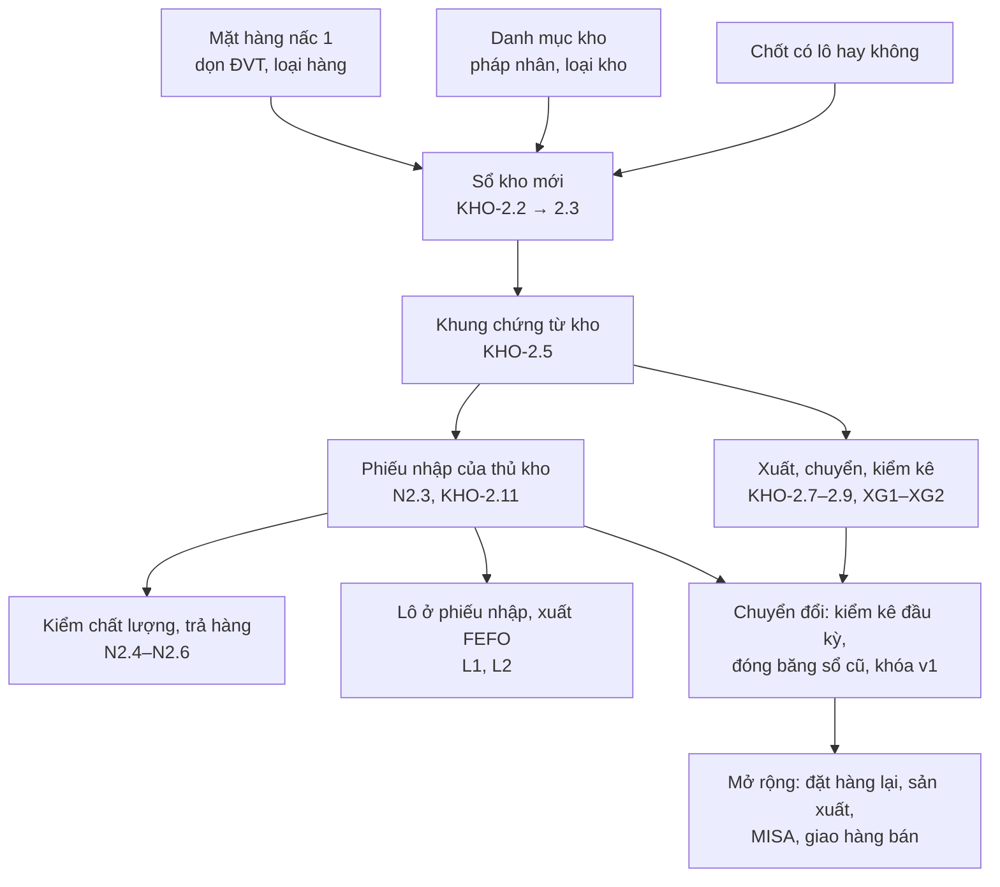

# MỨC ĐỘ CÁC MODULE MẶT HÀNG, KHO, NHẬN HÀNG, LÔ, XUẤT HÀNG SO VỚI ERPNEXT VÀ KẾ HOẠCH TRIỂN KHAI

| | |
|---|---|
| Bản | 1.0 — 02/11/2026 |
| Mục đích | Gộp năm bản nghiên cứu theo module thành một bức tranh: ERP DEGO đang ở ngưỡng nào so với ERPNext v16, và làm theo thứ tự nào |
| Nguồn | [Mặt hàng](../item/00-nghien-cuu-mat-hang-erpnext.md) · [Kho lõi](../inventory/00-nghien-cuu-kho-erpnext.md) · [Nhận hàng và chất lượng](../receiving/00-nghien-cuu-nhan-hang-chat-luong-erpnext.md) · [Lô, serial, hạn dùng](../batch-serial/00-nghien-cuu-lo-serial-erpnext.md) · [Xuất kho và giao hàng](../delivery/00-nghien-cuu-xuat-giao-hang-erpnext.md); nền: [01 luồng chuẩn](01-luong-chuan-mua-hang-kho-san-xuat.md), [10 nghiệp vụ kho](10-nghiep-vu-kho.md), [11 độ phủ thu mua - kho](11-do-phu-thu-mua-kho-so-voi-erpnext.md) |
| Mốc so sánh | ERPNext 16.53 trên trang học erpnext.degoholding.vn (có dữ liệu thật đồng bộ từ ERP DEGO), mã ERP DEGO nhánh `erp-v2` |

---

## 1. Kết luận trong một trang

**Năm module quanh kho, ERP DEGO đạt khoảng 25 %** so với ERPNext (36 / 146 chức năng, chấm *Có* = 1, *Một phần* = 0,5, *Chưa* = 0). Chuỗi **mua hàng phía trước** (yêu cầu, hỏi giá, đơn mua, duyệt) đã mạnh — tài liệu 11 chấm 72 % — nhưng **phía sau kho thì gần như chưa có nền**: sổ kho sửa được, chưa có chứng từ xuất, chuyển, kiểm kê, chưa có lô.

| Module | Hiện nay | Ngưỡng | Sau nấc 1 | Sau nấc 2 | Sau nấc 3 | Chỗ hở lớn nhất |
|---|---|---|---|---|---|---|
| **Mặt hàng** (Item) | **37 %** (14 / 38) | 2 | ~45 % | ~60 % | ~85 % | 94 % mã trống đơn vị tính, không quy đổi; quy cách nằm trong tên, chưa có thuộc tính; chưa có cờ loại hàng |
| **Kho lõi** (Inventory) | **19 %** (7 / 36) | 1 | ~25 % | ~76 % | ~90 % | Sổ kho sửa, xóa được, không khóa kỳ; chưa có phiếu xuất, chuyển, kiểm kê; chỉ một con số tồn |
| **Nhận hàng và chất lượng** | **35 %** (8 / 23) | 2 | ~54 % | ~91 % | ~100 % | Phiếu nhập sinh ngầm; hàng lỗi vẫn vào tồn và vẫn sinh nợ; không có trả hàng NCC |
| **Lô, serial, hạn dùng** | **3 %** (0,5 / 18) | 0 | — | ~79 % (L1 + L2) | ~96 % (L3) | Không bảng kho nào có lô, hạn dùng; kho Dr Xanh đang ghi ngoài ERP |
| **Xuất kho và giao hàng** | **21 %** (6,5 / 31) | 1 | — | ~37 % (XG1–XG2) | ~48–85 % | Chưa có chiều ra của kho; đặt xe giao hàng mạnh nhưng chưa nối chứng từ kho |
| **Cộng năm module** | **~25 %** (36 / 146) | | | | | |

**Thang ngưỡng** dùng ở bảng trên:

| Ngưỡng | Nghĩa |
|---|---|
| 0 | Chưa có trong ERP (làm ngoài Excel, sổ tay) |
| 1 | Có ghi chép nhưng không kiểm soát: sửa xóa tự do, không chứng từ, không duyệt |
| 2 | Có màn hình và dữ liệu dùng được hằng ngày, còn thiếu kiểm soát hoặc thiếu nghiệp vụ quan trọng |
| 3 | Đúng chuẩn chứng từ: Nháp, Ghi sổ, Hủy bằng dòng đảo, khóa kỳ, có người chịu trách nhiệm |
| 4 | Tự động hóa và đối chiếu: đặt hàng lại tự sinh, đối chiếu ba chiều, nối kế toán |

**Đề xuất chính:** học **xương sống** của ERPNext — sổ kho chỉ ghi thêm, chứng từ Nháp / Ghi sổ / Hủy, bình quân di động tính lúc ghi, ngày khóa sổ, bốn con số tồn, phiếu nhập do thủ kho lập — nhưng **không chép** phần nặng: hạch toán sổ cái (kế toán ở MISA), ghi lùi rồi tính lại giá vốn, hơn mười kiểu phiếu kho, gói lô và serial, tính giá theo từng lô. Đường găng là **sổ kho mới** (Kho lõi KHO-2.2 → 2.3 → 2.5); mọi module còn lại xây lên nó.

---

## 2. Bức tranh từng module

### 2.1. Mặt hàng — ngưỡng 2

- **Có:** mã SKU ổn định nối bảy bảng (`product_code`), nhóm hàng, nhà cung cấp, khảo sát giá.
- **Hở:** đơn vị tính trống ở 6.424 / 6.803 mã, không có quy đổi thùng – cái, kg – gram; quy cách viết trong tên, cột `specs` trống, thiết kế thuộc tính đã duyệt nhưng chưa làm; không phân biệt hàng tồn kho, phi kho, dịch vụ; 685 mã ghi phân loại lệch danh mục; bảng `tab_brand` thực chất là *bộ phận đặt hàng*.
- **Hướng:** giữ luật `tab_product` là bảng SKU (không thêm bảng biến thể bên dưới); học ERPNext ở các bảng con quanh mặt hàng (`tab_product_uom`, `tab_product_supplier`, mức đặt hàng lại, giá có hiệu lực); họ sản phẩm đặt **ở trên**.

### 2.2. Kho lõi — ngưỡng 1

- **Có:** tồn theo pháp nhân, kho, mặt hàng; sổ phát sinh; màn tồn trên v2.
- **Hở:** sổ sửa xóa được, không ngày ghi sổ, không khóa kỳ; bình quân tính lại trên cả lịch sử (công thức đúng nếu sổ không bị sửa — chỉ cần đóng băng lịch sử); chỉ có nhập và điều chỉnh tay với đơn giá gõ tùy ý, không chặn tồn âm; `tab_inventory` thiếu ràng buộc duy nhất; danh mục kho không gắn pháp nhân, không loại kho, lẫn kho đặt tại nhà cung cấp và nhà gia công.
- **Hướng:** `tab_stock_ledger` chỉ ghi thêm (trigger chặn sửa xóa), `tab_stock_voucher` chung cho mọi phiếu, `tab_inventory` thành bảng tồn đệm kiểu `Bin`, `tab_stock_setting` theo pháp nhân (ngày khóa, khung ghi lùi N ngày, chặn tồn âm), bốn phiếu nhập khác, xuất, chuyển, kiểm kê.

### 2.3. Nhận hàng và chất lượng — ngưỡng 2

- **Có:** nhận nhiều lần, lịch giao, cảnh báo trễ; chi phí thu mua ba giai đoạn đã phân bổ về dòng hàng.
- **Hở:** phiếu nhập sinh ngầm khi thu mua gõ số nhận; ô kiểm chất lượng là một chữ cho cả lần giao và **bảng lần giao v2 không có ô này**; hàng lỗi vẫn vào tồn, vẫn sinh nợ; không chặn nhận vượt (dữ liệu thật: 128 mặt hàng nhận vượt, gần hết là bao bì); không trả hàng NCC; chi phí nhập khẩu chưa vào giá kho.
- **Hướng:** phiếu nhập do thủ kho lập (lần giao chỉ còn là lịch dự kiến), số chấp nhận / từ chối + kho hàng lỗi, mẫu kiểm theo nhóm hàng, hàng lỗi giá 0 và không sinh nợ (**luật cứng** — ERPNext mặc định có cài đặt kéo cả số lỗi vào hóa đơn), dung sai theo nhóm hàng (đề xuất bao bì in 10 %, chai nắp 5 %, nguyên liệu rời 2 %), trả hàng trỏ phiếu nhập gốc sinh nợ âm, chi phí về muộn ghi dòng điều chỉnh giá trị chứ không tính lại lùi.

### 2.4. Lô, serial, hạn dùng — ngưỡng 0

- **Có:** chưa có gì trong ERP; dùng lại được khuôn tính hết hạn ở `dossier/expiry.py`.
- **Nhu cầu có thật:** sheet *Kết quả KCS Kho Dr Xanh* đang ghi số lô, ngày sản xuất, hạn dùng; luật nhãn phân bón và thuốc BVTV đòi ngày sản xuất, hạn dùng, số lô (cần Pháp lý xác nhận bản hiện hành sau sáp nhập Bộ năm 2025).
- **Hướng:** thành phẩm bắt buộc theo lô và hạn; nguyên liệu có hạn nên bật; bao bì không; **serial không cần**. Bản tối giản: mỗi dòng chứng từ một lô, không gói, không tính giá theo lô, bảng `tab_stock_lot` (tên `batch` đã bị phân hệ nhập liệu chiếm).

### 2.5. Xuất kho và giao hàng — ngưỡng 1

- **Có:** đặt xe giao hàng (`vehicle_booking`): xe, tài xế, nhiều điểm dừng, điều phối, km, chi phí, *Chuyến của tôi* — gần với *chuyến giao* của ERPNext.
- **Hở:** chưa có phiếu xuất, chuyển kho, đề nghị lĩnh vật tư; phân hệ Bán hàng, Khách hàng ở v2 mới là vỏ.
- **Hướng:** xuất dùng nội bộ, xuất hủy, chuyển kho và đề nghị lĩnh vật tư trước; xuất cho sản xuất khi có lệnh sản xuất; giao hàng bán chỉ khi chốt công ty bán qua ERP. Đặt xe **nối** với chứng từ kho chứ không gộp, và không bao giờ tự trừ kho.

---

## 3. Phụ thuộc giữa các module

Ba điều phải chốt **trước khi dựng sổ kho mới**, vì làm sau là phải sửa lại bảng sổ: **phương pháp tính giá**, **có theo dõi lô hay không**, **sổ kho chính thức ở ERP hay MISA**.

---

## 4. Kế hoạch triển khai hợp nhất

Mã việc giữ nguyên theo từng tài liệu module: Mặt hàng `MH-x.y` (mục 6 tài liệu item), Kho `KHO-x.y`, Nhận hàng `N1.x / N2.x / N3.x`, Lô `L1–L4`, Xuất `XG0–XG9`. Việc trùng giữa các tài liệu chỉ làm một lần (ghi chú *trùng*). Độ lớn ước tính thô cho một người, đã gồm bài kiểm, hướng dẫn và giao diện v2.

### Giai đoạn 0 — Chốt câu hỏi và chuẩn bị dữ liệu (1–2 tuần, song song giai đoạn 1)

- Chốt các câu ở mục 5 (ưu tiên nhóm **Chặn sổ kho**).
- Dọn **đơn vị tính** 6.424 mã: script đề xuất theo nhóm hàng và tên, xuất Excel, người phụ trách danh mục duyệt (MH-1.5).
- Dọn **danh mục kho**: gắn pháp nhân, tách kho tại NCC và nhà gia công (KHO-1.5).
- Chọn **thủ kho, trưởng kho** từng kho; lên lịch **kiểm kê** chốt số dư đầu kỳ cho pháp nhân thí điểm.

### Giai đoạn 1 — Vá nhanh trong mô hình cũ (khoảng 3–4 người-tuần)

Không đổi cấu trúc chứng từ, người dùng gần như không phải học gì mới; chặn mất tiền ngay.

| Việc | Nguồn | Ghi chú |
|---|---|---|
| Ràng buộc duy nhất cho `tab_inventory`; kiểm mã kho khi lưu | KHO-1.1, KHO-1.3 | Làm ngay, không phụ thuộc câu nào |
| Danh mục kho thêm pháp nhân, loại kho, kho cha | KHO-1.4 | Làm ngay |
| Điều chỉnh tay bắt buộc lý do, đơn giá chỉ người có quyền gõ, chặn tồn âm | KHO-1.2 | |
| Chặn số nhận khi ĐMH chưa duyệt | N1.1 | Làm ngay |
| Kết quả kiểm thành bộ mã + số chấp nhận / từ chối; tồn và nợ theo số chấp nhận; **thêm cột kiểm ở bảng lần giao v2** | N1.2, N1.3, N1.4 | |
| Dung sai nhận vượt theo nhóm hàng | N1.5 | Chờ câu M3 |
| Nhật ký sửa số nhận | N1.6 = KHO-1.6 | Trùng, làm một lần |
| Báo cáo hàng về chưa có hóa đơn, cảnh báo ở YCTT | N1.7 | |
| Màn Sản phẩm lọc mã trống ĐVT, lệch phân loại; `item_group_id`; bắt buộc ĐVT mã mới; cờ loại hàng; khóa đổi ĐVT khi đã có phát sinh | MH-1.1–1.6 | |

### Giai đoạn 2 — Sổ kho mới (khoảng 5–6 người-tuần) — **đường găng**

| Việc | Nguồn |
|---|---|
| Bộ mã kho, `tab_stock_setting`, màn cài đặt | KHO-2.1, KHO-2.4 |
| Sổ `tab_stock_ledger` chỉ ghi thêm + cột tồn mở rộng | KHO-2.2 |
| Dịch vụ ghi sổ `post` / `cancel`, bình quân di động `Decimal`, dòng đảo | KHO-2.3 (= N2.1) |
| Khung chứng từ kho Nháp → Chờ duyệt → Ghi sổ → Hủy → Sửa đổi | KHO-2.5 |
| Quyền thủ kho theo kho, ẩn giá với thủ kho | KHO-2.10 |
| Quy đổi đơn vị: `tab_product_uom`; dòng chứng từ mang `conversion_factor`, `stock_qty` | MH-2.4, MH-2.5 (chờ câu Q4 mặt hàng) |
| Nếu chốt có lô: cột lô trên dòng sổ ngay từ đầu, `tab_stock_lot` | L1 phần bảng |

### Giai đoạn 3 — Chứng từ kho và nhận hàng chuẩn (khoảng 6–8 người-tuần)

| Việc | Nguồn |
|---|---|
| Màn phiếu kho v2, phiếu nhập khác, phiếu xuất (mục đích chi phí), chuyển kho một bước, kiểm kê + số dư đầu kỳ | KHO-2.6–2.9, XG1 |
| Đề nghị lĩnh vật tư qua bộ máy duyệt chung | XG2 |
| Loại kho + kho hàng lỗi đi kèm | N2.2 |
| Phiếu nhập do thủ kho lập, entity `goods_receipt`, lần giao thành lịch dự kiến | N2.3 (= KHO-2.11) |
| Mẫu kiểm theo nhóm hàng | N2.4 |
| Trả hàng NCC + khoản giảm nợ âm, tiền treo NCC | N2.5, N2.6 |
| Lô ở phiếu nhập, tồn theo lô; xuất FEFO, chặn lô hết hạn | L1, L2 |

### Giai đoạn 4 — Chuyển đổi và vận hành (khoảng 3 người-tuần + kiểm kê thực tế)

- Chốt ngày cắt, **thí điểm một pháp nhân**, kiểm kê thật, nạp số dư đầu kỳ (đơn giá từ MISA), đóng băng sổ cũ, **khóa ô số nhận ở v1** (KHO-2.12, N2.3 phần chuyển đổi).
- Báo cáo số dư kho theo kỳ, sổ kho chi tiết, đối soát đêm (KHO-2.13, KHO-2.16).
- Chi phí thu mua vào giá kho bằng dòng điều chỉnh giá trị (KHO-2.17 = N2.7).
- Báo cáo nhận hàng, tỷ lệ từ chối theo NCC vào chấm điểm NCC (N2.8).
- Tập huấn thủ kho và người kiểm trên trang ERPNext học (đã có tài khoản `thu.kho`).

### Giai đoạn 5 — Mở rộng (theo ưu tiên kinh doanh)

| Nhóm | Việc | Điều kiện |
|---|---|---|
| Đặt hàng lại | Bốn con số tồn, tồn dự kiến, mức đặt hàng lại tự sinh YCMH nháp | KHO-2.14, KHO-2.15, MH-3.2 |
| Chuyển kho giữa nhà máy | Chuyển hai bước + nối đặt xe | XG3, XG4 |
| Danh mục giàu hơn | Thuộc tính, mã hàng của NCC, cây nhóm hàng, giá có hiệu lực | MH-2.1–2.3, 2.6–2.8 |
| Sản xuất | Xuất theo lệnh, nhập thành phẩm, giữ chỗ, gửi gia công, lô trong sản xuất | KHO-3.4–3.6, XG5, L3 — sau SX2-1 |
| Kế toán | Bảng kê nhập xuất mẫu MISA, đóng kỳ, tuổi tồn; hóa đơn NCC, đối chiếu bốn chiều | KHO-3.1–3.3, N3.1–N3.4 |
| Bán hàng | Giao hàng bán, giữ hàng, soạn hàng, vận chuyển | XG6–XG9 — chỉ khi chốt bán qua ERP (câu X1) |

**Tổng ước tính giai đoạn 1–4:** khoảng **17–21 người-tuần** (khoảng 4–5 tháng với một người, 2–3 tháng nếu chia hai người theo nhánh máy chủ / giao diện). Đây là ước lượng thô để xếp lịch, chưa phải cam kết.

---

## 5. Câu cần chốt (đã gộp trùng giữa năm tài liệu)

| Nhóm | Câu hỏi | Ai trả lời | Đề xuất | Mã gốc |
|---|---|---|---|---|
| **Chặn sổ kho** | Phương pháp tính giá xuất | Kế toán | Bình quân di động cho mọi pháp nhân | Q1 kho, K3, X5 |
| **Chặn sổ kho** | Sổ kho chính thức ở ERP hay MISA | Kế toán, ban lãnh đạo | ERP là sổ nghiệp vụ, MISA nhận bảng kê cuối tháng | K1, X4 |
| **Chặn sổ kho** | Có theo dõi lô, hạn dùng không; nhóm hàng nào | Sản xuất, kho, Pháp lý | Có cho thành phẩm và nguyên liệu có hạn | Q8 kho, S2, Q-L1, Q-L4 |
| **Chặn sổ kho** | Cho tồn âm không; khung ghi lùi | Kế toán, trưởng kho | Không cho tồn âm; ghi lùi tối đa 3 ngày, trưởng kho | Q3 kho |
| Chuyển đổi | Ngày cắt; thí điểm pháp nhân nào | Ban lãnh đạo | Đầu tháng sau khi sổ mới ổn trên dev; thí điểm một pháp nhân | Q2 kho |
| Chuyển đổi | Đơn giá số dư đầu kỳ lấy từ đâu | Kế toán | Từ MISA | Q6 kho |
| Chuyển đổi | Khóa ô số nhận ở v1 khi bật phiếu nhập mới | Chủ dự án | Có | R-Q7 |
| Con người | Thủ kho, trưởng kho từng kho; ai kiểm chất lượng, bộ chỉ tiêu | Ban lãnh đạo, kho, QC | | Q5 kho, Đ3, X2, R-Q1, R-Q2 |
| Mặt hàng | Ai duyệt ĐVT 6.424 mã; nhóm nào cần quy đổi; cho thêm cột quy đổi vào chứng từ | Thu mua, kho | Người phụ trách danh mục duyệt theo nhóm; có thêm cột | MH Q1, Q3, Q4 |
| Nhận hàng | Mức dung sai nhận vượt | Thu mua, kế toán | Bao bì in 10 %, chai nắp 5 %, nguyên liệu rời 2 %, còn lại 0 % | M3 |
| Duyệt | Hạn mức duyệt xuất dùng, xuất hủy, kiểm kê | Ban lãnh đạo, kế toán | Theo tài liệu 10 mục 7.2 | Q7 kho, X3 |
| Bán hàng | Công ty có bán hàng qua ERP không | Ban lãnh đạo (hạn 30/11/2026) | | X1 |
| Ưu tiên | Kho trước hay công nợ theo hóa đơn trước | Chủ dự án | Kho trước nếu Sản xuất là ưu tiên năm nay | Q9 kho, Đ2 |

---

## 6. Rủi ro chính

| Rủi ro | Mức | Cách giảm |
|---|---|---|
| **v1 thumua chạy song song cùng cơ sở dữ liệu** vẫn sửa được số nhận | Cao | Khóa ô ở v1 cùng lúc bật phiếu nhập mới (R-Q7); bài kiểm canh |
| **Số dư đầu kỳ sai** vì sổ cũ chỉ có nhập | Cao | Kiểm kê thật, thí điểm một pháp nhân, đối soát với MISA trước khi mở rộng |
| **Dữ liệu danh mục bẩn** (ĐVT trống, kho lẫn, phân loại lệch) | Cao | Giai đoạn 0 dọn trước, có người duyệt; khóa đổi ĐVT sau phát sinh đầu tiên |
| **Thói quen** thu mua tự gõ số nhận, kho không lập phiếu | Vừa | Tập huấn trên trang ERPNext học; chuyển quyền nhận sang thủ kho từng kho một |
| **Lệch giá với MISA** nếu MISA dùng bình quân cuối kỳ | Vừa | Chốt K1, K3; bảng đối chiếu cuối tháng (KHO-3.1) |
| **Phạm vi phình** sang bán hàng, sản xuất | Vừa | Giữ đúng điều kiện mở của giai đoạn 5 |

---

## 7. Việc làm được ngay, không chờ câu nào

1. KHO-1.1 ràng buộc duy nhất cho bảng tồn; KHO-1.3 kiểm mã kho khi lưu.
2. KHO-1.4 danh mục kho thêm pháp nhân, loại kho.
3. N1.1 chặn số nhận khi ĐMH chưa duyệt.
4. N1.2 + N1.4 bộ mã kết quả kiểm, số chấp nhận / từ chối, cột kiểm trên bảng lần giao v2.
5. N1.6 nhật ký sửa số nhận.
6. MH-1.1, MH-1.2 lọc mã trống ĐVT, cột nhóm hàng chuẩn trên sản phẩm.

Sáu việc này cộng lại khoảng 2 người-tuần, đưa Nhận hàng lên gần 50 % và chặn được phần lớn rủi ro mất tiền trước khi dựng sổ kho mới.
