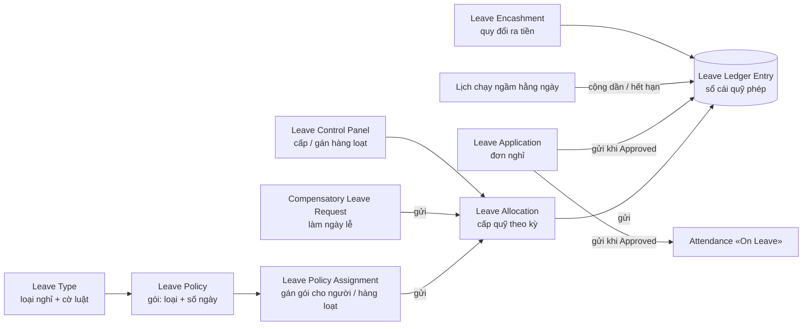
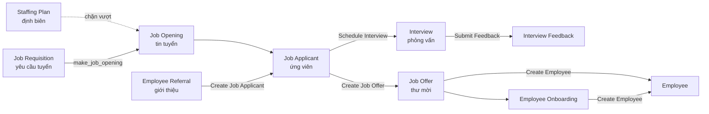

# App nhân sự `hrms` của ERPNext: chức năng và cách các chứng từ liên kết với nhau

| | |
|---|---|
| **Mã việc** | duoc-CR-709 |
| **Ngày viết** | 02/11/2026 · cập nhật 03/11/2026 (trạng thái DEGO ở §6 và Phụ lục A sau duoc-CR-713, duoc-CR-715) |
| **Mục đích** | Đi sâu từng chức năng nhân sự của nexterp (ERPNext + app `hrms`), đặc biệt là cách các chứng từ con **liên kết** với nhau và với hồ sơ nhân viên, rồi đối chiếu với phân hệ Nhân sự của DEGO để biết nên học gì. |
| **Nguồn** | App `hrms` nhánh `develop`, commit `ffadbbf` (01/11/2026), clone vào `dego-holding/nexterp/hrms` để đọc mã — khớp với lõi ERPNext `17.0.0-dev` đang có ở `nexterp/erpnext`. Đường dẫn trong tài liệu tính từ `nexterp/hrms/hrms/` (gọi tắt `hrms/`), trừ khi ghi rõ. |
| **Đọc trước** | `03-chuc-nang-nhan-su-erpnext-va-doi-chieu.md` (phần nhân sự trong LÕI ERPNext: hồ sơ Employee, phòng ban, chức danh, lịch nghỉ). Tài liệu này nói phần app `hrms` cài thêm. |

> **Phạm vi DEGO.** DEGO đã chốt **không làm chấm công và không làm lương** (16/10/2026). Các mục thuộc hai mảng
> đó vẫn được mô tả ngắn để hiểu liên kết, nhưng gắn nhãn «Ngoài phạm vi» và không đưa vào đề xuất.

---

## 1. Bản đồ: 9 workspace của `hrms`

Mỗi workspace là một mục trên thanh bên trái của nexterp (ảnh chụp màn «HR Setup» anh Được gửi ngày 02/11/2026).
Danh sách màn lấy từ `hrms/workspace_sidebar/*.json`.

| Workspace | Màn chính | Báo cáo | Thiết lập |
|---|---|---|---|
| **HR Setup** (Thiết lập nhân sự) | Employee (nhân viên), sơ đồ tổ chức | — | Company, Branch, Department, Designation, Employee Group, Employee Grade, HR Settings |
| **Tenure** (Vòng đời nhân viên) | Employee Onboarding (tiếp nhận), Employee Separation (cho nghỉ), Employee Grievance (khiếu nại) | Employee Exits, Employee Birthday, Employee Information, Employee Analytics | Employee Skill Map, Grievance Type, Training Program / Event / Feedback / Result |
| **Leaves** (Nghỉ phép) | Leave Application, Leave Encashment, Leave Control Panel, Leave Policy Assignment, Leave Allocation | Employee Leave Balance, Employee Leave Balance Summary, Employees working on a holiday | Holiday List, Holiday List Assignment, Leave Period, Leave Policy, Leave Block List, Leave Type |
| **Recruitment** (Tuyển dụng) | Job Opening, Job Applicant, Interview, Job Offer, Appointment Letter; nhóm *Planning*: Job Requisition, Staffing Plan, Employee Referral | Recruitment Analytics | Interview Type, Job Opening Template, Appointment Letter Template, Job Offer Term Template |
| **Performance** (Hiệu suất) | Goal, Appraisal Cycle, Appraisal, Employee Performance Feedback, Employee Promotion | Appraisal Overview | Appraisal Template, KRA, Employee Feedback Criteria |
| **Expenses** (Chi phí) | Expense Claim, Employee Advance; nhóm *Travel*: Purpose of Travel, Travel Request, Vehicle Log | Unpaid Expense Claim, Vehicle Expenses, sổ công nợ / sổ cái | Expense Claim Type, Driver, Vehicle |
| **Shift & Attendance** (Ca và chấm công) — *Ngoài phạm vi* | Attendance, Employee Attendance Tool, Employee Checkin, Shift Request, Attendance Request, Overtime | Monthly Attendance Sheet, Shift Attendance, giờ làm theo timesheet | Shift Type, Shift Location, Shift Schedule, Activity Type, Timesheet |
| **Payroll** (Lương) — *Ngoài phạm vi* | Payroll Entry, Salary Structure Assignment, Salary Slip, Additional Salary, Salary Withholding | Employee CTC Break-up, Salary Register, Income Tax Deductions | Salary Component, Salary Structure, Payroll Settings |
| **Tax & Benefits** (Thuế và phúc lợi) — *Ngoài phạm vi* | Employee Tax Exemption Declaration / Proof, Employee Benefit Application / Claim | Income Tax Computation, Accrued Earnings | Income Tax Slab, Employee Tax Exemption Category |

---

## 2. Hồ sơ nhân viên là «trục» nối mọi chứng từ

`hrms` không sửa doctype Employee của lõi mà **gắn thêm** vào nó ba thứ:

- **Lớp xử lý riêng**: `override_doctype_class = {"Employee": "hrms.overrides.employee_master.EmployeeMaster"}` (`hooks.py:165-166`).
- **Mã JS form riêng**: `public/js/erpnext/employee.js` và `employee_overview.js` (`hooks.py:54`).
- **Tab «Kết nối» (Connections)**: `override_doctype_dashboards` trỏ tới `overrides/dashboard_overrides.py:get_dashboard_for_employee` (`hooks.py:348-349`).

### 2.1 Tab «Kết nối» của hồ sơ nhân viên — 11 nhóm

Trên form nhân viên, tab cuối liệt kê mọi chứng từ đang trỏ vào người đó, có số đếm và nút «+» để tạo mới ngay với
nhân viên đã điền sẵn. Danh sách lấy nguyên ở `overrides/dashboard_overrides.py:7-63`:

| Nhóm | Chứng từ | Với DEGO |
|---|---|---|
| Attendance (chấm công) | Attendance, Attendance Request, Employee Checkin | Ngoài phạm vi |
| Leave (nghỉ phép) | Leave Application, Leave Allocation, Leave Policy Assignment, Holiday List Assignment | DEGO có đơn nghỉ + quỹ phép (tab «Quỹ phép» của hồ sơ) |
| Lifecycle (vòng đời) | Employee Onboarding, Employee Transfer, Employee Promotion, Employee Grievance | DEGO ghi chung trong «Quá trình công tác» |
| Employee Exit (nghỉ việc) | Employee Separation, Exit Interview, Full and Final Statement, Salary Withholding | DEGO có hộp kiểm việc treo khi cho nghỉ |
| Shift (ca) | Shift Request, Shift Assignment | Ngoài phạm vi |
| Expense (chi phí) | Expense Claim, Travel Request, Employee Advance | Chưa có |
| Benefit (phúc lợi) | Employee Benefit Application, Employee Benefit Claim | Ngoài phạm vi |
| Payroll (lương) | Salary Structure Assignment, Salary Slip, Additional Salary, Timesheet, Employee Incentive, Retention Bonus, Bank Account, Overtime Slip, Arrear, Payroll Correction | Ngoài phạm vi |
| Training (đào tạo) | Training Event, Training Result, Training Feedback, Employee Skill Map | Chưa có |
| Evaluation (đánh giá) | Appraisal | Chưa có |
| Contract (hợp đồng) | Contract | DEGO có Hợp đồng lao động |

Hai chi tiết đáng học trong cùng hàm:

- **Trỏ bằng trường khác tên**: chứng từ không dùng trường `employee` vẫn hiện được, nhờ khai `non_standard_fieldnames`
  (Bank Account trỏ bằng `party`, Contract bằng `party_name`, Employee Grievance bằng `raised_by`, Holiday List
  Assignment bằng `assigned_to`) và `dynamic_links` cho liên kết đa hình (`dashboard_overrides.py:65-77`).
- **Biểu đồ nhiệt chấm công** ở đầu form, dữ liệu từ `employee_master.get_timeline_data` (`dashboard_overrides.py:78-84`).

Lịch nghỉ (Holiday List) cũng có tab Kết nối riêng: Leave Period, Shift Type, Holiday List Assignment
(`dashboard_overrides.py:89-94`).

### 2.2 Việc chạy ngầm theo lịch (`hooks.py` `scheduler_events`)

| Nhịp | Việc | Nguồn |
|---|---|---|
| Hằng giờ (dài) | Đồng bộ lượt quẹt thẻ, tự chấm công theo ca, tự sinh ca theo lịch ca — *Ngoài phạm vi* | `hooks.py:267-270` |
| Hằng ngày | Gửi nhắc **sinh nhật**, nhắc **kỷ niệm ngày vào làm**, nhắc phản hồi phỏng vấn, tắt phân ca hết hạn, **tự đóng tin tuyển dụng hết hạn** | `hooks.py:272-278` |
| Hằng ngày (dài) | **Hết hạn quỹ phép chuyển năm**, tự sinh quy đổi phép ra tiền, **cộng dần phép tích lũy** (earned leave) | `hooks.py:280-283` |
| Hằng tuần / tháng | Gửi trước danh sách sinh nhật, kỷ niệm sắp tới | `hooks.py:285-286` |

---

<!-- Các mục 3–5 gộp từ ba phần nghiên cứu chi tiết (vòng đời; nghỉ phép; tuyển dụng – hiệu suất – chi phí). -->
## 3. Vòng đời nhân viên (workspace Tenure + HR Setup)

### 3.1 Ba «động cơ» liên kết dùng chung — hiểu ba cái này là hiểu cả app

| Động cơ | Làm gì | Ai dùng | Nguồn |
|---|---|---|---|
| **Ghi thay đổi vào hồ sơ + quá trình công tác** | Chứng từ có bảng «thuộc tính → giá trị cũ → giá trị mới» (`Employee Property History`). Khi gửi, hệ thống **ghi thẳng giá trị mới vào hồ sơ nhân viên** và **thêm một dòng `internal_work_history`** (quá trình trong công ty) có ngày hiệu lực. Khi hủy thì trả lại như cũ. | Điều chuyển, Thăng chức | `hr/utils.py:58-88` (`update_employee_work_history`) |
| **Phiếu checklist sinh dự án + việc** | Phiếu tiếp nhận / cho nghỉ việc có bảng hoạt động lấy từ mẫu. Khi gửi, hệ thống **tạo một Project và một Task cho mỗi hoạt động**, giao cho người được chỉ định hoặc **mọi người giữ vai trò** ghi trong mẫu; hạn việc **tự lùi qua ngày lễ**. Task xong thì trạng thái phiếu tự cập nhật; hủy phiếu thì xóa Project và Task. | Tiếp nhận, Cho nghỉ việc | `controllers/employee_boarding_controller.py:26-148`, `178-199` |
| **Tab Kết nối + nút «+»** | Mọi chứng từ trỏ vào nhân viên hiện ở hồ sơ, tạo mới từ đó thì nhân viên điền sẵn. | Mọi chứng từ ở mục 2.1 | `overrides/dashboard_overrides.py:7-84` |

### 3.2 Tiếp nhận nhân viên — `Employee Onboarding`

- **Dùng để:** quản lý danh sách việc phải làm khi đón một người mới (cấp máy, tạo email, ký giấy tờ, giới thiệu…).
- **Luồng:** lập từ thư mời nhận việc đã được chấp nhận, chọn mẫu `Employee Onboarding Template` để nạp hoạt động → **gửi** → sinh Project + Task (động cơ thứ hai) → nút **«Create Employee»** tạo hồ sơ nhân viên → nút **«Mark as Completed»** (`employee_onboarding.js:59`).
- **Luật chặn đáng học:** không cho tạo hồ sơ nhân viên khi phiếu chưa gửi, và khi **còn hoạt động đánh dấu «bắt buộc trước khi tạo nhân viên» chưa xong** (`employee_onboarding.py:69-83`). Chốt này chạy cả khi ai đó tạo nhân viên bằng tay có gắn thư mời (`overrides/employee_master.py:31-48`).
- **Liên kết:** mapper `make_employee` (`employee_onboarding.py:104`); hồ sơ nhân viên tạo xong được ghi ngược vào phiếu (`employee_master.py:48`).

### 3.3 Điều chuyển — `Employee Transfer`

- **Dùng để:** đổi phòng ban / công ty / các thuộc tính khác của nhân viên kèm ngày hiệu lực.
- **Luồng:** khai bảng thay đổi (trường nào, cũ → mới) → gửi. Không gửi được trước ngày điều chuyển (`employee_transfer.py:39-44`).
- **Hai kiểu:**
  - Giữ mã cũ: ghi thẳng thay đổi vào hồ sơ + thêm dòng quá trình (`employee_transfer.py:69`).
  - **Tạo mã nhân viên mới** (chuyển sang pháp nhân khác): sao hồ sơ sang mã mới, **chuyển tài khoản đăng nhập sang mã mới**, hồ sơ **cũ** chuyển «Left» (`employee_transfer.py:48-67`).
- **Liên kết:** hủy phiếu thì trả lại hồ sơ (`employee_transfer.py:75`).

### 3.4 Thăng chức — `Employee Promotion`

- **Dùng để:** đổi chức danh / cấp bậc / phòng ban khi thăng chức, kèm mức lương trước và sau.
- **Luồng:** nhân viên phải đang làm (`employee_promotion.py:38-39`), không gửi được trước ngày thăng chức (`:41-46`) → gửi: ghi thay đổi vào hồ sơ + thêm dòng quá trình, cập nhật `ctc` nếu có lương mới (`employee_promotion.py:48-55`) → hủy thì trả lại (`:57`).
- **Liên kết:** nằm trong workspace Performance, đi sau kết quả đánh giá (mục 5.2), nhưng không thấy mã tự tạo thăng chức từ phiếu đánh giá — **chưa kiểm**.

### 3.5 Cho nghỉ việc — `Employee Separation` → `Exit Interview` → `Full and Final Statement`

| Chứng từ | Làm gì | Luật / liên kết | Nguồn |
|---|---|---|---|
| `Employee Separation` (cho nghỉ việc) | Checklist bàn giao: thu hồi tài sản, khóa email, bàn giao việc… theo mẫu | Cùng động cơ checklist với tiếp nhận (Project + Task) | `employee_separation.py:41-47` |
| `Exit Interview` (phỏng vấn nghỉ việc) | Ghi buổi phỏng vấn, người phỏng vấn, kết luận giữ lại / xác nhận nghỉ | Bắt buộc hồ sơ đã có ngày nghỉ việc; mỗi người một phiếu; chỉ gửi khi trạng thái «Completed»; gửi xong ghi ngày phỏng vấn vào hồ sơ (`held_on`) | `exit_interview.py:49-78` |
| `Full and Final Statement` (quyết toán) | Gom khoản phải trả / phải thu / tài sản phải trả lại | Không gửi được khi còn khoản chưa tất toán (`validate_settlement`) — **Ngoài phạm vi** vì gắn lương và khoản vay | `full_and_final_statement.py:62-82` |

### 3.6 Khiếu nại — `Employee Grievance`

- Nhân viên nêu khiếu nại (`raised_by`) theo loại `Grievance Type`, có đối tượng bị khiếu nại, nguyên nhân, cách giải quyết, người chịu trách nhiệm.
- Chỉ gửi được khi trạng thái là «Resolved» hoặc «Invalid» (`employee_grievance.py:39-45`) — tức phiếu gửi là phiếu **đã đóng**.

### 3.7 Đào tạo và kỹ năng

| Chứng từ | Làm gì | Liên kết | Nguồn |
|---|---|---|---|
| `Training Program` | Chương trình đào tạo (mô tả, giảng viên / nhà cung cấp) | Mẹ của sự kiện | — |
| `Training Event` | Một khóa cụ thể: thời gian, địa điểm, danh sách học viên | Nút **«Training Result»**, **«Training Feedback»** trên form | `training_event.js:10-16` |
| `Training Result` | Kết quả từng học viên | Gửi xong: **khóa học chuyển «Completed»** và từng học viên chuyển «Completed» | `training_result.py:50-58` |
| `Training Feedback` | Học viên đánh giá khóa học | Gửi xong: học viên chuyển «Feedback Submitted»; hủy thì trả về | `training_feedback.py:52-63` |
| `Employee Skill Map` | Bản đồ kỹ năng + bảng các khóa đã học của một người | Có bảng `trainings`; không thấy mã tự đổ kết quả đào tạo vào — **chưa kiểm** | `employee_skill_map.py:19-25` |

### 3.8 Người duyệt theo phòng ban

`hrms` thêm ba trường người duyệt vào **Phòng ban**: người duyệt đổi ca, **danh sách người duyệt nghỉ phép**,
**danh sách người duyệt chi phí** (`setup.py:178-231`). Đơn nghỉ lấy người duyệt từ hồ sơ nhân viên trước, thiếu thì
lấy người **đầu tiên** trong danh sách của phòng (`leave_application.py:1550-1561`).

---

## 4. Nghỉ phép (workspace Leaves)

### 4.1 Dòng chảy quỹ phép

**Số dư không lưu thành cột** mà cộng từ sổ cái `Leave Ledger Entry`; mỗi lần cấp, nghỉ, hết hạn, quy đổi là một dòng
cộng / trừ.

### 4.2 Từng chứng từ

| Chứng từ | Làm gì | Liên kết / luật đáng chú ý | Nguồn |
|---|---|---|---|
| `Leave Type` (loại nghỉ) | Khai loại nghỉ và cờ luật: không lương, **cộng dần theo tháng / quý** (earned leave), **chuyển năm** (carry forward) và số ngày hết hạn phần chuyển, cho âm, tính cả ngày lễ, nghỉ bù, được quy đổi ra tiền, nghỉ sau N ngày vào làm | Là nguồn luật cho mọi chứng từ dưới | `leave_type.json` |
| `Leave Policy` + `Leave Policy Assignment` | Gói chính sách (vd «Nhân viên chính thức»: phép năm 12, ốm 5) gán cho người theo **kỳ phép** hoặc **ngày vào làm** | Gửi phân bổ là **tự cấp quỹ** cho từng loại trong gói; chặn gán chồng kỳ; có hàm gán hàng loạt | `leave_policy_assignment.py:57-70`, `:111`, `:523` |
| `Leave Control Panel` | Màn thao tác hàng loạt: lọc nhân viên, cấp quỹ hoặc gán gói cho cả nhóm, chỉ lấy người chưa có quỹ | — | `leave_control_panel.py:62`, `:98`, `:161` |
| `Leave Allocation` (cấp quỹ) | Cấp N ngày loại X cho một người trong một kỳ | Gửi / hủy ghi sổ cái; có hàm cho hết hạn phần chuyển năm bằng tay | `leave_allocation.py:112-128`, `:593` |
| `Compensatory Leave Request` (nghỉ bù) | Đi làm ngày lễ thì xin cộng ngày nghỉ bù | Chặn nếu ngày đó **không có chấm công đi làm**; gửi xong **cộng vào quỹ loại nghỉ bù** (cộng thêm vào quỹ đang có hoặc tạo mới) | `compensatory_leave_request.py:79`, `:94-127` |
| `Leave Application` (đơn nghỉ) | Nhân viên xin nghỉ, người duyệt chọn Approved / Rejected | Xem 4.3 | `leave_application.py` |
| `Leave Block List` | Danh sách ngày cấm nghỉ (theo công ty / phòng) | Lúc lập đơn chỉ **cảnh báo**; **chặn duyệt** đơn rơi vào ngày cấm | `leave_application.py:411-432` |
| `Leave Encashment` | Quy đổi phép dư ra tiền — **Ngoài phạm vi** (đi vào lương) | Gửi ghi sổ cái | `leave_encashment.py:73-89` |
| `Holiday List Assignment` | Gán lịch nghỉ lễ cho từng người / nhóm thay vì chỉ theo công ty | Hiện trong tab Kết nối của nhân viên và của lịch nghỉ | `dashboard_overrides.py:17`, `:70`, `:92` |

### 4.3 Đơn nghỉ — các chốt khi lưu và khi gửi

- **Khi lưu** (`leave_application.py:110-128`): nhân viên phải đang làm; kiểm ngày; **kiểm số dư** (bỏ qua loại không
  lương; đơn toàn ngày lễ thì báo «không cần xin») (`:434-473`); **chặn trùng ngày** với đơn khác (`:499`); trần số ngày
  liên tục; ngày cấm nghỉ; chặn sửa kỳ đã chạy lương; chặn nếu đã chấm công đi làm ngày đó; luật «chỉ được nghỉ sau N
  ngày vào làm»; **chặn tự duyệt đơn của mình** nếu bật trong HR Settings (`:873-884`); bắt buộc có người duyệt nếu bật
  (`:859-865`).
- **Khi tạo / đổi:** báo người duyệt ngay khi tạo (`:107-108`), chia sẻ đơn cho người duyệt và báo trạng thái mỗi lần
  đổi (`:130-133`).
- **Khi gửi** (`:135-156`): chỉ gửi được khi đã **Approved hoặc Rejected**; đơn Approved thì **tự tạo bản ghi chấm công
  «On Leave» cho từng ngày nghỉ, bỏ qua ngày lễ** (`:300-332`) và **ghi sổ cái trừ quỹ**. Hủy đơn thì hoàn sổ cái và hủy
  chấm công (`:166-170`).
- **Không giữ chỗ:** số ngày của đơn đang chờ duyệt chỉ được **hiển thị riêng** («leaves pending approval», `:1006-1013`),
  sổ cái chỉ trừ khi đơn đã duyệt và gửi.

### 4.4 Việc chạy ngầm của nghỉ phép

Hằng ngày: cho **hết hạn phần phép chuyển năm** (`leave_ledger_entry.py:154`), tự sinh quy đổi phép, **cộng dần phép
tích lũy** theo tần suất và ngày cấp khai ở loại nghỉ (`hr/utils.py:353-370`). Lịch chạy: `hooks.py:280-283`.

### 4.5 Ca và chấm công — *Ngoài phạm vi*

Chỉ ghi để hiểu liên kết: chấm công (`Attendance`) có thể do quẹt thẻ (`Employee Checkin`) và ca (`Shift Type`) tự
sinh hằng giờ (`hooks.py:267-270`), và **đơn nghỉ đã duyệt tự tạo chấm công «On Leave»** như mục 4.3. Nghỉ bù cũng dựa
vào chấm công đi làm ngày lễ. DEGO không có chấm công nên hai liên kết này không áp dụng.

---

## 5. Tuyển dụng, hiệu suất, chi phí

### 5.1 Tuyển dụng — chuỗi tám bước nối nhau bằng nút

| Bước | Liên kết / luật | Nguồn |
|---|---|---|
| Định biên → tin tuyển | Tin tuyển tự tìm định biên đang hiệu lực theo công ty + chức danh và **chặn mở quá số chỗ đã duyệt** | `job_opening.py:110-140`, `staffing_plan.py:273` |
| Yêu cầu tuyển → tin tuyển | Mapper chép chức danh, phòng ban, số chỗ, mô tả, mức lương dự kiến | `job_requisition.py:74-100` |
| Tin tuyển hết hạn | **Tự đóng** hằng ngày | `hooks.py:277` |
| Ứng viên | Nút **Shortlist / Reject / Schedule Interview / Create Job Offer / Create Employee** ngay trên hồ sơ ứng viên; tạo nhân viên chép tên, email, điện thoại | `job_applicant.js:69-107`, `job_applicant.py:120-153`, `:189` |
| Phỏng vấn | Chỉ gửi khi kết quả «Cleared» hoặc «Rejected», rồi hỏi có cập nhật trạng thái ứng viên không; nút **Submit Feedback** cho người phỏng vấn | `interview.py:50-56`, `:225`, `interview.js:62` |
| Phản hồi phỏng vấn | Chỉ người phỏng vấn được phân mới gửi được; không gửi trước ngày phỏng vấn; gửi / hủy **tính lại điểm trung bình** của buổi phỏng vấn | `interview_feedback.py:40-60` |
| Thư mời | Trạng thái Draft → Ready to Send → Awaiting Response → Accepted / Rejected; chặn hai thư mời còn hiệu lực cho một ứng viên | `job_offer.py:69-131` |
| Thư mời → nhân viên | Nút **Create Employee**: chép tên, email cá nhân, gắn thư mời, ngày offer | `job_offer.js:103`, `job_offer.py:248-262` |
| Nhân viên → thư mời | Tạo nhân viên có gắn thư mời thì **thư mời tự chuyển «Accepted»**; thư mời đã từ chối / hủy thì chặn | `overrides/employee_master.py:57-95` |
| Giới thiệu | Từ phiếu giới thiệu tạo ứng viên; thưởng giới thiệu đi qua `Additional Salary` (lương — *Ngoài phạm vi*) | `employee_referral.js:21-40` |

### 5.2 Đánh giá hiệu suất

| Chứng từ | Làm gì | Liên kết / luật | Nguồn |
|---|---|---|---|
| `Appraisal Cycle` (kỳ đánh giá) | Khai kỳ, nhóm nhân viên, mẫu, công thức điểm | Nút **Create Appraisals** tạo phiếu cho cả nhóm; **Start / Mark as Completed**; chặn đổi phương pháp khi đã có phiếu | `appraisal_cycle.js:34-67`, `appraisal_cycle.py:44-53`, `:133-190` |
| `Appraisal Template` + `KRA` | Mẫu đánh giá: các lĩnh vực kết quả chính và trọng số | — | — |
| `Goal` (mục tiêu) | **Cây mục tiêu** (mục tiêu cha – con), cập nhật tiến độ | Hàm cây và cập nhật tiến độ / trạng thái | `goal.py:165-278` |
| `Appraisal` (phiếu đánh giá) | Điểm mục tiêu, tự đánh giá, điểm phản hồi | **Điểm cuối = công thức của kỳ**, hoặc mặc định **trung bình ba điểm** (mục tiêu, phản hồi, tự đánh giá) | `appraisal.py:224-245` |
| `Employee Performance Feedback` | Đồng nghiệp / quản lý chấm theo tiêu chí | Không tự chấm cho mình; gửi / hủy **tính lại điểm phản hồi trung bình** trong phiếu đánh giá | `employee_performance_feedback.py:51-60` |

### 5.3 Chi phí và công tác

| Chứng từ | Làm gì | Liên kết / luật | Nguồn |
|---|---|---|---|
| `Employee Advance` (tạm ứng) | Nhân viên xin tạm ứng | Bắt buộc tài khoản tạm ứng; hoàn ứng bằng bút toán (`make_return_entry`) hoặc trừ lương (*Ngoài phạm vi*) | `employee_advance.py:69-92`, `:304-323` |
| `Expense Claim` (đề nghị thanh toán chi phí) | Kê khoản chi theo loại, kèm thuế, **cấn trừ tạm ứng** | Chỉ gửi khi đã Approved / Rejected; **chặn tự duyệt**; chia sẻ cho người duyệt; gửi xong: cập nhật chi phí vào Task / Project, **ghi sổ cái kế toán**, cập nhật số đã hoàn, **cập nhật số đã quyết toán của tạm ứng** | `expense_claim.py:217-220`, `:239-247` |
| `Travel Request` (đề nghị đi công tác) | Lịch trình, chi phí dự kiến, mục đích | Hiện trong nhóm Expense của hồ sơ | `dashboard_overrides.py:39` |
| `Vehicle Log` (nhật ký xe) | Số km, nhiên liệu, chi phí dịch vụ của xe công ty | Gửi xong **ghi số km cuối vào xe**; tạo đề nghị thanh toán chi phí xe từ nhật ký; hủy nhật ký thì gỡ khoản xe khỏi đề nghị nháp | `vehicle_log.py:46-73` |

### 5.4 Lương, thuế, phúc lợi — *Ngoài phạm vi*

Có đủ chuỗi cơ cấu lương → phân bổ lương → bảng lương → phiếu lương, khoản lương bổ sung, giữ lương, thưởng giữ chân,
truy lĩnh, khai miễn thuế, phúc lợi. DEGO đã chốt không làm nên không đi sâu; chỉ lưu ý nhiều chứng từ khác (giới thiệu,
tạm ứng, quy đổi phép, quyết toán nghỉ việc) **đẩy tiền qua lương** — đó là lý do phần «tiền» của chúng cũng nằm ngoài
phạm vi DEGO.

---

## 6. Với DEGO: nên học gì

DEGO đã có: hồ sơ nhân sự mở rộng, quá trình công tác ghi tay (6 loại sự kiện, tệp quyết định, nút «Áp» vào hồ sơ),
kiêm nhiệm, chức vụ + gói quyền tự cấp, khóa tài khoản khi nghỉ việc kèm hộp kiểm việc duyệt treo, hợp đồng lao động,
nghỉ phép (đơn nhiều loại + nhiều khoảng ngày, giữ chỗ quỹ khi gửi duyệt, luồng duyệt chung, lịch làm việc 4 cấp),
lịch nhắc sinh nhật / kỷ niệm / hợp đồng sắp hết, báo cáo nhân sự, phân hệ Dự án (task), Yêu cầu thanh toán, Đặt xe.

| Ưu tiên | Học gì từ `hrms` | Vì sao hợp với DEGO |
|---|---|---|
| **Cao** | **Checklist tiếp nhận / cho nghỉ việc sinh việc vào phân hệ Dự án**: mẫu hoạt động theo vai trò, gửi phiếu là tạo task giao đúng người, hạn tự lùi qua ngày lễ, chốt «việc bắt buộc xong mới tạo hồ sơ / mới khóa tài khoản» | DEGO đã có phân hệ Dự án và lịch làm việc; hiện việc đón / tiễn người chỉ làm bằng trí nhớ, và hộp kiểm việc treo khi nghỉ việc mới phủ việc **duyệt** |
| **Cao** | **Điều chuyển / bổ nhiệm thành chứng từ có duyệt**: duyệt xong tự ghi vào hồ sơ + quá trình công tác, hủy thì trả lại (kiểu `update_employee_work_history`) | DEGO đang «Áp» bằng tay từng dòng quá trình công tác; gắn vào luồng duyệt chung là có dấu vết ai cho phép |
| **Cao** | **Tab «Kết nối» trên hồ sơ nhân sự**: đếm và mở nhanh mọi chứng từ của người đó (đơn nghỉ, hợp đồng, quá trình công tác, đặt xe, yêu cầu mua hàng đã lập…), nút «+» tạo mới có điền sẵn | Màn hồ sơ vừa đổi khung kiểu ERPNext (duoc-CR-708); thêm tab này là bước tự nhiên, dữ liệu đã có sẵn ở các phân hệ |
| ~~**Trung bình**~~ **Đã có (duoc-CR-715)** | **Gói chính sách nghỉ theo cấp bậc + màn cấp quỹ hàng loạt** (Leave Policy, Leave Control Panel) | Làm theo kiểu gọn: tab «Hạn mức theo nhóm» ngay trên loại nghỉ (hình thức nhân viên > cấp bậc > hạn mức chung), cộng cách cấp quỹ theo tỷ lệ / cộng dần; nút «Cấp quỹ năm» sẵn có đóng vai màn cấp hàng loạt. Chưa có «gói» gán riêng từng người |
| ~~**Trung bình**~~ **Đã có (duoc-CR-715)** | **Ngày cấm nghỉ** (Leave Block List: cảnh báo lúc lập, chặn lúc duyệt) | Đúng hai nhịp như `hrms`; vai trò được duyệt qua khai ở Cài đặt nhân sự |
| **Trung bình** | **Phỏng vấn nghỉ việc + khiếu nại** dạng phiếu đơn giản | Có dữ liệu cho báo cáo nghỉ việc và giữ chân; khớp đề xuất «ghi lý do nghỉ việc» ở tài liệu 03 |
| **Trung bình** | **Nhật ký xe ↔ Đặt xe**: ghi số km cuối vào xe, sinh đề nghị thanh toán chi phí xe | DEGO đã có Đặt xe và Yêu cầu thanh toán, thiếu khâu ghi km / chi phí sau chuyến |
| **Thấp** | Đào tạo (chương trình, khóa, kết quả, phản hồi) + bản đồ kỹ năng | Cần khi công ty có kế hoạch đào tạo chính thức |
| **Thấp** | Tuyển dụng đủ chuỗi (định biên → tin → ứng viên → phỏng vấn → thư mời → nhân viên) | Lớn; DEGO vừa gỡ «Kế hoạch nhân sự» (duoc-CR-692), nên phần định biên cần quyết lại trước |
| **Thấp** | Đánh giá hiệu suất (kỳ, mục tiêu dạng cây, công thức điểm) | Lớn, phụ thuộc chính sách đánh giá của công ty |
| — | Ca, chấm công, lương, thuế, quy đổi phép ra tiền, quyết toán nghỉ việc | **Ngoài phạm vi (đã chốt không làm)** |

**Cập nhật 03/11/2026 — đã làm sau khi viết tài liệu này** (chi tiết ở [`doc/erp/hrm/02-nghi-phep.md`](../../hrm/02-nghi-phep.md) §13–§14 và [`01-ho-so-nhan-su.md`](../../hrm/01-ho-so-nhan-su.md) §7.17):

| Chức năng `hrms` | DEGO | Khác `hrms` ở đâu |
|---|---|---|
| Leave Type: earned leave, nghỉ sau N ngày vào làm, cho âm | **Đã có (duoc-CR-715)** — `accrual_mode` (đủ đầu năm / theo tỷ lệ tháng vào làm / cộng dần theo tháng), `applicable_after_days`, `max_negative_days` | Cộng dần tính động khi xem số dư, không có việc chạy ngầm cộng phép; không có sổ công nợ phép |
| Leave Policy (quỹ theo nhóm) | **Đã có một phần (duoc-CR-715)** — bảng `tab_leave_type_quota` theo hình thức nhân viên / cấp bậc | Không có gói gán riêng từng người, không có Leave Control Panel riêng |
| Leave Block List | **Đã có (duoc-CR-715)** | Chặn ở duyệt chặng cuối bằng `HookVeto`; miễn theo vai trò ở Cài đặt nhân sự |
| Compensatory Leave Request | **Đã có (duoc-CR-715)** — phiếu nghỉ bù, khóa `leave_comp_request` | Không dựa chấm công: kiểm ngày lễ + lịch làm việc của người đó; luôn chặn tự duyệt; giữ chỗ «một ngày một phiếu» |
| HR Settings | **Một phần (duoc-CR-713)** — trang Cài đặt nhân sự, ba tab Nhân viên · Nghỉ phép · Hợp đồng lao động | Chỉ lấy các cài đặt hợp phạm vi DEGO (chặn đơn lùi ngày + vai trò miễn, chặn tự duyệt, vai trò duyệt qua ngày cấm nghỉ, tiền tố mã, sơ đồ tổ chức, mốc kỷ niệm, ngày báo HĐLĐ); bỏ tab Chi phí, Chấm công, Tuyển dụng |

**Điều DEGO đang làm tốt hơn `hrms`** (giữ nguyên, đừng «học ngược»): đơn nghỉ nhiều loại + nhiều khoảng ngày; giữ chỗ quỹ
ngay khi gửi duyệt (`hrms` chỉ hiển thị số chờ duyệt, không giữ chỗ — `leave_application.py:1006-1013`); phạm vi dữ liệu
theo vai trò thay vì quyền theo từng bản ghi; trường nhạy cảm che ở tầng API.

---

## 7. Câu hỏi còn treo

1. Ba đề xuất ưu tiên Cao làm cái nào trước? Đề nghị: tab «Kết nối» (nhỏ, dùng ngay) → checklist tiếp nhận / nghỉ việc →
   điều chuyển có duyệt.
2. Checklist tiếp nhận / nghỉ việc có chặn cứng (chưa xong việc bắt buộc thì không khóa tài khoản) hay chỉ nhắc?
3. Có giữ bản clone `nexterp/hrms` để tra cứu tiếp không (chỉ đọc, không chạy)?

> Ghi chú nguồn: ba bản nghiên cứu nháp ở thư mục [`ban-nhap-hrms/`](ban-nhap-hrms/). Mọi trích dẫn trong tài liệu
> này đã được kiểm lại trực tiếp với mã; chỗ nháp ghi sai đã sửa (vd «điều chuyển tạo mã mới thì hồ sơ **cũ** chuyển
> Left», «đơn nghỉ đã duyệt có tự tạo chấm công»).

---

## Phụ lục A. Danh sách đầy đủ chức năng con của module nhân sự

Lấy thẳng từ mã: mọi doctype **không phải bảng con** của app `hrms` (104 doctype, quét `hrms/*/doctype/*/*.json` bỏ
`istable`) cộng các danh mục của lõi ERPNext hiện trên workspace; xếp theo workspace ở `hrms/workspace_sidebar/*.json`.
Ba doctype hệ thống không phải nghiệp vụ bị bỏ: HR Telemetry Milestone, PWA Notification, Interest.

Ký hiệu: **[P]** = chứng từ có bước gửi (submit), khi gửi mới tự cập nhật sang chỗ khác · **[1]** = màn một trang
(cấu hình hoặc thao tác hàng loạt). Cột DEGO: **Có** · **Một phần** · **Chưa** · **Ngoài** (ngoài phạm vi, đã chốt không làm) · **Đã có (CR)** = làm sau ngày viết tài liệu, kèm mã việc.

### A.1 HR Setup — Thiết lập nhân sự

| Chức năng | Nghĩa | DEGO |
|---|---|---|
| Employee | Hồ sơ nhân viên | Có |
| Sơ đồ tổ chức | Cây người quản lý → nhân viên | Có |
| Company · Branch · Department · Designation *(lõi ERPNext)* | Công ty · Chi nhánh · Phòng ban · Chức danh | Có (chưa có Chi nhánh) |
| Employee Group *(lõi ERPNext)* | Nhóm nhân viên tự đặt | Chưa |
| Employee Grade | Cấp bậc (gắn chính sách nghỉ, lương) | Một phần (cấp bậc cố định 7 mức) |
| Employment Type | Hình thức làm việc | Có |
| Identification Document Type | Loại giấy tờ tùy thân | Một phần (chỉ CCCD) |
| Employee Health Insurance | Bảo hiểm sức khỏe | Một phần (số BHXH, nơi khám BHYT) |
| HR Settings [1] | Cấu hình nhân sự chung | Một phần — trang Cài đặt nhân sự (duoc-CR-713): tab Nhân viên, Nghỉ phép, Hợp đồng lao động |

### A.2 Tenure — Vòng đời nhân viên

| Chức năng | Nghĩa | DEGO |
|---|---|---|
| Employee Onboarding [P] + Employee Onboarding Template | Tiếp nhận người mới, checklist sinh việc | Chưa |
| Employee Transfer [P] | Điều chuyển (tự ghi vào hồ sơ) | Một phần (ghi tay ở Quá trình công tác) |
| Employee Promotion [P] | Thăng chức (tự ghi vào hồ sơ) | Một phần (ghi tay) |
| Employee Separation [P] + Employee Separation Template | Cho nghỉ việc, checklist bàn giao | Một phần (hộp kiểm việc duyệt treo) |
| Exit Interview [P] | Phỏng vấn nghỉ việc | Chưa |
| Full and Final Statement [P] | Quyết toán khi nghỉ | Ngoài |
| Employee Grievance [P] + Grievance Type | Khiếu nại và loại khiếu nại | Chưa |
| Employee Skill Map + Skill | Bản đồ kỹ năng | Chưa |
| Training Program · Training Event [P] · Training Result [P] · Training Feedback [P] | Chương trình · Khóa học · Kết quả · Phản hồi đào tạo | Chưa |
| *Báo cáo:* Employee Exits, Employee Birthday, Employee Information, Employee Analytics | Nghỉ việc, sinh nhật, thông tin, phân tích nhân sự | Có (báo cáo nhân sự, lịch nhắc) |

### A.3 Leaves — Nghỉ phép

| Chức năng | Nghĩa | DEGO |
|---|---|---|
| Leave Type | Loại nghỉ | Có — thêm cách cấp quỹ (tỷ lệ / cộng dần), dùng sau N ngày, ứng phép, loại nhận nghỉ bù (duoc-CR-715) |
| Leave Period | Kỳ phép | Có (theo năm) |
| Leave Policy [P] + Leave Policy Assignment [P] | Gói chính sách nghỉ và gán gói | Đã có một phần (duoc-CR-715) — hạn mức theo hình thức nhân viên / cấp bậc trên từng loại nghỉ; chưa có gói gán riêng từng người |
| Leave Allocation [P] | Cấp quỹ phép | Có — cấp theo tỷ lệ tháng vào làm hoặc cộng dần (duoc-CR-715) |
| Leave Control Panel [1] | Cấp quỹ / gán gói hàng loạt | Một phần — nút «Cấp quỹ năm» cấp cả công ty theo hạn mức nhóm; chưa lọc nhóm, chưa gán gói |
| Leave Application [P] | Đơn xin nghỉ | Có (đơn nhiều loại, nhiều khoảng) |
| Leave Adjustment [P] | Điều chỉnh quỹ phép | Có (sửa quỹ) |
| Leave Ledger Entry | Sổ cái quỹ phép (tự sinh) | Một phần (số dư tính động) |
| Compensatory Leave Request [P] | Xin nghỉ bù khi làm ngày lễ | Đã có (duoc-CR-715) — kiểm theo ngày lễ + lịch làm việc, không dựa chấm công |
| Leave Block List | Ngày cấm nghỉ | Đã có (duoc-CR-715) |
| Leave Encashment [P] | Quy đổi phép ra tiền | Ngoài |
| Holiday List *(lõi ERPNext)* · Holiday List Assignment [P] | Lịch nghỉ lễ · Gán lịch theo người | Có (ngày lễ + lịch làm việc 4 cấp) |
| *Báo cáo:* Employee Leave Balance, Employee Leave Balance Summary, Employees working on a holiday | Số dư phép, tổng hợp, người đi làm ngày lễ | Có (hai báo cáo đầu) |

### A.4 Recruitment — Tuyển dụng

| Chức năng | Nghĩa | DEGO |
|---|---|---|
| Staffing Plan [P] | Định biên | Chưa (Kế hoạch nhân sự đã gỡ ở duoc-CR-692) |
| Job Requisition | Yêu cầu tuyển | Chưa |
| Job Opening + Job Opening Template | Tin tuyển dụng và mẫu tin | Chưa |
| Job Applicant + Job Applicant Source | Ứng viên và nguồn ứng viên | Chưa |
| Interview [P] · Interview Type · Interview Feedback [P] | Phỏng vấn · Loại phỏng vấn · Phản hồi | Chưa |
| Job Offer [P] · Offer Term · Job Offer Term Template | Thư mời nhận việc và điều khoản | Chưa |
| Appointment Letter + Appointment Letter Template | Thư bổ nhiệm và mẫu | Chưa |
| Employee Referral [P] | Nhân viên giới thiệu ứng viên | Chưa |
| *Báo cáo:* Recruitment Analytics | Phân tích tuyển dụng | Chưa |

### A.5 Performance — Hiệu suất

| Chức năng | Nghĩa | DEGO |
|---|---|---|
| Appraisal Cycle | Kỳ đánh giá | Chưa |
| Appraisal Template · KRA | Mẫu đánh giá · Lĩnh vực kết quả chính | Chưa |
| Goal | Mục tiêu dạng cây | Chưa |
| Appraisal [P] | Phiếu đánh giá (điểm theo công thức) | Chưa |
| Employee Performance Feedback [P] + Employee Feedback Criteria | Phản hồi hiệu suất và tiêu chí | Chưa |
| *Báo cáo:* Appraisal Overview | Tổng quan đánh giá | Chưa |

### A.6 Expenses — Chi phí và công tác

| Chức năng | Nghĩa | DEGO |
|---|---|---|
| Employee Advance [P] | Tạm ứng nhân viên | Chưa |
| Expense Claim [P] + Expense Claim Type | Đề nghị thanh toán chi phí và loại chi phí | Một phần (Yêu cầu thanh toán bên thu mua) |
| Travel Request [P] + Purpose of Travel | Đề nghị công tác và mục đích | Chưa |
| Vehicle Log [P] + Vehicle Service Item · Driver · Vehicle *(lõi ERPNext)* | Nhật ký xe, hạng mục bảo dưỡng · Tài xế · Xe | Một phần (Đặt xe có xe, tài xế) |
| *Báo cáo:* Unpaid Expense Claim, Vehicle Expenses | Chi phí chưa trả, chi phí xe | Chưa |

### A.7 Shift & Attendance — Ca và chấm công *(Ngoài)*

Attendance [P] · Employee Attendance Tool [1] · Employee Checkin · Attendance Request [P] · Shift Type · Shift Assignment [P] ·
Shift Assignment Tool [1] · Shift Request [P] · Shift Schedule [P] · Shift Schedule Assignment · Shift Location · Overtime Type ·
Overtime Slip [P]. Báo cáo: Monthly Attendance Sheet, Shift Attendance, giờ làm theo timesheet.

### A.8 Payroll — Lương *(Ngoài)*

Salary Component · Salary Structure [P] · Salary Structure Assignment [P] · Bulk Salary Structure Assignment [1] · Payroll Period ·
Payroll Entry [P] · Salary Slip [P] · Additional Salary [P] · Salary Withholding [P] · Arrear [P] · Payroll Correction [P] ·
Employee Incentive [P] · Retention Bonus [P] · Employee Other Income [P] · Gratuity [P] + Gratuity Rule · Payroll Settings [1].
Báo cáo: Employee CTC Break-up, Salary Register.

### A.9 Tax & Benefits — Thuế và phúc lợi *(Ngoài)*

Income Tax Slab [P] · Employee Tax Exemption Category / Sub Category · Employee Tax Exemption Declaration [P] ·
Employee Tax Exemption Proof Submission [P] · Employee Benefit Application [P] · Employee Benefit Claim [P] · Employee Benefit Ledger.
Báo cáo: Income Tax Computation, Income Tax Deductions, Accrued Earnings.

**Tổng hợp** (không tính ba mục Ngoài): DEGO đã có hoặc có một phần khoảng một phần ba; trống nhiều nhất là **vòng
đời** (tiếp nhận, nghỉ việc có checklist, khiếu nại, đào tạo), **tuyển dụng** và **hiệu suất**.

---

## Phụ lục B. Tiện ích khung chung của Frappe trên mọi chứng từ

Thanh bên phải (Chỉ định · Tập tin đính kèm · Thẻ · Chia sẻ · Sửa lần cuối / Được tạo bởi) và khối «Bình luận» +
«Hoạt động» cuối form (ảnh chụp anh Được gửi ngày 02/11/2026) **không thuộc app nhân sự** mà là khung chung của Frappe
— chứng từ nào trên nexterp cũng có. Mã nguồn Frappe **không có trong repo**: phần mô tả dưới đây theo hiểu biết về
Frappe, **chưa đối chiếu mã**; cột DEGO đã kiểm trong code DEGO.

| Chức năng (nexterp) | Làm gì | DEGO hiện có |
|---|---|---|
| **Chỉ định** (Assigned To) | Giao chứng từ cho một / nhiều người → tạo việc cần làm (ToDo), báo thông báo, hiện ảnh người được giao ở thanh bên; có luật tự giao theo điều kiện; chứng từ xong thì việc tự đóng | **Chưa** cho chứng từ bất kỳ (phân hệ Dự án có giao việc nhưng không gắn vào chứng từ khác) |
| **Tập tin đính kèm** | Kéo thả tệp vào bất kỳ chứng từ nào, riêng tư / công khai | **Có lõi**: `tab_file` + `tab_file_link` gắn theo cặp (entity, id) ở `backend/app/modules/attachment/model.py`, giao diện `frontend-v2/src/shared/attachments`; hồ sơ nhân sự **chưa gắn** |
| **Thẻ** (Tags) | Gắn nhãn tự do vào chứng từ, lọc danh sách theo thẻ | **Chưa** |
| **Chia sẻ** (Share) | Cho riêng một người quyền đọc / sửa đúng một chứng từ dù vai trò không có quyền | **Chưa — cố ý**: DEGO giới hạn bằng phạm vi dữ liệu theo vai trò; chia sẻ từng bản ghi là thêm một cửa vượt phạm vi, nhất là với hồ sơ có dữ liệu nhạy cảm |
| **Sửa lần cuối bởi / Được tạo bởi** | Ai tạo, ai sửa cuối, bao lâu trước | **Một phần**: thanh bên có «Cập nhật lần cuối» (giờ, chưa có tên người); người tạo / sửa có trong nhật ký thao tác |
| **Hoạt động** — dòng lịch sử | «A đã đổi Công ty **từ X sang Y**, Bộ phận **từ … sang …**» — giá trị cũ → mới ngay trên dòng | **Một phần**: «Lịch sử thao tác» ghi ai làm gì lúc nào, «Cập nhật (1 trường)» kèm liên kết sang nhật ký hệ thống; chưa hiện cũ → mới tại chỗ |
| **Bình luận** | Trao đổi ngay trên chứng từ, nhắc tên bằng `@` | **Có lõi**: `tab_comment` (+ nhắc tên, thả cảm xúc) gắn theo (entity, id) ở `backend/app/modules/comment/model.py`; đang dùng ở chứng từ thu mua, Dự án, Diễn đàn; hồ sơ nhân sự **chưa gắn** |
| **Email mới** | Soạn email từ chứng từ; thư gửi / thư trả lời tự gắn vào dòng hoạt động | **Chưa** |
| **Sự kiện mới** | Tạo lịch hẹn gắn với chứng từ | **Chưa** (có Đặt phòng họp nhưng không gắn chứng từ) |
| Tiện ích khác cùng loại | Theo dõi chứng từ, nhắc tôi lúc hẹn giờ, sao chép link, nhân bản, nút ‹ › qua bản ghi trước / sau | Chưa |

**Đề xuất áp vào màn hồ sơ nhân sự:**

| Ưu tiên | Việc | Ghi chú |
|---|---|---|
| **Cao, rẻ** | Gắn **Bình luận** dưới «Lịch sử thao tác», gom thành khối «Hoạt động» | Dùng lại lõi bình luận, khai entity `employee`; ai xem được hồ sơ mới thấy bình luận |
| **Cao, rẻ** | Gắn **Tệp đính kèm** vào thanh bên phải (đếm số tệp, nút «+») | Dùng lại `shared/attachments`; tệp có thể chứa giấy tờ nhạy cảm → gác bằng `employee_sensitive` |
| Trung bình | «Sửa lần cuối bởi **tên người**» và «Được tạo bởi …» ở thanh bên | Lấy từ nhật ký thao tác, không thêm cột |
| Trung bình | Dòng lịch sử hiện **cũ → mới** | Cần kiểm nhật ký có lưu giá trị cũ / mới không; **che trường nhạy cảm và lương** |
| Trung bình | **Chỉ định**: giao hồ sơ cho người phụ trách bổ sung, sinh việc bên phân hệ Dự án | Khớp đề xuất checklist tiếp nhận / nghỉ việc ở mục 6 |
| Thấp | **Thẻ** + lọc theo thẻ | Bảng dùng chung, làm một lần cho mọi phân hệ |
| Không nên | **Chia sẻ từng bản ghi** | Phá mô hình phạm vi dữ liệu |
| Thấp | Email mới / Sự kiện mới từ chứng từ | Cần hạ tầng email gửi / nhận gắn chứng từ |
