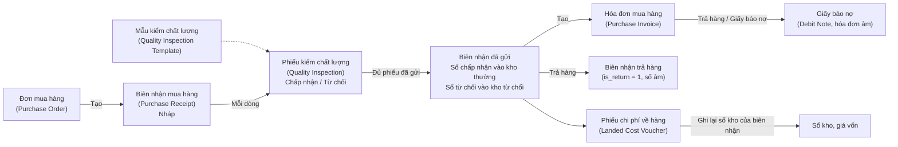
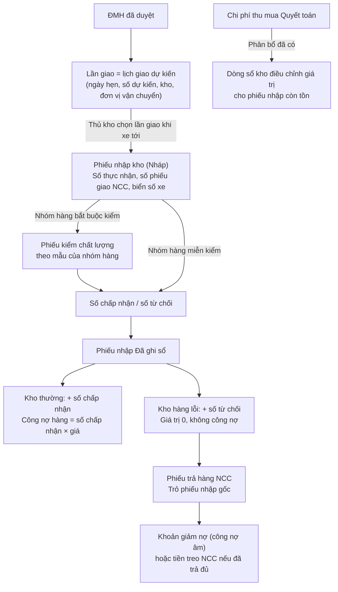

# NHẬN HÀNG, KIỂM CHẤT LƯỢNG, TRẢ HÀNG VÀ CHI PHÍ NHẬP — ERPNEXT V16 SO VỚI ERP DEGO

| | |
|---|---|
| Bản | 1.0 — 02/11/2026 |
| Mục đích | Hiểu đúng cách ERPNext v16 làm mảng **Nhận hàng và Chất lượng** (Receiving & Quality), đặt cạnh ERP DEGO, chấm độ phủ và đề xuất cách làm kho cho DEGO |
| Mốc so sánh | ERPNext 16.53.0, Frappe 16.54.0 trên site học `erpnext.degoholding.vn` (site `frontend`, container `erpnext-hoc-backend-1` ở VPS 2), mã nguồn `frappe/erpnext` nhánh `version-16`, tài liệu `docs.erpnext.com` |
| Mã soát | nhánh `erp-v2`, commit `601ec718`, ngày 02/11/2026 (`backend/app/modules`, `frontend-v2/src/modules`) |
| Cách soát | Chỉ đọc. Trên site học chỉ chạy câu `select` và `grep` mã nguồn; không ghi dữ liệu, không sửa mã DEGO |
| Đọc kèm | [01 Luồng chuẩn mua hàng, kho, sản xuất](../../../plans/01-luong-chuan-mua-hang-kho-san-xuat.md) (mục 3.6 tới 3.12, mục 7 điểm a tới h, mục 8 ba nấc) · [11 Độ phủ thu mua, kho](../../thu-mua/nghien-cuu/11-do-phu-thu-mua-kho-so-voi-erpnext.md) (mục E, F3) · [09 Nghiệp vụ mua hàng](../../thu-mua/nghien-cuu/09-nghiep-vu-mua-hang.md) (mục 11, nhóm A mục 13) · [10 Nghiệp vụ kho](../../kho/nghien-cuu/10-nghiep-vu-kho.md) (mục 6, 9.4, 13.1) · [ERPNext 01 Hướng dẫn mua hàng tới thanh toán](../../thu-mua/nghien-cuu/erpnext-01-huong-dan-mua-hang-den-thanh-toan-va-kho.md) (mục 0.4, Phần C) · [Chi phí thu mua bao-CR-453](../../nhap-khau/02-chi-phi-thu-mua.md) |

## Mục lục

1. [Kết luận trong một trang](#1-kết-luận-trong-một-trang)
2. [Phạm vi và cách chấm](#2-phạm-vi-và-cách-chấm)
3. [ERPNext v16 làm mảng này thế nào](#3-erpnext-v16-làm-mảng-này-thế-nào)
4. [ERP DEGO hiện có gì](#4-erp-dego-hiện-có-gì)
5. [Bảng fit-gap và tỷ lệ phủ](#5-bảng-fit-gap-và-tỷ-lệ-phủ)
6. [Đề xuất cho DEGO](#6-đề-xuất-cho-dego)
7. [Kế hoạch theo nấc](#7-kế-hoạch-theo-nấc)
8. [Nguồn](#8-nguồn)

---

## 1. Kết luận trong một trang

- Trên **23 chức năng** của mảng nhận hàng, kiểm chất lượng, trả hàng và chi phí nhập, ERP DEGO phủ **8 / 23 = 35 %** so với ERPNext v16. Con số thấp hơn mức 43 % của chặng E ở doc 11 vì bản này tính thêm trả hàng, giảm nợ, chi phí nhập vào giá kho và các báo cáo nhận hàng, là những chỗ DEGO gần như chưa có.
- ERPNext đặt mảng này trên **ba chứng từ có dòng riêng**: **biên nhận mua hàng** (Purchase Receipt) do thủ kho lập, **phiếu kiểm chất lượng** (Quality Inspection) theo mẫu chỉ tiêu, **phiếu chi phí về hàng** (Landed Cost Voucher). Trả hàng và giảm nợ là **chính các chứng từ đó với số âm**, trỏ về chứng từ gốc. Mọi thứ đều Nháp, Gửi, Hủy; không sửa sau khi gửi.
- ERP DEGO gộp tất cả vào **một dòng lần giao** trên ĐMH (`tab_po_delivery`). Lưu ĐMH là sinh ngầm phiếu nhập, dòng sổ kho và công nợ; xóa lần giao là xóa cả ba. Kết quả kiểm chỉ là một ô chữ `qc_result` cho cả lần giao, và **giao diện v2 không còn ô nhập kết quả kiểm** (chỉ v1 đóng băng mới nhập được).
- DEGO **mạnh hơn** ERPNext ở chi phí thu mua: ba giai đoạn dự toán, tạm tính, quyết toán ngay từ lúc lập đơn, năm cách chia (ERPNext chỉ có ba), công nợ riêng cho từng khoản chi phí. Nhưng kết quả chia **chỉ để xem**, chưa vào giá kho.
- Năm điểm **mất tiền hoặc sai số** cần làm trước: hàng lỗi vẫn sinh công nợ đủ; không có số chấp nhận, số từ chối; không có dung sai nhận vượt (dữ liệu thật có **128 mặt hàng** từng nhận vượt, 1 tới 25 %, phần lớn là bao bì in); không có phiếu trả hàng và khoản giảm nợ; giá kho hàng nhập khẩu thiếu phần chi phí (khoảng 5 % theo ví dụ doc 01 mục 3.8).
- Một bẫy cần biết khi dùng ERPNext làm mốc: site học đang bật **Bill for Rejected Quantity in Purchase Invoice**, tức là hóa đơn lập từ biên nhận **vẫn kéo cả số từ chối**. Muốn hàng lỗi không sinh nợ phải tắt cài đặt này. DEGO nên chọn hành vi tắt làm mặc định cứng.
- Đề xuất đi theo ba nấc của doc 01 mục 8: **nấc 1** thêm số chấp nhận, từ chối, bộ mã kết quả kiểm, dung sai theo nhóm hàng ngay trên lần giao, công nợ tính theo số chấp nhận; **nấc 2** phiếu nhập kho của thủ kho, kho hàng lỗi, mẫu chỉ tiêu kiểm theo nhóm hàng, phiếu trả hàng kèm khoản giảm nợ, đẩy chi phí thu mua vào giá kho; **nấc 3** hóa đơn NCC đối chiếu bốn chiều với số chấp nhận, giấy báo nợ chính thức. Làm xong nấc 1 thì mảng này lên khoảng **54 %**, xong cả nấc 2 thì khoảng **91 %**.

## 2. Phạm vi và cách chấm

**Trong phạm vi:** từ lúc hàng tới cổng kho tới lúc số hàng, số nợ và giá kho của lô đó đã đúng. Gồm biên nhận, nhận nhiều lần, nhận vượt, kiểm chất lượng, hàng từ chối, trả hàng, giảm nợ, chi phí về hàng, các báo cáo nhận và lập hóa đơn.

**Ngoài phạm vi:** xuất kho, chuyển kho, kiểm kê, cách tính giá xuất (xem doc 10 và doc 01 mục 3.8); hóa đơn NCC và đối chiếu ba chiều (chỉ nhắc chỗ giao nhau).

**Cách chấm** giống doc 11 mục 2: **Có** = 1 điểm, **Một phần** = 0,5, **Chưa** = 0. Chức năng ERPNext không có mà DEGO có vẫn tính điểm cho DEGO.

---

## 3. ERPNext v16 làm mảng này thế nào

### 3.0. Bức tranh chung



Mỗi chứng từ có vòng đời **Nháp → Gửi (Submit) → Hủy (Cancel) → Sửa đổi (Amend)**. Chỉ lúc **Gửi** mới ghi sổ kho và sổ kế toán. Sau khi gửi không sửa được; muốn sai thì hủy (hệ thống ghi đảo bút toán) rồi sửa đổi thành bản mới.

### 3.1. Biên nhận mua hàng (Purchase Receipt)

**Là gì.** Chứng từ kho ghi nhận hàng thật sự về kho. Đây là nơi duy nhất trong chuỗi mua làm **tăng tồn**.

**Dùng khi nào.** Mỗi lần xe hàng tới. Thủ kho mở ĐMH đã duyệt, bấm **Tạo → Biên nhận mua hàng**, sửa số theo số đếm thực tế rồi gửi.

**Trường chính trên dòng** (`Purchase Receipt Item`):

| Trường | Nghĩa |
|---|---|
| `received_qty` | Số **thực nhận** = chấp nhận + từ chối |
| `qty` | Số **chấp nhận** (Accepted Qty), vào kho `warehouse` |
| `rejected_qty` | Số **từ chối**, vào kho `rejected_warehouse` |
| `warehouse`, `rejected_warehouse` | Kho nhận hàng đạt, kho chứa hàng từ chối. Đầu phiếu có `set_warehouse`, `rejected_warehouse` để điền sẵn cho mọi dòng |
| `quality_inspection` | Liên kết phiếu kiểm của dòng |
| `batch_no`, `serial_and_batch_bundle`, `rejected_serial_and_batch_bundle` | Lô, số serial cho hàng đạt và hàng từ chối |
| `purchase_order`, `purchase_order_item` | Trỏ về dòng ĐMH |
| `billed_amt` | Số tiền của dòng đã lên hóa đơn |
| `returned_qty` | Số đã trả lại NCC |
| `landed_cost_voucher_amount` | Phần chi phí về hàng đã cộng vào dòng |
| `valuation_rate` | Đơn giá ghi sổ kho = giá mua + thuế không khấu trừ + chi phí về hàng, chia số lượng |

**Đầu phiếu:** `per_billed` (% đã lập hóa đơn), `per_returned` (% đã trả), `status` (Nháp, Chờ lập hóa đơn `To Bill`, Lập hóa đơn một phần `Partly Billed`, Hoàn thành `Completed`, Trả hàng `Return`, Đã trả hàng `Return Issued`, Đóng `Closed`, Hủy).

**Luật chính:**

1. **Lập từ ĐMH, nhận nhiều lần.** Lần sau bấm Tạo, hệ thống tự điền **phần còn lại**. ĐMH hiện `per_received`. Ví dụ trên site: ĐMH **PUR-ORD-2026-00404** nhận đợt 1 bằng **MAT-PRE-2026-00371** (3.000 chai), ĐMH hiện 60 %.
2. **Số đẩy về ĐMH là số thực nhận**, gồm cả phần từ chối (`received_qty × conversion_factor` cộng vào `Purchase Order Item.received_qty`). Nghĩa là hàng từ chối vẫn tính là NCC **đã giao**; nếu muốn NCC giao bù thì phải trả hàng (mục 3.6) để số đã nhận giảm xuống.
3. **Chặn nhận vượt** theo dung sai (mục 3.2).
4. **Chỉ phần chấp nhận ghi vào kho thường** và vào bút toán Nợ hàng tồn kho / Có *Stock Received But Not Billed* (tài khoản tạm hàng về chưa có hóa đơn). Phần từ chối ghi vào sổ của kho từ chối **với giá trị 0**, trừ khi bật `set_valuation_rate_for_rejected_materials` (mục 3.3).
5. **Thuế GTGT không ghi ở biên nhận**; chỉ ghi khi có hóa đơn.
6. Trên site học đang có **365 biên nhận đã gửi**, phần lớn đồng bộ từ ERP DEGO; mẫu hướng dẫn là **MAT-PRE-2026-00369** (20.000 chai, đơn giá ghi sổ 3.500).

### 3.2. Dung sai nhận vượt (Over Delivery/Receipt Allowance)

**Là gì.** Phần trăm cho phép nhận nhiều hơn số đặt trên ĐMH.

**Dùng khi nào.** Hàng rời cân không tròn số, bao bì in thường giao dư theo thông lệ ngành in, hàng đóng thùng không chia lẻ được.

**Luật** (`controllers/status_updater.py`, hàm `check_overflow_with_allowance` và `get_allowance_for`):

| Mức | Nơi đặt | Ưu tiên |
|---|---|---|
| Mặt hàng | `Item.over_delivery_receipt_allowance` | Có số thì dùng số này |
| Toàn cục | `Stock Settings.over_delivery_receipt_allowance` | Dùng khi mặt hàng để trống |
| Vai trò được vượt | `Stock Settings.role_allowed_to_over_deliver_receive` | Người có vai trò này được nhận vượt mọi mức, hệ thống chỉ báo |

- Số tối đa = số đặt × (100 + dung sai) / 100. Vượt quá thì chặn gửi biên nhận với thông báo *vượt quá giới hạn* và số tối đa cho phép.
- Hóa đơn có dung sai riêng: `Item.over_billing_allowance` và `Accounts Settings.over_billing_allowance`, vai trò vượt là `role_allowed_to_over_bill`.

**Dữ liệu thật trên site học** (đồng bộ từ ERP DEGO, nới dung sai đúng bằng mức đã từng nhận vượt):

| Chỉ số | Giá trị |
|---|---|
| Dung sai toàn cục | **0 %** |
| Mặt hàng có dung sai riêng | **128 / 7.005** |
| Thấp nhất, cao nhất, trung bình | 1 %, 25 %, **7,3 %** |
| Phân bố | ≤ 2 %: 16 mã · 2 tới 5 %: 37 mã · 5 tới 10 %: 43 mã · trên 10 %: **32 mã** |

| Nhóm hàng | Số mã | Trung bình | Cao nhất |
|---|---:|---:|---:|
| Nhãn giấy cán bóng | 27 | 7,4 % | 15 % |
| Thùng | 24 | 8,7 % | 25 % |
| Túi rời | 19 | 7,8 % | 14 % |
| Chai | 17 | 6,2 % | 21 % |
| Nắp | 15 | 4,4 % | 13 % |
| Nhãn, nhãn decal, hộp, túi flexo, nắp HDPE, khác | 26 | 3 tới 10 % | 17 % |

Nhận xét: **gần như toàn bộ là bao bì in và bao bì nhựa**, đúng thông lệ ngành in giao dư vài phần trăm. Không thấy nguyên liệu rời trong danh sách vượt.

### 3.3. Ngưỡng đã nhận, đã lập hóa đơn trên ĐMH và cài đặt liên quan

**Trên ĐMH** có hai thanh phần trăm `per_received` và `per_billed`. Trạng thái ĐMH là hàm của hai số này: *Chờ nhận và lập hóa đơn* (To Receive and Bill), *Chờ lập hóa đơn* (To Bill), *Chờ nhận* (To Receive), *Hoàn thành* (Completed); và hai trạng thái tay *Tạm dừng* (On Hold), *Đóng* (Closed). Đóng ĐMH là cách chốt phần NCC không giao nữa mà không phải sửa số đặt.

Ví dụ trên site: ĐMH **PUR-ORD-2026-00403** đã nhận đủ 20.000 rồi trả 100 chai, nên `per_received` lùi về **99,5 %**, ĐMH quay lại trạng thái *Chờ nhận*. Người mua phải hoặc chờ NCC giao bù 100 chai, hoặc Đóng ĐMH.

**Cài đặt mua hàng** (`Buying Settings`) quyết định hàng từ chối có thành tiền hay không:

| Cài đặt | Trên site học | Tác dụng |
|---|---|---|
| `bill_for_rejected_quantity_in_purchase_invoice` | **Bật (1)** | Hóa đơn lập từ biên nhận lấy **số thực nhận** gồm cả số từ chối, và kiểm vượt hóa đơn tính cả giá trị từ chối. Tắt thì hóa đơn chỉ lấy số chấp nhận |
| `set_valuation_rate_for_rejected_materials` | Tắt | Bật thì hàng ở kho từ chối được ghi giá trị. Chỉ bật được khi cài đặt trên đang bật |
| `maintain_same_rate` | Bật, hành động *Stop* | Giá trên hóa đơn phải giữ đúng giá ĐMH, lệch thì chặn |
| `po_required`, `pr_required` | Không | Không bắt buộc có ĐMH, biên nhận mới lập được hóa đơn |
| `over_order_allowance` | 0 | Dung sai đặt vượt yêu cầu mua |

Tài liệu ERPNext 01 Phần C.7 ghi *phần từ chối không tính vào công nợ*. Điều đó chỉ đúng khi tắt `bill_for_rejected_quantity_in_purchase_invoice`; trên site học hiện đang bật, nên bài tập đó cần sửa số trên hóa đơn bằng tay.

### 3.4. Kiểm chất lượng (Quality Inspection)

**Là gì.** Phiếu ghi kết quả kiểm một mặt hàng trên một dòng chứng từ, theo bộ chỉ tiêu định sẵn, kết luận **Chấp nhận** (Accepted) hoặc **Từ chối** (Rejected).

**Dùng khi nào.** Nguyên liệu, hóa chất, bao bì cần kiểm trước khi cho vào kho dùng được. Loại kiểm `inspection_type`: **Đầu vào** (Incoming, cho biên nhận và hóa đơn có cập nhật kho), **Đầu ra** (Outgoing, cho phiếu giao và hóa đơn bán), **Trong quá trình** (In Process, cho phiếu kho và thẻ công việc sản xuất).

**Mẫu kiểm** (`Quality Inspection Template`), mỗi dòng chỉ tiêu (`Item Quality Inspection Parameter`) có:

| Trường | Nghĩa |
|---|---|
| `specification` | Tên chỉ tiêu, lấy từ danh mục `Quality Inspection Parameter` (có nhóm chỉ tiêu) |
| `numeric` | Bật: chỉ tiêu **đọc số**, kiểm bằng `min_value`, `max_value` |
| `value` | Tắt `numeric`: chỉ tiêu **đọc chữ**, kết quả phải bằng đúng giá trị này (ví dụ *Trắng*, *Không vón cục*) |
| `formula_based_criteria`, `acceptance_formula` | Kiểm bằng công thức trên các lần đọc, ví dụ trung bình mười lần đọc nằm trong khoảng |

Mẫu gắn vào **mặt hàng** qua `Item.quality_inspection_template`; cùng trang có hai cờ `inspection_required_before_purchase` và `inspection_required_before_delivery`.

**Phiếu kiểm** có `reference_type`, `reference_name` (chứng từ gốc), `child_row_reference` (đúng dòng), `item_code`, `batch_no`, `sample_size` (cỡ mẫu), bảng `readings` với tối đa mười lần đọc (`reading_1` tới `reading_10`) hoặc `reading_value` cho chỉ tiêu chữ, `status` từng chỉ tiêu, `status` chung, `inspected_by`, `verified_by`, `remarks`. Mặc định kết luận **tự tính** từ các chỉ tiêu: một chỉ tiêu trượt là cả phiếu Từ chối; bật `manual_inspection` thì người kiểm tự chọn.

**Luật chặn biên nhận** (`controllers/stock_controller.py`, hàm `validate_inspection`):

| Tình huống | Lúc lưu nháp | Lúc gửi |
|---|---|---|
| Mặt hàng bật *Yêu cầu kiểm tra trước khi mua*, dòng chưa có phiếu kiểm | Chỉ báo | **Chặn** |
| Phiếu kiểm chưa gửi | | Chặn hoặc chỉ cảnh báo theo `action_if_quality_inspection_is_not_submitted` |
| Phiếu kiểm kết luận khác Chấp nhận | | Chặn hoặc chỉ cảnh báo theo `action_if_quality_inspection_is_rejected` |
| Bật `allow_to_make_quality_inspection_after_purchase_or_delivery` | Bỏ qua toàn bộ kiểm tra trên | |

Trên site học hai hành động đều là **Stop**, cờ cho kiểm sau là **tắt**. Có sẵn mẫu **Kiểm nguyên liệu KCl** với hai chỉ tiêu số: *Hàm lượng K2O* 60 tới 62 %, *Độ ẩm* 0 tới 1 %. Chưa có phiếu kiểm nào và chưa mặt hàng nào bật cờ bắt buộc kiểm.

**Điểm cần hiểu đúng:** phiếu kiểm kết luận cho **cả dòng**, không chia số. Nếu phiếu Từ chối và hành động là Stop thì **cả biên nhận không gửi được**. Cách làm thường gặp khi một lô có một phần hỏng: kết luận Chấp nhận cho lô (đạt chỉ tiêu), rồi ghi số hỏng vào `rejected_qty` của dòng biên nhận; hoặc tách thành hai dòng. Muốn nhận cả lô không đạt vào kho từ chối thì đặt hành động là *Warn*.

Báo cáo kèm theo: **Quality Inspection Summary** (số phiếu theo mặt hàng, kết luận, người kiểm).

### 3.5. Phân hệ Chất lượng (Quality), mức khái niệm

Phân hệ này dựng theo tinh thần ISO 9001, **không nối tự động** với phiếu kiểm hay biên nhận. Site học chưa có bản ghi nào.

| Chứng từ | Là gì | Dùng khi nào | Trường chính |
|---|---|---|---|
| **Mục tiêu chất lượng** (Quality Goal) | Mục tiêu đo được, ví dụ *tỷ lệ lô nguyên liệu bị từ chối dưới 2 %* | Đặt mục tiêu năm, quý cho phòng QC, kho, mua | `goal`, `procedure`, tần suất theo dõi `frequency` (ngày, tuần, tháng, quý), bảng `objectives` (chỉ tiêu, mức đích, đơn vị) |
| **Quy trình chất lượng** (Quality Procedure) | Cây quy trình có người chủ quy trình | Viết lại quy trình nhận hàng, kiểm hàng, xử lý hàng lỗi thành văn bản gắn trách nhiệm | `quality_procedure_name`, `process_owner`, `parent_quality_procedure` (dạng cây), bảng `processes` (các bước) |
| **Đánh giá chất lượng** (Quality Review) | Lần soát định kỳ một mục tiêu | Cuối kỳ so số thật với mục tiêu | Mục tiêu, ngày, kết quả từng chỉ tiêu |
| **Phản hồi chất lượng** (Quality Feedback) | Ý kiến từ khách hàng hoặc nhân viên theo mẫu | Thu phản ánh về chất lượng | Mẫu phản hồi, điểm |
| **Sự không phù hợp** (Non Conformance) | Ghi một lần sai khác so với quy trình | Lô hàng lỗi nặng, NCC giao sai quy cách lặp lại | `subject`, `procedure`, `process_owner`, `details`, `corrective_action` (khắc phục), `preventive_action` (phòng ngừa), `status` Mở, Đã xử lý, Hủy |
| **Hành động chất lượng** (Quality Action) | Việc khắc phục hoặc phòng ngừa cụ thể | Theo dõi việc phải làm sau một đánh giá, phản hồi hay sự không phù hợp | `corrective_preventive`, `goal`, `procedure`, `review`, `feedback`, bảng `resolutions`, `status` Mở, Hoàn thành |
| **Họp chất lượng** (Quality Meeting) | Biên bản họp chất lượng | Họp định kỳ | Chương trình, biên bản |

### 3.6. Trả hàng nhà cung cấp (Purchase Return)

**Là gì.** Một **biên nhận mua hàng có `is_return = 1`**, số lượng âm, `return_against` trỏ về biên nhận gốc.

**Dùng khi nào.** Trả hàng lỗi, hàng sai quy cách, hàng giao thừa đã lỡ nhận.

**Luật chính:**

- Lập từ biên nhận gốc bằng **Tạo → Trả hàng**. Hệ thống chép dòng, điền số âm; không trả quá số đã nhận còn lại.
- Ghi sổ kho âm **theo đơn giá ghi sổ của biên nhận gốc**, không theo giá bình quân hiện tại. Bút toán: Nợ *Stock Received But Not Billed* / Có hàng tồn kho.
- Có thể **trả thẳng từ kho từ chối**: dòng có cờ `return_qty_from_rejected_warehouse`, hàm `make_purchase_return_against_rejected_warehouse`.
- Biên nhận gốc tăng `per_returned`, trạng thái sang *Đã trả hàng*. ĐMH **giảm `per_received`**, tức là phần đã trả trở thành phần chờ nhận lại.
- Mẫu trên site: **MAT-PRE-2026-00370** trả 100 chai của **MAT-PRE-2026-00369**, giá trị 350.000.

### 3.7. Giấy báo nợ (Debit Note)

**Là gì.** Một **hóa đơn mua hàng có `is_return = 1`**, số tiền âm, `return_against` trỏ về hóa đơn gốc. Theo cách gọi Việt Nam, nó tương đương hóa đơn điều chỉnh giảm của NCC hoặc biên bản giảm nợ.

**Dùng khi nào.** Sau khi trả hàng, hoặc khi NCC đồng ý giảm giá cho hàng kém chất lượng mà không trả.

**Luật chính:**

- Lập từ hóa đơn gốc bằng **Tạo → Trả hàng / Giấy báo nợ**. Bút toán: Nợ công nợ NCC / Có *Stock Received But Not Billed*, Có thuế GTGT đầu vào.
- Cờ `update_outstanding_for_self` (mặc định bật): giấy báo nợ thành **khoản dư âm riêng** của nó. Tắt cờ thì số âm **trừ thẳng vào dư nợ hóa đơn gốc**.
- Nếu hóa đơn gốc đã trả đủ thì NCC thành **nợ ngược** công ty; lần chi tiếp theo cho NCC đó, khoản âm hiện ra ở *Lấy hóa đơn chưa thanh toán* để đối trừ.
- Hóa đơn gốc chuyển trạng thái *Đã có giấy báo nợ* (Debit Note Issued).
- Mẫu trên site: **ACC-PINV-2026-00571** âm 385.000 (350.000 tiền hàng, 35.000 thuế), dư nợ âm 385.000 vì hóa đơn gốc **ACC-PINV-2026-00570** đã trả đủ.

### 3.8. Phiếu chi phí về hàng (Landed Cost Voucher)

**Là gì.** Chứng từ cộng thêm cước, thuế nhập khẩu, phí hải quan, bốc xếp vào **giá ghi sổ kho** của các dòng hàng đã nhận.

**Dùng khi nào.** Sau khi đã có biên nhận (hoặc hóa đơn có cập nhật kho, phiếu kho, biên nhận gia công) và đã biết số chi phí. Có thể lập nhiều phiếu cho một lô khi hóa đơn dịch vụ về rải rác.

**Trường chính:**

| Khối | Trường |
|---|---|
| Chứng từ nhận | Bảng `purchase_receipts`: `receipt_document_type` (Purchase Invoice, Purchase Receipt, Stock Entry, Subcontracting Receipt), `receipt_document`, NCC, ngày |
| Dòng hàng | Bảng `items` (nút *Lấy dòng từ chứng từ nhận*): mặt hàng, số lượng, đơn giá, thành tiền, `applicable_charges` (phần chi phí dòng gánh) |
| Hóa đơn dịch vụ | Bảng `vendor_invoices`: gắn hóa đơn mua của hãng tàu, đơn vị khai thuê |
| Khoản chi phí | Bảng `taxes`: `expense_account` (tài khoản *Expenses Included In Valuation*, tương ứng 1562 hoặc cộng thẳng 152), `amount`, `exchange_rate`, `base_amount`, `has_corrective_cost`, `has_operating_cost` |
| Cách chia | `distribute_charges_based_on`: **Theo số lượng** (Qty), **Theo giá trị** (Amount), **Chia tay** (Distribute Manually) |

**Luật khi gửi** (`landed_cost_voucher.py`, hàm `update_landed_cost`):

1. Chia chi phí về từng dòng theo cách đã chọn, ghi `landed_cost_voucher_amount` lên dòng biên nhận, tính lại `valuation_rate`.
2. **Hủy rồi ghi lại** sổ kho và sổ cái của chính biên nhận đó với đơn giá mới.
3. Gọi `repost_future_sle_and_gle`: **tính lại mọi bút toán kho sau ngày biên nhận**, kể cả các lần xuất đã xảy ra. Nghĩa là giá vốn của lần xuất cũ **bị đổi lùi**, trừ khi kỳ đã khóa.

Điểm (3) **khác** với cách doc 10 mục 13.1 và doc 09 mục 11 khuyên theo Chuẩn mực 02: phần chi phí của hàng đã xuất nên ghi vào chi phí kỳ hiện tại, không sửa lần xuất đã chốt. DEGO không nên chép nguyên cách của ERPNext ở điểm này.

Báo cáo kèm theo (có trong v16): **Landed Cost Report**. Site học chưa có phiếu chi phí về hàng nào.

### 3.9. Báo cáo của mảng nhận hàng

| Báo cáo | Loại | Trả lời câu hỏi |
|---|---|---|
| **Received Items To Be Billed** (Đã nhận chưa có hóa đơn) | Script Report trên Purchase Invoice | Dòng biên nhận đã gửi mà chưa lập đủ hóa đơn: NCC, mặt hàng, số tiền chưa lập. Kế toán dùng để đòi hóa đơn và ước nợ cuối tháng |
| **Purchase Receipt Trends** (Xu hướng biên nhận) | Script Report trên Purchase Receipt | Số lượng, giá trị nhận theo tháng, quý hoặc năm, nhóm theo mặt hàng, nhóm hàng, NCC |
| **Purchase Order Analysis** | Script Report trên Purchase Order | Từng dòng ĐMH: đã nhận, đã lập hóa đơn, còn chờ, trễ |
| **Delayed Order Report**, **Delayed Item Report** | Script Report | Đơn và dòng giao trễ so với ngày cần |
| **Quality Inspection Summary** | Script Report | Phiếu kiểm theo kết luận, mặt hàng, người kiểm |
| **Landed Cost Report** | Script Report | Chi phí về hàng đã phân bổ theo chứng từ nhận |
| **Stock Ledger**, **Stock Balance** | Script Report | Sổ kho và tồn, thấy cả kho từ chối |

### 3.10. Bảng tóm tắt cài đặt trên site học

| Cài đặt | Giá trị | Ý nghĩa với DEGO |
|---|---|---|
| Dung sai nhận vượt toàn cục | 0 % | Mặc định chặt, nới theo mặt hàng |
| Mặt hàng có dung sai riêng | 128 | Lấy từ dữ liệu thật |
| Hành động khi thiếu phiếu kiểm đã gửi / khi phiếu kiểm từ chối | Stop / Stop | Chặt nhất |
| Cho kiểm sau khi nhận | Tắt | Kiểm trước mới nhận |
| Lập hóa đơn cả số từ chối | **Bật** | Ngược ý DEGO muốn; xem mục 3.3 |
| Phương pháp định giá | FIFO | Khác thói quen bình quân ở Việt Nam (doc 01 câu K3) |
| Giấy báo nợ tự thành khoản riêng | Bật | Giống khoản công nợ âm riêng |

---

## 4. ERP DEGO hiện có gì

Soát trên `erp-v2` commit `601ec718`. Phần lớn đã được doc 01 mục 7 mô tả ở commit `767ffab9`; bản này kiểm lại và thêm vài điểm mới.

### 4.1. Luồng đang chạy

Toàn bộ hiệu ứng nằm trong hàm `recompute_effects` (`backend/app/modules/purchase_order/service.py`), chạy **mỗi lần lưu ĐMH**. Với mỗi lần giao có `received_qty > 0`:

1. `goods_receipt.service.upsert_for_delivery` tạo hoặc ghi đè **phiếu nhập ngầm** `GRxxxxx` trong `tab_goods_receipt` (một lần giao một phiếu, khóa duy nhất `delivery_id`).
2. `inventory.service.apply_delivery` tạo hoặc ghi đè **một dòng sổ kho** `tab_inventory_move` (`ref_type = gr`), giá = đơn giá ĐMH × tỷ giá dòng.
3. `payable.service.upsert` tạo hoặc ghi đè **công nợ hàng** `source_type = goods`, tiền = số nhận × giá ĐMH × tỷ giá, VAT theo dòng ĐMH, ngày phát sinh = ngày nhận.
4. Có đơn vị vận chuyển và cước > 0 thì thêm **công nợ cước** `source_type = shipping`.

Lần giao về 0 hoặc bị xóa thì `_cleanup_delivery` **xóa** cả phiếu nhập, dòng sổ kho, công nợ (bị chặn nếu công nợ đã có tiền trả hoặc có dòng YCTT trỏ tới, hàm `payment_block_reason`).

Trạng thái lần giao (`status`, mã B-06): `pending`, `short`, `defect`, `received`. Mã `defect` bật lên **chỉ khi** ô chữ `qc_result` đúng bằng chuỗi *Lỗi*; nó không đổi số tồn hay số nợ.

### 4.2. Từng khả năng: Có, Một phần, Chưa

| Khả năng | Mức | Ở đâu | Ghi chú |
|---|---|---|---|
| Lần giao nhiều đợt trên dòng ĐMH, số nhận, ngày nhận, kho nhận | **Có** | `tab_po_delivery` (`PODelivery` trong `purchase_order/model.py`); v2 `procurement/components/purchase-order-deliveries-table.tsx` | Dòng ĐMH có `qty_received`, `qty_remaining`, `line_status` |
| Hẹn giao, số ngày quy định, trễ cam kết, trễ quy định | **Có** | Cột `promised_date`, `std_days`, `regulated_date`, `diff_promise`, `diff_regulated`, `diff_required` | Đi xa hơn ERPNext |
| Đính kèm phiếu giao, biên bản trên lần giao | **Có** | Cột *Phiếu giao*, `purchase-order-delivery-files.tsx` | Dùng được cho biên bản giao nhận, ảnh hàng lỗi |
| Phiếu nhập kho | **Một phần** | `backend/app/modules/goods_receipt/model.py`, `service.py` | Sinh ngầm, không màn, không trạng thái, không người kho xác nhận (doc 01 điểm d) |
| Kết quả kiểm chất lượng | **Một phần** | `PODelivery.qc_result` `String(20)`, chú thích *Đạt, Thiếu, Lỗi* | Ô chữ tự do, một kết quả cho cả lần giao (doc 01 điểm b). **Mới thấy:** bảng lần giao v2 **không có cột QC**; chỉ v1 (`frontend/src/pages/PurchaseOrderDetail.tsx`) nhập được, v2 chỉ gửi chuỗi rỗng khi tạo dòng (`purchase-order-line-dialog.tsx`) |
| Số chấp nhận, số từ chối | **Chưa** | | Không có cột |
| Kho hàng lỗi, loại kho | **Chưa** | `tab_warehouse` (`catalog/model.py`) chỉ có mã, tên, địa chỉ, hiệu lực | Doc 01 điểm j |
| Dung sai nhận vượt | **Chưa** | `tab_item_group` có `std_days` nhưng không có dung sai | Máy chủ không chặn (doc 01 điểm h) |
| Chặn nhận khi ĐMH chưa duyệt | **Một phần** | Chỉ giao diện chặn | Máy chủ không xét trạng thái đơn (doc 01 điểm g) |
| Hàng lỗi không sinh công nợ | **Chưa** | `recompute_effects` | Công nợ luôn = số nhận × giá |
| Trả hàng NCC | **Chưa** | `tab_inventory_move.ref_type` chỉ `gr`, `adjust` | Doc 01 điểm f |
| Khoản giảm nợ (giấy báo nợ) | **Chưa** | `tab_payable` chỉ có `goods`, `shipping`, `import_cost` | Có cơ chế **tiền treo cấp NCC** ở `payment_request/service.py` (`get_hanging_lines`, `offset_supplier_hanging`) dùng lại được cho khoản NCC nợ ngược |
| Chi phí thu mua ba giai đoạn, năm cách chia | **Có** | `tab_po_cost`, `allocate_import_costs`, `AllocationMethod` (theo giá trị, khối lượng, số lượng, chỉ định mã, nhập tay); thiết kế ở `doc/erp/nhap-khau/02-chi-phi-thu-mua.md` | Công nợ chi phí chỉ sinh từ cột Quyết toán |
| Báo cáo giá vốn lô nhập khẩu | **Có** (để xem) | `backend/app/modules/report/import_landed_cost.py` (bao-CR-347) | Tính lúc xem, chú thích ghi rõ *không ghi vào kho* |
| Chi phí thu mua vào giá kho | **Chưa** | Chú thích `AllocationMethod`: *không đẩy vào giá tồn kho* | Doc 01 điểm e |
| Công nợ cước vận chuyển theo lần giao | **Có** | `source_type = shipping` | ERPNext làm qua hóa đơn dịch vụ và phiếu chi phí về hàng |
| Phần trăm đã nhận trên ĐMH | **Có** | `line_status`, Tiến độ đơn mua hàng | |
| Phần trăm đã có hóa đơn trên ĐMH | **Chưa** | `invoice_no`, `invoice_date` chỉ là ô chữ trên lần giao và dòng ĐMH | Doc 01 điểm a |
| Báo cáo hàng về chưa có hóa đơn | **Chưa** | Danh sách công nợ lọc được theo khoảng ngày hóa đơn, không lọc *chưa có số* | Nấc 1.6 doc 01 chưa làm |
| Báo cáo nhận hàng theo kỳ | **Một phần** | Tiến độ đơn mua hàng (`purchase_progress/`), Báo cáo mua hàng | Theo đơn và lần giao, không gom theo kỳ nhận, nhóm hàng |
| Hủy hoặc đảo phiếu nhập giữ dấu vết | **Chưa** | `_cleanup_delivery` xóa cứng | Doc 01 điểm c |
| Quản lý chất lượng (mục tiêu, quy trình, sự không phù hợp) | **Chưa** | | Phiếu hỗ trợ (`support/`) và Việc (`work/`) có thể dùng tạm để ghi việc khắc phục |
| Kết quả lab ở khâu chọn NCC | **Có** (ngoài phạm vi chấm) | `SurveyRequestOption`, `PurchaseRequestItemOption` | Nguồn chỉ tiêu để dựng mẫu kiểm |

### 4.3. Ánh xạ với các điểm a tới h của doc 01

| Điểm doc 01 | Nội dung | Còn nguyên ở `601ec718`? |
|---|---|---|
| a | Công nợ sinh lúc nhận theo giá ĐMH, không theo hóa đơn | Còn |
| b | Hàng QC *Lỗi* vẫn vào tồn và sinh công nợ | Còn, thêm: v2 không nhập được QC |
| c | Sổ kho sửa, xóa được, tính lại | Còn |
| d | Phiếu nhập ngầm, không người kho xác nhận | Còn |
| e | Giá vốn chỉ là giá ĐMH × tỷ giá | Còn |
| f | Chưa có trả hàng NCC (và xuất, chuyển, kiểm kê) | Còn |
| g | Chặn nhận khi ĐMH chưa duyệt chỉ ở giao diện | Còn |
| h | Không có dung sai nhận vượt | Còn |

---

## 5. Bảng fit-gap và tỷ lệ phủ

| # | Chức năng | ERPNext v16 | ERP DEGO | Điểm |
|---|---|---|---|---:|
| R1 | Biên nhận là chứng từ riêng, thủ kho lập, Nháp → Gửi | Purchase Receipt | **Một phần**: phiếu ngầm do người sửa ĐMH sinh ra | 0,5 |
| R2 | Nhận nhiều lần, theo dõi phần còn lại | Tạo lại, tự điền phần còn lại, `per_received` | **Có**: nhiều lần giao một dòng, `qty_remaining`, `line_status` | 1 |
| R3 | Tách số thực nhận, số chấp nhận, số từ chối | `received_qty`, `qty`, `rejected_qty` | **Chưa** | 0 |
| R4 | Kho hàng từ chối riêng, không tính vào tồn dùng được | `rejected_warehouse` | **Chưa** | 0 |
| R5 | Dung sai nhận vượt theo mặt hàng và toàn cục, vai trò được vượt | `over_delivery_receipt_allowance`, `role_allowed_to_over_deliver_receive` | **Chưa** | 0 |
| R6 | Chặn nhận khi ĐMH chưa duyệt ở máy chủ | Chỉ lập được từ ĐMH đã gửi | **Một phần**: chỉ giao diện | 0,5 |
| R7 | Mẫu kiểm theo chỉ tiêu số và chữ | Quality Inspection Template | **Chưa** | 0 |
| R8 | Phiếu kiểm có người kiểm, kết luận Chấp nhận, Từ chối | Quality Inspection | **Một phần**: ô chữ `qc_result`, v2 không có ô nhập | 0,5 |
| R9 | Bắt buộc kiểm theo mặt hàng, chặn ghi sổ khi thiếu hoặc từ chối | `inspection_required_before_purchase`, hành động Stop/Warn | **Chưa** | 0 |
| R10 | Hàng từ chối không thành tiền phải trả | Tắt `bill_for_rejected_quantity_in_purchase_invoice` | **Chưa** | 0 |
| R11 | Quản lý chất lượng: mục tiêu, quy trình, sự không phù hợp, hành động | Quality Goal, Procedure, Non Conformance, Action | **Chưa** | 0 |
| R12 | Trả hàng NCC trỏ phiếu nhập gốc, trả theo giá gốc, trả từ kho từ chối | Purchase Receipt `is_return` | **Chưa** | 0 |
| R13 | Khoản giảm nợ, đối trừ ở lần chi sau | Debit Note, `update_outstanding_for_self` | **Chưa** (có tiền treo cấp NCC để dựa vào) | 0 |
| R14 | Chi phí về hàng cộng vào giá ghi sổ kho | Landed Cost Voucher | **Một phần**: chia xong nhưng chỉ để xem | 0,5 |
| R15 | Cách chia chi phí: số lượng, giá trị, tay | Ba cách | **Có**: năm cách, thêm khối lượng và chỉ định mã | 1 |
| R16 | Chi phí về muộn cập nhật lại sổ kho | Nhiều phiếu, ghi lại sổ | **Chưa** | 0 |
| R17 | Phần trăm đã nhận và đã có hóa đơn trên ĐMH | `per_received`, `per_billed` | **Một phần**: có % nhận, không có % hóa đơn | 0,5 |
| R18 | Báo cáo hàng về chưa có hóa đơn | Received Items To Be Billed | **Chưa** | 0 |
| R19 | Báo cáo nhận hàng theo kỳ, nhóm hàng, NCC | Purchase Receipt Trends | **Một phần**: Tiến độ đơn mua hàng | 0,5 |
| R20 | Hẹn giao, cảnh báo trễ | Required By, Delayed Order Report | **Có**, sâu hơn ERPNext | 1 |
| R21 | Đính kèm biên bản giao nhận, ảnh | Đính kèm trên chứng từ | **Có**: cột Phiếu giao | 1 |
| R22 | Hủy phiếu nhập bằng bút toán đảo, giữ dấu vết | Cancel, Amend | **Chưa**: xóa cứng | 0 |
| R23 | Công nợ cước vận chuyển riêng cho đơn vị vận chuyển | Qua hóa đơn dịch vụ và phiếu chi phí về hàng | **Có** | 1 |

| Nhóm | Số chức năng | Có | Một phần | Chưa | Điểm | Tỷ lệ |
|---|---:|---:|---:|---:|---:|---:|
| Nhận hàng (R1 tới R6, R20 tới R22) | 9 | 3 | 2 | 4 | 4,0 | 44 % |
| Kiểm chất lượng (R7 tới R11) | 5 | 0 | 1 | 4 | 0,5 | 10 % |
| Trả hàng, giảm nợ (R12, R13) | 2 | 0 | 0 | 2 | 0 | 0 % |
| Chi phí nhập (R14 tới R16, R23) | 4 | 2 | 1 | 1 | 2,5 | 63 % |
| Ngưỡng và báo cáo (R17 tới R19) | 3 | 0 | 2 | 1 | 1,0 | 33 % |
| **Chung** | **23** | **5** | **6** | **12** | **8,0** | **35 %** |

**Nếu làm xong nấc 1** (mục 7): R3, R5, R10, R18 lên Có, R6 lên Có, R8 giữ Một phần (đã có bộ mã nhưng chưa có mẫu chỉ tiêu), ước **12,5 / 23 = 54 %**. **Nếu làm xong nấc 2**: R1, R4, R7, R8, R9, R12, R13, R14, R19, R22 lên Có, R16 lên Một phần (chi phí về muộn theo hóa đơn dịch vụ chờ nấc 3), ước **21 / 23 = 91 %**. Phần còn lại (R11 quản lý chất lượng, R17 phần trăm hóa đơn, nửa còn lại của R16) chờ nấc 3.

---

## 6. Đề xuất cho DEGO

### 6.1. Mô hình đích



### 6.2. Phiếu nhập do thủ kho lập, lần giao chỉ còn là lịch giao dự kiến

- Nâng `tab_goods_receipt` thành **chứng từ thật** có đầu phiếu và dòng: mã phiếu (giữ dạng `GRxxxxx` cho dữ liệu cũ), ngày ghi sổ riêng, kho, người lập, người xác nhận, số phiếu giao của NCC, biển số xe, ghi chú, đính kèm, **trạng thái `SMALLINT` + `IntEnum`** (Nháp, Chờ kiểm, Đã ghi sổ, Đã đảo) theo luật R2 ở `CLAUDE.md`.
- Dòng phiếu trỏ **dòng ĐMH** và **lần giao dự kiến**: `received_qty`, `accepted_qty`, `rejected_qty`, `warehouse_code`, `rejected_warehouse_code`, lô và hạn dùng nếu câu S2 chốt có.
- Một phiếu được gom **nhiều dòng của cùng ĐMH**, một lần giao dự kiến được nhận bằng **nhiều phiếu** (nhận dần).
- Lần giao trên ĐMH giữ các cột lịch (`promised_date`, `ship_qty`, đơn vị vận chuyển, cước); cột `received_qty`, `received_date` trở thành **số tổng hợp từ phiếu nhập đã ghi sổ**, chỉ đọc. Giữ cột để không gãy Tiến độ đơn mua hàng, Báo cáo mua hàng, công cụ trợ lý `erp_read_tool`.
- Quyền mới `goods_receipt` (lập, ghi sổ, đảo) tách khỏi `purchase_order.write`. Thêm entity theo hướng dẫn skill `them-entity-moi` (bảy sổ đăng ký, `SCOPE_FIELDS`).
- Ghi sổ xong không sửa; sai thì **Đảo** (sinh dòng sổ kho ngược dấu, gỡ công nợ chưa trả) rồi lập phiếu mới. Cần sổ kho chỉ ghi thêm (doc 01 nấc 2.3).

### 6.3. Số chấp nhận, số từ chối và kho hàng lỗi

- Thêm vào `tab_warehouse` **loại kho** (`SMALLINT`): Thường, Chờ kiểm, Hàng lỗi. Mỗi kho thật có **một kho hàng lỗi đi kèm** (cột trỏ `rejected_warehouse_code`), phiếu nhập tự điền.
- Hàng từ chối vào sổ kho của kho hàng lỗi **có số lượng, giá trị 0** (giống mặc định ERPNext khi tắt `set_valuation_rate_for_rejected_materials`). Lý do: hàng chưa thuộc về công ty theo nghĩa phải trả tiền; giữ số lượng để biết đang cầm bao nhiêu hàng của NCC.
- Tồn dùng được và báo cáo tồn **loại trừ** kho Chờ kiểm và kho Hàng lỗi, theo doc 10 mục 6.

### 6.4. Kiểm chất lượng theo chỉ tiêu, theo nhóm hàng

- Bảng **mẫu kiểm** gắn với **nhóm hàng** (`tab_item_group`), cho phép **ghi đè theo mã hàng**. Mỗi chỉ tiêu: tên, kiểu (số hoặc chữ), đơn vị, cận dưới, cận trên hoặc giá trị chấp nhận, có bắt buộc không, phương pháp thử.
- Bảng **phiếu kiểm** trỏ dòng phiếu nhập: cỡ mẫu, kết quả từng chỉ tiêu, kết luận tự tính (một chỉ tiêu bắt buộc trượt là Từ chối), cho phép người kiểm ghi đè có lý do, người kiểm, người xác nhận, đính kèm phiếu kết quả phòng thử nghiệm.
- Cờ trên nhóm hàng: **bắt buộc kiểm** hay **miễn kiểm**; mức chặn **Chặn** hay **Cảnh báo** (giống `action_if_quality_inspection_is_rejected`). Nhóm miễn kiểm đi thẳng vào kho thường.
- Khác ERPNext ở một điểm có chủ ý: phiếu kiểm **cho phép chia số** (ví dụ 1.960 đạt, 40 lỗi) để khớp tình huống A4 ở doc 09, thay vì buộc tách dòng.
- Ví dụ mẫu cho nguyên liệu phân bón và hóa chất (số chỉ để minh họa, phòng QC chốt):

| Nhóm hàng | Chỉ tiêu | Kiểu | Ngưỡng ví dụ |
|---|---|---|---|
| KCl | Hàm lượng K2O, độ ẩm, cỡ hạt | Số | K2O 60 tới 62 % (như mẫu trên site học), độ ẩm ≤ 1 % |
| Urê | Đạm tổng, biuret, độ ẩm | Số | Theo tiêu chuẩn NCC công bố |
| Hóa chất lỏng | Độ tinh khiết, pH, tỷ trọng, màu | Số và chữ | Theo phiếu kỹ thuật |
| Bao bì in (nhãn, thùng, túi) | Kích thước, màu so với mẫu, nội dung in, bám mực | Chữ và số | *Đúng mẫu duyệt*, sai số kích thước ± 1 mm |
| Chai, nắp | Khối lượng phôi, kín khít, màu | Số và chữ | Ví dụ chai 500 ml 45 g ± 1 g |

- Nguồn chỉ tiêu: kết quả lab đã có ở phương án khảo sát (`SurveyRequestOption`) khi chọn NCC. Dựng mẫu kiểm từ đó để chỉ tiêu lúc nhận khớp chỉ tiêu lúc chọn.
- Quản lý chất lượng (mục 3.5) **chưa cần** dựng phân hệ riêng. Ghi *sự không phù hợp* bằng Phiếu hỗ trợ hoặc Việc trong Dự án, gắn mã phiếu nhập và NCC; điểm lỗi đưa vào chấm điểm NCC (`supplier_scorecard`, phần đúng hạn và chất lượng).

### 6.5. Hàng lỗi không sinh công nợ

- Công nợ hàng = **số chấp nhận** × giá (nấc 1 tính trên lần giao, nấc 2 tính trên dòng phiếu nhập). Đây là hành vi **tắt `bill_for_rejected_quantity_in_purchase_invoice`** của ERPNext; DEGO đặt làm luật cứng, không làm công tắc.
- Phiếu nhập còn ở Chờ kiểm thì **chưa sinh công nợ** (giống nấc 1.3 doc 01). Kế toán không chọn được khoản chưa có.
- Trường hợp **nhận có giảm giá** (doc 09 A4): hàng vào kho thường theo số chấp nhận; phần giảm giá là một khoản giảm nợ ở mục 6.7, chờ hóa đơn điều chỉnh của NCC.

### 6.6. Dung sai nhận vượt theo nhóm hàng

- Cột `over_receipt_pct` trên `tab_item_group`, ghi đè được trên sản phẩm; mặc định toàn cục **0 %**. Máy chủ chặn khi tổng số thực nhận của dòng ĐMH > số đặt × (100 + dung sai) / 100. Người có quyền duyệt ĐMH được vượt, phải ghi lý do (giống `role_allowed_to_over_deliver_receive`).
- Gợi ý mặc định theo dữ liệu thật ở mục 3.2: **bao bì in** (nhãn, thùng, túi, hộp) 10 %; **chai, nắp** 5 %; **nguyên liệu rời** 2 %; **hàng chiếc, tài sản, dịch vụ** 0 %. Rà riêng **32 mã đã vượt trên 10 %** (cao nhất thùng 25 %, chai 21 %) xem là quen giao dư thật hay do gõ sai.
- Nạp sẵn 128 mức đã có trên site học vào cột ghi đè của sản phẩm để không chặn nhầm ngày đầu.
- Phần vượt trong dung sai có trả tiền không là câu R-Q3; mặc định đề xuất **trả theo số chấp nhận thực**, giống ERPNext.

### 6.7. Trả hàng NCC và giảm nợ

- **Phiếu trả hàng** là chứng từ kho trỏ **dòng phiếu nhập gốc**, trả từ kho hàng lỗi hoặc kho thường, ghi sổ kho âm **theo giá của phiếu gốc**. Không trả quá số đã nhận còn lại. Ba lựa chọn hậu quả trên ĐMH:
  - **Trả để đổi**: số đã nhận của dòng ĐMH giảm, phần đó quay về chờ giao (giống ERPNext giảm `per_received`).
  - **Trả không đổi**: đóng phần đó trên dòng ĐMH.
  - **Trả hàng từ chối chưa sinh nợ**: chỉ trừ kho hàng lỗi, không có khoản giảm nợ vì chưa có nợ.
- **Khoản giảm nợ** là một dòng `tab_payable` âm, `source_type` mới (ví dụ `goods_return`), trỏ phiếu trả hàng, cùng NCC, cùng đơn. Giống giấy báo nợ có `update_outstanding_for_self` bật: khoản riêng, đối trừ khi lập YCTT.
- Nếu lô gốc **đã trả đủ tiền**: chuyển khoản âm thành **tiền treo cấp NCC** đã có sẵn (`get_hanging_lines`, `offset_supplier_hanging` trong `payment_request/service.py`), để lần chi sau cấn trừ.
- Hàng hủy tại chỗ, NCC chịu: vẫn đi qua phiếu trả hàng có cờ *hủy tại kho*, để công nợ giảm đúng.

### 6.8. Đẩy chi phí thu mua vào giá kho

- Dữ liệu đã đủ: `tab_po_cost` ba giai đoạn, `allocate_import_costs` chia về dòng hàng, báo cáo `import_landed_cost.py`. Chỉ thiếu bước **ghi xuống sổ kho**.
- Khi một dòng chi phí sang **Quyết toán** (hoặc Tạm tính, nếu câu K6 chốt vậy), sinh **dòng sổ kho điều chỉnh giá trị** (`ref_type` mới, số lượng 0, giá trị cộng thêm) cho từng phiếu nhập của đơn, theo kết quả chia. Chi phí đổi số hoặc mở lại giai đoạn thì sinh dòng điều chỉnh chênh lệch, không sửa dòng cũ.
- Phần của hàng **đã xuất** thì ghi vào chi phí kỳ hiện tại theo doc 10 mục 13.1. **Không** tính lại lùi các lần xuất như `repost_future_sle_and_gle` của ERPNext.
- Điều kiện: sổ kho chỉ ghi thêm và giá bình quân di động thật (doc 01 nấc 2.3, 2.4). Làm trước điều kiện này thì giá bình quân tính lại toàn lịch sử sẽ nuốt dòng điều chỉnh.

### 6.9. Tác động lên công nợ và YCTT hiện tại

| Chỗ | Hiện tại | Sau thay đổi | Cách giữ an toàn |
|---|---|---|---|
| Khóa công nợ hàng | `ref_type = delivery`, `ref_id` = id lần giao | Nấc 1 giữ nguyên; nấc 2 trỏ dòng phiếu nhập | Nấc 2 thêm `ref_type` mới, công nợ cũ giữ `delivery`; không đổi khóa của khoản đã có YCTT |
| Số tiền công nợ | Số nhận × giá | Số chấp nhận × giá | Dữ liệu cũ: số chấp nhận = số nhận, không đổi một đồng |
| YCTT trỏ `payable_id` | Có | Giữ | Không đụng |
| Lần giao có công nợ đã trả hoặc có YCTT | Không gỡ được | Hạ số chấp nhận dưới số đã trả phải qua phiếu trả hàng, không qua sửa số | Thêm chặn ở máy chủ |
| Khoản giảm nợ âm | Không có | Dòng âm trong `tab_payable` | YCTT hiện chặn dòng tiền ≤ 0 ở phiếu trả trước; phiếu thường phải cho cấn trừ khoản âm. Kiểm `recalc_status` với `total` âm |
| Tiền treo cấp NCC | Sinh từ phiếu trả trước | Thêm nguồn: khoản giảm nợ của lô đã trả đủ | Tái dùng `offset_supplier_hanging` |
| Đối trừ trả trước theo đơn | `apply_prepay_offsets` chạy trong `recompute_effects` | Phải chạy sau khi ghi sổ phiếu nhập | Gọi cùng chỗ sinh công nợ mới |
| Hoàn thành đơn | Xét chi phí Quyết toán, đơn nhập khẩu phải trả đủ | Thêm: không còn phiếu nhập Nháp hoặc Chờ kiểm, không còn hàng ở kho lỗi chưa xử lý | Hộp xác nhận nhắc trước |
| Báo cáo tuổi nợ, Excel công nợ | Đọc `tab_payable` | Khoản âm hiện riêng | Gắn nhãn *Giảm nợ* |

### 6.10. Rủi ro chuyển đổi

| Rủi ro | Hậu quả | Cách né |
|---|---|---|
| **v1 vẫn chạy trên prod cùng cơ sở dữ liệu** (`thumua.degoholding.vn`) và vẫn gõ được số nhận, `qc_result` | Hai đường ghi cùng một số; v1 không biết số chấp nhận | Bật nấc 2 thì khóa ô số nhận ở v1 (ngoại lệ sửa lỗi cho `frontend/` đóng băng), hoặc làm sau đợt Đ-15 tắt v1 |
| `qc_result` cũ là chữ tự do | Không ánh xạ hết vào bộ mã | Migration ánh xạ *Đạt*, *Thiếu*, *Lỗi*, rỗng; còn lại về *Khác* và giữ chữ gốc ở ghi chú |
| Dữ liệu lần giao cũ | Phải sinh phiếu nhập thật | Một lần giao đã nhận thành một phiếu **Đã ghi sổ**, giữ mã `GRxxxxx`, số chấp nhận = số nhận |
| Sổ kho cũ chỉ có nhập và điều chỉnh tay | Không dùng được làm số dư | Kiểm kê chốt số dư đầu kỳ trước khi bật nấc 2 (doc 01 mục 8.2) |
| Người mua quen gõ số nhận trên ĐMH; thủ kho chưa có tài khoản | Nhận hàng chậm, gõ hộ | Chốt câu Đ3 (ai là thủ kho), mở dần theo kho; thời gian đầu cho người mua lập phiếu thay nhưng ghi rõ người lập |
| Báo cáo và công cụ đang đọc `tab_po_delivery.received_qty` | Gãy số tiến độ, trợ lý AI trả sai | Giữ cột, cập nhật từ phiếu nhập; thêm bài kiểm so hai nguồn |
| Dung sai mặc định 0 % | Chặn nhầm 128 mã ngày đầu | Nạp sẵn mức ghi đè theo mục 6.6 |
| Khoản công nợ âm | Màn, Excel, YCTT, trang chủ tuổi nợ có thể chưa chịu số âm | Bài kiểm riêng cho từng chỗ đọc `tab_payable` |
| Chi phí vào giá kho khi sổ kho chưa chỉ ghi thêm | Dòng điều chỉnh bị tính lại mất | Làm 6.8 sau doc 01 nấc 2.3, 2.4 |

### 6.11. Câu hỏi cần chốt

Các câu đã có ở doc 01 mục 9 vẫn chặn mảng này: **Đ3** (thủ kho từng kho), **K1** (sổ kho chính thức ở đâu), **K3** (cách tính giá xuất), **K6** (chi phí vào giá kho ở giai đoạn nào), **S2** (lô, hạn dùng), **S4** (ai kiểm, hàng nào miễn), **S5** (hàng lỗi xử lý thế nào), **M3** (dung sai theo loại hàng). Thêm các câu riêng:

| # | Câu hỏi | Vì sao chặn | Gợi ý |
|---|---|---|---|
| R-Q1 | Phòng QC đầu vào có ở từng nhà máy không, hay thủ kho tự kiểm cảm quan? | Quyết định phiếu kiểm là của ai, có cần người xác nhận | Nhà máy có QC thì QC lập; kho văn phòng thì thủ kho kiểm cảm quan |
| R-Q2 | Bộ chỉ tiêu cho từng nhóm nguyên liệu phân bón, hóa chất, bao bì; nhóm nào miễn kiểm? | Dựng mẫu kiểm | QC gửi phiếu kỹ thuật đang dùng, nhóm làm ERP dựng thành mẫu |
| R-Q3 | Phần nhận vượt trong dung sai có trả tiền không? | Công nợ tính theo số nào | Trả theo số chấp nhận thực |
| R-Q4 | Hàng ở kho lỗi có ghi giá trị không? | Giá trị tồn, đối chiếu MISA | Giá trị 0 |
| R-Q5 | Trả hàng mặc định là đổi hay không đổi? | Dòng ĐMH mở lại hay đóng | Hỏi người mua mỗi lần, mặc định đổi |
| R-Q6 | Khoản giảm nợ lập khi nào: ngay khi trả hàng, hay chờ hóa đơn điều chỉnh của NCC? | Nấc 2 hay nấc 3 | Ngay khi trả, ghi số hóa đơn điều chỉnh sau |
| R-Q7 | Khóa nhập số nhận ở v1 lúc bật nấc 2, hay chờ tắt v1? | Thứ tự phát hành | Khóa ở v1 cùng đợt |
| R-Q8 | Có định hướng ISO 9001 không? | Có cần mục tiêu, quy trình, hành động chất lượng như mục 3.5 | Chưa cần, dùng Phiếu hỗ trợ |

---

## 7. Kế hoạch theo nấc

Độ lớn: **Nhỏ** dưới 2 ngày công, **Vừa** 2 tới 5 ngày, **Lớn** trên 5 ngày (đã gồm bài kiểm, HDSD, port v2). Cột **Doc 01** trỏ số việc ở doc 01 mục 8.

### 7.1. Nấc 1 — Vá trong mô hình lần giao

Không đổi cấu trúc, chặn mất tiền. Không phụ thuộc câu hỏi nào trừ M3 cho mức dung sai.

| # | Việc | Doc 01 | Độ lớn | Phụ thuộc |
|---|---|---|---|---|
| N1.1 | Máy chủ chặn lưu số nhận > 0 khi ĐMH chưa duyệt | 1.1 | Nhỏ | Không |
| N1.2 | `qc_result` thành bộ mã `SMALLINT` (Chưa kiểm, Đạt, Đạt một phần, Không đạt) qua `status_catalog.py` + `gen_status_ts.py`; thêm `accepted_qty`, `rejected_qty` trên lần giao; dữ liệu cũ chấp nhận = nhận | 1.2 | Vừa | Không |
| N1.3 | Tồn và công nợ tính theo `accepted_qty`; lần giao Không đạt hoặc Chưa kiểm ở nhóm bắt buộc kiểm thì chưa sinh công nợ | 1.2, 1.3 | Nhỏ | N1.2 |
| N1.4 | Bảng lần giao v2 thêm cột Kết quả kiểm, Số chấp nhận, Số từ chối (hiện v2 không có ô QC) | | Nhỏ | N1.2 |
| N1.5 | Dung sai nhận vượt trên nhóm hàng, ghi đè trên sản phẩm, chặn ở máy chủ, người duyệt ĐMH được vượt có lý do; nạp 128 mức sẵn có | 1.4 | Nhỏ | M3 |
| N1.6 | Nhật ký sửa số nhận, số chấp nhận (ai, lúc nào, từ bao nhiêu, lý do) | 1.5 | Vừa | Không |
| N1.7 | Báo cáo hàng về chưa có hóa đơn, kèm tuổi; cảnh báo ở YCTT khi chọn khoản chưa có số hóa đơn | 1.6, 1.7 | Nhỏ | K7 |

Sau nấc 1: mảng lên khoảng **54 %**.

### 7.2. Nấc 2 — Kho đúng chuẩn

| # | Việc | Doc 01 | Độ lớn | Phụ thuộc |
|---|---|---|---|---|
| N2.1 | Sổ kho chỉ ghi thêm, ngày ghi sổ, khóa kỳ, bình quân di động thật | 2.3, 2.4 | Lớn | K1, K3 |
| N2.2 | Loại kho và kho hàng lỗi đi kèm trên `tab_warehouse`; tồn dùng được loại trừ kho chờ kiểm, kho lỗi | 2.2, 2.10 | Vừa | N2.1 |
| N2.3 | Phiếu nhập kho thật của thủ kho, entity quyền mới `goods_receipt`, lần giao thành lịch giao dự kiến, đảo phiếu; migration lần giao cũ thành phiếu Đã ghi sổ; khóa ô số nhận ở v1 | 2.1 | Lớn | N2.1, Đ3, R-Q7 |
| N2.4 | Mẫu kiểm theo nhóm hàng, phiếu kiểm có chỉ tiêu, cờ bắt buộc kiểm và mức chặn | 2.2 | Vừa | N2.3, R-Q1, R-Q2 |
| N2.5 | Phiếu trả hàng NCC trỏ phiếu nhập gốc, ba lựa chọn đổi, không đổi, hàng chưa sinh nợ | 2.8 | Vừa | N2.2, N2.3, S5, R-Q5 |
| N2.6 | Khoản giảm nợ âm trong `tab_payable`, cấn trừ trong YCTT, chuyển tiền treo NCC khi lô đã trả đủ | 2.8 | Vừa | N2.5, R-Q6 |
| N2.7 | Đẩy chi phí thu mua vào giá kho bằng dòng sổ kho điều chỉnh giá trị; phần hàng đã xuất ghi chi phí kỳ | 2.9 | Vừa | N2.1, K6 |
| N2.8 | Báo cáo nhận hàng theo kỳ, nhóm hàng, NCC, tỷ lệ từ chối theo NCC; đưa tỷ lệ từ chối vào chấm điểm NCC | | Nhỏ | N2.4 |
| N2.9 | Lô và hạn dùng trên dòng phiếu nhập | 2.10 | Vừa | S2 |

**Việc trước khi bật nấc 2:** kiểm kê chốt số dư đầu kỳ (doc 01 mục 8.2), tập huấn thủ kho và QC. Site học ERPNext dùng được làm nơi tập: tài khoản `thu.kho` đã có quyền kho và chất lượng, có sẵn mẫu kiểm KCl.

Sau nấc 2: mảng lên khoảng **91 %**.

### 7.3. Nấc 3 — Hóa đơn và đối chiếu

| # | Việc | Doc 01 | Độ lớn | Phụ thuộc |
|---|---|---|---|---|
| N3.1 | Hóa đơn NCC là chứng từ, công nợ sinh từ hóa đơn; ĐMH có phần trăm đã có hóa đơn | 3.1, 3.2 | Lớn | K2 |
| N3.2 | Đối chiếu **bốn chiều** cho nhóm hàng bắt buộc kiểm: số hóa đơn ≤ số chấp nhận | 3.3 | Vừa | N3.1, N2.4 |
| N3.3 | Giấy báo nợ chính thức gắn hóa đơn điều chỉnh của NCC, thay khoản giảm nợ tạm của N2.6 | | Vừa | N3.1 |
| N3.4 | Chi phí về muộn theo hóa đơn dịch vụ gắn thẳng vào lô (giống bảng `vendor_invoices`) | | Nhỏ | N2.7, N3.1 |
| N3.5 | Nếu R-Q8 chốt có: mục tiêu, sự không phù hợp, hành động chất lượng | | Vừa | R-Q8 |

### 7.4. Thứ tự gợi ý

```
Nấc 1: N1.1 -> N1.2 -> N1.3, N1.4 (song song N1.5, N1.6, N1.7)
   └─► Chốt Đ3, K1, K3, K6, S2, S4, S5, R-Q1, R-Q2, R-Q5, R-Q6, R-Q7
         └─► Kiểm kê chốt số dư
               └─► N2.1 -> N2.2 -> N2.3 -> N2.4 -> N2.5 -> N2.6
                                      └─► N2.7 (sau N2.1), N2.8, N2.9
                     └─► Chốt K2, K4, K5
                           └─► Nấc 3
```

Nấc 1 làm được ngay, khoảng **2 tuần công**. Nấc 2 phần nhận hàng (N2.2 tới N2.8, không tính N2.1 dùng chung với mảng kho) khoảng **5 tới 6 tuần công**.

---

## 8. Nguồn

**Site học** (chỉ đọc, 02/11/2026): bảng `tabPurchase Receipt`, `tabPurchase Receipt Item`, `tabPurchase Invoice`, `tabPurchase Order`, `tabItem`, `tabItem Quality Inspection Parameter`, `tabQuality Inspection Template`, `tabSingles` (Stock Settings, Buying Settings, Accounts Settings), `tabDocField`, `tabReport`.

**Mã nguồn ERPNext 16.53.0** trong container: `controllers/status_updater.py` (dung sai), `controllers/stock_controller.py` (`validate_inspection`), `controllers/buying_controller.py` (kho từ chối), `controllers/accounts_controller.py` (kiểm vượt hóa đơn), `stock/doctype/purchase_receipt/purchase_receipt.py` (cập nhật ĐMH, trả hàng, lập hóa đơn), `stock/doctype/landed_cost_voucher/landed_cost_voucher.py` (`update_landed_cost`), `buying/doctype/buying_settings/buying_settings.py`. Cùng nội dung ở `github.com/frappe/erpnext` nhánh `version-16`.

**Tài liệu ERPNext:** `docs.erpnext.com/docs/user/manual/en/buying/purchase-order`, các trang Quality Inspection, Landed Cost Voucher, Purchase Receipt, Buying Reports (bản v13, v14 cùng khái niệm; v16 thêm `vendor_invoices`, chia tay, Landed Cost Report).

**ERP DEGO** (`erp-v2` `601ec718`): `backend/app/modules/purchase_order/model.py` (`PODelivery`, `POCost`, `AllocationMethod`, `CostStage`), `purchase_order/service.py` (`recompute_effects`, `allocate_import_costs`), `goods_receipt/model.py`, `goods_receipt/service.py`, `inventory/model.py`, `payable/model.py`, `payable/service.py` (`recalc_status`, `payment_block_reason`, `remove`), `payment_request/service.py` (tiền treo, `apply_prepay_offsets`), `report/import_landed_cost.py`, `catalog/model.py` (`Warehouse`, `ItemGroup`); `frontend-v2/src/modules/procurement/components/purchase-order-deliveries-table.tsx`, `purchase-order-line-dialog.tsx`; `frontend/src/pages/PurchaseOrderDetail.tsx`.

**Tài liệu nội bộ:** doc 01, 09, 10, 11 ở `doc/erp/nghien-cuu/`, `doc/erp/nghien-cuu/erpnext/01-...md`, `doc/erp/nhap-khau/02-chi-phi-thu-mua.md`.
