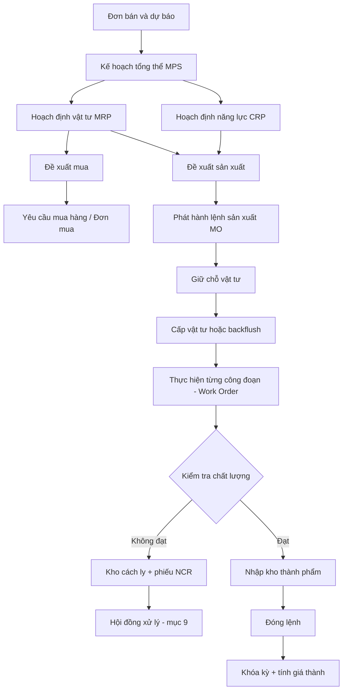
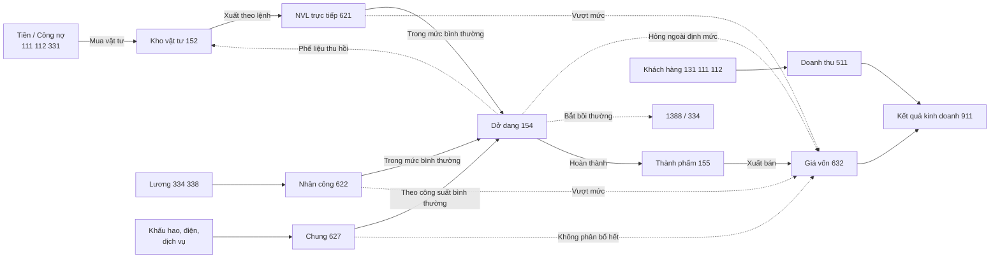

# SẢN XUẤT (MFG) — TỔNG QUAN NGHIỆP VỤ, TỒN KHO, GIÁ THÀNH VÀ DÒNG TIỀN

| | |
|---|---|
| Phiên bản | **1.0** — 21/10/2026 |
| Trạng thái | **Tài liệu nghiên cứu**, chưa phải tài liệu yêu cầu. Chưa có dòng mã, chưa có bảng nào |
| Nguồn | Bản tổng quan đại ca gửi ngày 21/10/2026, đã sửa các chỗ sai và bổ sung phần thiếu |
| Căn cứ kế toán | **Thông tư 99/2025/TT-BTC** (thay Thông tư 200/2014, hiệu lực từ 01/01/2026) · Chuẩn mực kế toán số 02 *Hàng tồn kho* |

---

## Mục lục

0. [Bản này khác bản gốc ở đâu](#0-bản-này-khác-bản-gốc-ở-đâu)
1. [Phạm vi và căn cứ](#1-phạm-vi-và-căn-cứ)
2. [Thuật ngữ](#2-thuật-ngữ)
3. [Quan hệ giữa Sản xuất và các phân hệ khác](#3-quan-hệ-giữa-sản-xuất-và-các-phân-hệ-khác)
4. [Quy trình sản xuất chuẩn](#4-quy-trình-sản-xuất-chuẩn)
5. [Hạch toán chi phí và giá thành](#5-hạch-toán-chi-phí-và-giá-thành)
6. [Đánh giá sản phẩm dở dang cuối kỳ](#6-đánh-giá-sản-phẩm-dở-dang-cuối-kỳ)
7. [Phân bổ chi phí sản xuất chung](#7-phân-bổ-chi-phí-sản-xuất-chung)
8. [Giá thành chuẩn, giá thành thực tế và cách tính giá xuất kho](#8-giá-thành-chuẩn-giá-thành-thực-tế-và-cách-tính-giá-xuất-kho)
9. [Hàng lỗi: quy trình và hạch toán](#9-hàng-lỗi-quy-trình-và-hạch-toán)
10. [Nghiệp vụ đặc biệt](#10-nghiệp-vụ-đặc-biệt)
11. [Dòng tiền và lợi nhuận](#11-dòng-tiền-và-lợi-nhuận)
12. [Sơ đồ luân chuyển tổng hợp](#12-sơ-đồ-luân-chuyển-tổng-hợp)
13. [Đối chiếu với ERP DEGO hiện tại](#13-đối-chiếu-với-erp-dego-hiện-tại)
14. [Câu hỏi phải chốt trước khi viết yêu cầu](#14-câu-hỏi-phải-chốt-trước-khi-viết-yêu-cầu)

---

## 0. Bản này khác bản gốc ở đâu

| # | Bản gốc | Bản này | Vì sao |
|---|---|---|---|
| S1 | Sơ đồ cho vật tư đi thẳng từ TK 152 vào TK 154, đoạn văn bên dưới lại ghi vào TK 621 | Vật tư đi **152 → 621**, cuối kỳ mới kết chuyển **621 → 154** | Chế độ kế toán doanh nghiệp (Thông tư 200 trước đây, Thông tư 99 hiện nay) đều tập hợp qua 621, 622, 627. Đi thẳng vào 154 là cách của chế độ doanh nghiệp nhỏ và vừa. Bản gốc trộn hai chế độ |
| S2 | Căn cứ Thông tư 200 | Căn cứ **Thông tư 99/2025** | Thông tư 200 hết hiệu lực từ 01/01/2026. Các tài khoản 152, 154, 155, 621, 622, 627, 632 vẫn giữ số hiệu |
| S3 | Sơ đồ tổng hợp vẽ thành một chuỗi, hỏng ngoài định mức nằm giữa 154 và 155 | Hỏng ngoài định mức là **một nhánh rẽ** ra khỏi 154 | Nó không phải một bước bắt buộc trên đường đi của sản phẩm tốt |
| S4 | Gọi lệnh sản xuất là Work Order | **Lệnh sản xuất = Manufacturing Order (MO)**. Work Order là **một công đoạn** của lệnh trên một trạm | Odoo dùng đúng như vậy, SAP gọi lệnh là Production Order. Dùng lẫn thì thiết kế bảng sẽ sai cấp |
| S5 | Thiếu tiền thì chuyển sang chạy kiểu JIT | Thiếu tiền thì **ưu tiên lại lệnh, cắt lô mua, giãn kế hoạch** | JIT là cách sản xuất kéo theo nhu cầu, cần nhà cung cấp tin cậy và giao nhỏ lẻ, không phải lối thoát khi hết tiền |
| S6 | Ngay khi xuất bán là có lợi nhuận từng đơn | Chỉ đúng với **giá chuẩn** hoặc **bình quân di động**. Dùng bình quân cuối kỳ thì phải khóa sổ mới có giá vốn thật | Xem mục 8 |
| S7 | Không có | Thêm **đánh giá dở dang cuối kỳ** (mục 6), **phân bổ chi phí chung và công suất bình thường** (mục 7), **giá chuẩn và chênh lệch** (mục 8), **gia công ngoài, sản phẩm phụ, đồng sản phẩm, bán thành phẩm nhiều cấp** (mục 10), **lập kế hoạch tổng thể và năng lực** (mục 4) | Đây là các bài toán quyết định cách thiết kế dữ liệu |
| S8 | Không có | Thêm **đối chiếu với mã nguồn ERP đang chạy** (mục 13) và **câu hỏi cần chốt** (mục 14) | Để tài liệu dùng được làm đầu vào cho bản yêu cầu |

---

## 1. Phạm vi và căn cứ

**Quản lý sản xuất** là phân hệ lập kế hoạch, điều phối, theo dõi và kiểm soát quá trình biến nguyên vật liệu thành thành phẩm. Phân hệ này dùng chung dữ liệu với Mua hàng, Bán hàng, Tồn kho và Kế toán.

Tài liệu này chỉ mô tả nghiệp vụ chuẩn. Nó chưa trả lời câu hỏi DEGO sẽ làm phần nào. Phần đó thuộc bản yêu cầu, viết sau khi chốt các câu ở mục 14.

**Căn cứ kế toán:**

- **Thông tư 99/2025/TT-BTC** hướng dẫn chế độ kế toán doanh nghiệp, ban hành 27/10/2025, hiệu lực 01/01/2026, thay Thông tư 200/2014. Theo hướng dẫn tài khoản 621 của Thông tư 99, cuối kỳ 621 kết chuyển sang 154, **phần vượt mức bình thường kết chuyển thẳng vào 632**, tài khoản 621 không có số dư cuối kỳ.
- **Chuẩn mực kế toán số 02 Hàng tồn kho:** giá gốc hàng tồn kho **không gồm** chi phí nguyên vật liệu, nhân công và chi phí khác vượt mức bình thường, chi phí bảo quản sau khi nhập kho, chi phí bán hàng và quản lý. Chi phí sản xuất chung cố định phân bổ theo **công suất bình thường**.
- Pháp nhân nào áp dụng **chế độ doanh nghiệp nhỏ và vừa** thì không dùng 621, 622, 627 mà tập hợp thẳng vào 154. Kế toán từng pháp nhân phải xác nhận mình theo chế độ nào. Xem câu C3 ở mục 14.

Mọi bút toán trong tài liệu dùng **phương pháp kê khai thường xuyên**, vì ERP theo dõi kho theo từng phiếu. Phương pháp kiểm kê định kỳ không hợp với ERP và không bàn ở đây.

---

## 2. Thuật ngữ

### 2.1. Tên phân hệ

| Viết tắt | Tên đầy đủ | Nghĩa |
|---|---|---|
| **MFG** | Manufacturing | Tên phân hệ Sản xuất ở phần lớn ERP: Odoo, Oracle, Microsoft Dynamics |
| **PP** | Production Planning | Tên phân hệ Lập kế hoạch và quản lý sản xuất của SAP |
| **MES** | Manufacturing Execution System | Hệ thống điều hành tại xưởng, lấy dữ liệu máy và công nhân theo thời gian thực, đẩy kết quả về ERP. Là hệ riêng, không phải một phần của ERP |

### 2.2. Dữ liệu gốc

| Thuật ngữ | Nghĩa |
|---|---|
| **BOM** (Bill of Materials) | Định mức nguyên vật liệu: một đơn vị thành phẩm cần bao nhiêu của từng vật tư. Có **tỷ lệ hao hụt định mức** trên từng dòng. BOM có thể **nhiều cấp**: thành phẩm gồm bán thành phẩm, bán thành phẩm gồm nguyên liệu |
| **Phiên bản BOM** | Một sản phẩm có nhiều BOM theo thời gian hoặc theo dây chuyền. Lệnh sản xuất phải **chụp lại** BOM tại lúc phát hành, không tham chiếu sống |
| **Routing** | Quy trình công nghệ: thứ tự công đoạn, mỗi công đoạn làm ở trạm nào, thời gian chuẩn bao nhiêu |
| **Work Center** | Trạm làm việc hoặc tổ đội: một máy, một dây chuyền, một nhóm công nhân. Mang **năng lực** (giờ máy mỗi ngày) và **đơn giá giờ** |
| **Sản phẩm phụ** (By-product) | Thứ sinh ra kèm theo, giá trị nhỏ. Ví dụ phế liệu bán được |
| **Đồng sản phẩm** (Co-product) | Nhiều sản phẩm chính cùng ra từ một quy trình, giá trị đáng kể. Ví dụ một mẻ phân loại ra hai cấp hạt |

### 2.3. Kế hoạch và thực hiện

| Thuật ngữ | Nghĩa |
|---|---|
| **MPS** (Master Production Schedule) | Kế hoạch sản xuất tổng thể: tuần nào làm bao nhiêu thành phẩm nào. Đầu vào là đơn bán và dự báo |
| **MRP** (Material Requirements Planning) | Hoạch định nhu cầu vật tư: bung BOM từ MPS, trừ tồn kho và hàng đang về, ra **đề xuất mua** và **đề xuất sản xuất bán thành phẩm**. MRP chỉ tính vật tư |
| **CRP** (Capacity Requirements Planning) | Hoạch định năng lực: bung Routing từ MPS, so với năng lực các trạm. MRP báo đủ vật tư nhưng máy không đủ giờ thì kế hoạch vẫn hỏng |
| **MTO / MTS** | Sản xuất theo đơn hàng / sản xuất để tồn kho |
| **MO** (Manufacturing Order) | **Lệnh sản xuất**: làm bao nhiêu sản phẩm nào, theo BOM và Routing nào, trong khoảng thời gian nào. Đây là đối tượng tập hợp chi phí |
| **Work Order** | **Một công đoạn** của lệnh sản xuất, làm trên một trạm. Ghi nhận giờ máy, giờ công, số lượng đạt và hỏng |
| **Cấp vật tư theo lệnh** | Kho lập phiếu xuất theo lệnh trước khi làm |
| **Backflush** | Trừ kho tự động **sau** khi báo hoàn thành, theo BOM nhân sản lượng. Nhanh nhưng che mất chênh lệch tiêu hao thực tế |
| **WIP** (Work In Progress) | Sản phẩm dở dang. Về kế toán là số dư TK 154 |

### 2.4. Giá thành

| Thuật ngữ | Nghĩa |
|---|---|
| **COGM** (Cost of Goods Manufactured) | Giá thành sản phẩm hoàn thành trong kỳ |
| **COGS** (Cost of Goods Sold) | Giá vốn hàng bán, TK 632 |
| **Giá thành chuẩn** (Standard cost) | Giá định trước cho một đơn vị, dùng để nhập kho ngay. Chênh lệch với thực tế tính riêng |
| **Giá thành thực tế** (Actual cost) | Giá tính ra từ chi phí thật sau khi khóa kỳ |
| **Sản lượng tương đương** | Quy sản phẩm dở dang về số sản phẩm hoàn thành theo mức độ hoàn thành. Dùng để chia chi phí giữa hàng xong và hàng dở |
| **Công suất bình thường** | Sản lượng đạt được trung bình trong điều kiện bình thường. Căn cứ để phân bổ chi phí chung cố định |

---

## 3. Quan hệ giữa Sản xuất và các phân hệ khác

### 3.1. Sản xuất và Tồn kho

| Thời điểm | Việc xảy ra ở kho | Ghi chú |
|---|---|---|
| Phát hành lệnh | **Giữ chỗ** vật tư theo BOM chụp lại. Giữ chỗ chỉ làm giảm số **khả dụng**, chưa trừ số tồn | Thiếu vật tư thì lệnh vẫn phát hành được nhưng ở trạng thái chờ vật tư. Đề xuất mua đến từ MRP, không đến từ từng lệnh |
| Cấp vật tư | Trừ kho vật tư, ghi Nợ 621 theo lệnh | Theo phiếu xuất hoặc backflush |
| Trả lại vật tư thừa | Cộng kho, ghi giảm 621 | Hay bị bỏ quên. Không làm thì giá thành bị đội |
| Nhập thành phẩm | Cộng kho thành phẩm. Giá nhập tạm là giá chuẩn hoặc giá ước tính | Giá thật chỉ có sau khi tính giá thành kỳ (mục 5) |
| Đóng lệnh | Giải phóng phần giữ chỗ chưa dùng | Lệnh chưa đóng thì vẫn mang số dư dở dang |

### 3.2. Sản xuất và Mua hàng

MRP sinh **đề xuất mua**. Người mua xem, gộp, rồi chuyển thành yêu cầu mua hàng. Không nên để MRP tự tạo đơn mua, vì đơn mua cần chọn nhà cung cấp, giá và điều kiện thanh toán.

Gia công ngoài cũng đi qua Mua hàng: đơn mua **dịch vụ gia công** kèm phiếu xuất vật tư gửi đi (mục 10.1).

### 3.3. Sản xuất và Bán hàng

Với MTO, mỗi lệnh gắn với một hoặc nhiều dòng đơn bán. Với MTS, lệnh gắn với kế hoạch tổng thể. Bán hàng cần biết **ngày có hàng dự kiến** của lệnh để hứa ngày giao.

### 3.4. Sản xuất và Kế toán

Sản xuất cung cấp số lượng và chi phí trực tiếp theo lệnh. Kế toán cung cấp chi phí chung trong kỳ, tiền lương, khấu hao. Hai bên gặp nhau ở **bước tính giá thành cuối kỳ**.

Nếu ERP không làm sổ cái thì phải có điểm bàn giao rõ: ERP xuất cái gì, phần mềm kế toán nhập cái gì, ai khóa kỳ. Xem câu C1 ở mục 14.

### 3.5. Dữ liệu gốc sản phẩm

| Với | Sản phẩm phải mang |
|---|---|
| Sản xuất | Loại hàng (nguyên liệu, bán thành phẩm, thành phẩm, phế liệu), BOM mặc định, Routing mặc định, thời gian sản xuất, lô sản xuất tối thiểu |
| Tồn kho | Đơn vị tính và **quy đổi đơn vị** (bao 50 kg sang kg), quy cách đóng gói, điều kiện bảo quản, **theo dõi theo lô hay số seri**, hạn dùng |
| Kế toán | Tài khoản kho, nhóm tính giá, giá chuẩn nếu dùng giá chuẩn |

---

## 4. Quy trình sản xuất chuẩn



| Bước | Ai làm | Ra cái gì |
|---|---|---|
| 1. Lập kế hoạch tổng thể | Kế hoạch sản xuất | Bảng tuần nào làm bao nhiêu |
| 2. Chạy MRP và CRP | Kế hoạch sản xuất | Đề xuất mua, đề xuất sản xuất, cảnh báo quá tải trạm |
| 3. Phát hành lệnh | Kế hoạch sản xuất | Lệnh sản xuất, BOM và Routing chụp lại, vật tư giữ chỗ |
| 4. Cấp vật tư | Thủ kho | Phiếu xuất kho theo lệnh |
| 5. Thực hiện | Tổ trưởng | Báo cáo từng công đoạn: giờ máy, giờ công, số đạt, số hỏng |
| 6. Kiểm tra chất lượng | QC | Kết quả đạt hoặc phiếu NCR |
| 7. Nhập kho | Thủ kho | Phiếu nhập kho thành phẩm, mang số lô |
| 8. Đóng lệnh | Kế hoạch sản xuất | Lệnh hết nhận chi phí, trả vật tư thừa |
| 9. Tính giá thành | Kế toán giá thành | Giá thành từng lệnh, điều chỉnh giá nhập kho, bút toán kết chuyển |

Kiểm tra chất lượng có ba chặng: **IQC** khi nhận vật tư, **IPQC** giữa các công đoạn, **FQC** trước khi nhập kho thành phẩm.

---

## 5. Hạch toán chi phí và giá thành

### 5.1. Sơ đồ

```
                 Mua vật tư
Tiền / Công nợ (111, 112, 331) ──────────► Kho vật tư (152)
                                                │ Xuất theo lệnh
                                                ▼
                               Chi phí NVL trực tiếp (621)
Lương công nhân (334, 338) ──► Nhân công trực tiếp (622)
Khấu hao, điện, vật tư phụ ──► Chi phí sản xuất chung (627)
                                                │ Kết chuyển cuối kỳ
                                                │ (phần trong mức bình thường)
                                                ▼
                        Chi phí SX dở dang (154) ─────► Vượt mức bình thường,
                                                │         chung cố định không
                                                │         phân bổ hết: 632
                                                │
                                                ├─────► Phế liệu thu hồi: 152
                                                ├─────► Hỏng bắt bồi thường: 1388, 334
                                                │
                                                │ Hoàn thành (giá thành)
                                                ▼
                               Kho thành phẩm (155)
                                                │ Xuất bán
                                                ▼
                               Giá vốn hàng bán (632) ──► Kết quả kinh doanh (911)
                               Doanh thu (511) ◄── Khách hàng (131, 111, 112)
```

Các mũi tên rẽ ngang từ 154 là **nhánh**, không phải bước tuần tự. Sản phẩm tốt chỉ đi thẳng xuống.

### 5.2. Bút toán theo từng nghiệp vụ

| # | Nghiệp vụ | Nợ | Có | Phát sinh từ đâu trong ERP |
|---|---|---|---|---|
| 1 | Xuất nguyên vật liệu cho lệnh | 621 (chi tiết theo lệnh) | 152 | Phiếu xuất kho theo lệnh |
| 2 | Trả lại vật tư thừa | 152 | 621 | Phiếu nhập trả |
| 3 | Lương công nhân trực tiếp | 622 | 334 | Bảng lương, chia theo giờ công từng lệnh |
| 4 | Trích bảo hiểm, kinh phí công đoàn | 622 | 338 | Bảng lương |
| 5 | Lương quản lý xưởng, khấu hao, điện, vật tư phụ, dịch vụ mua ngoài | 627 | 334, 338, 214, 152, 153, 242, 331, 111, 112 | Kế toán |
| 6 | Kết chuyển trong mức bình thường | 154 | 621, 622, 627 | Bước tính giá thành |
| 7 | Kết chuyển vượt mức bình thường và chung cố định không phân bổ hết | 632 | 621, 622, 627 | Bước tính giá thành (mục 7) |
| 8 | Phế liệu thu hồi nhập kho | 152 | 154 | Phiếu nhập phế liệu |
| 9 | Hỏng không sửa được, ngoài định mức | 632 (phần tính vào chi phí) · 1388, 334 (phần bắt bồi thường) | 154 | Quyết định xử lý của hội đồng |
| 10 | Thành phẩm nhập kho | 155 | 154 | Phiếu nhập kho thành phẩm |
| 11 | Thành phẩm giao bán thẳng không qua kho | 632 | 154 | Phiếu giao hàng từ xưởng |
| 12 | Thành phẩm gửi đi bán | 157 | 154 hoặc 155 | Phiếu gửi hàng |
| 13 | Xuất bán | 632 | 155 | Phiếu xuất bán |
| 14 | Doanh thu | 131, 111, 112 | 511, 3331 | Hóa đơn bán |

**Lưu ý về tên tài khoản.** Thông tư 99 giữ số hiệu các tài khoản trên. Tên một số tài khoản có thể đổi so với Thông tư 200. Kế toán cần soát lại tên, nhất là 155 và 1388, trước khi đưa vào danh mục tài khoản của hệ thống.

### 5.3. Bốn giai đoạn của giá trị

1. **Tài sản dạng vật tư** — số dư 152.
2. **Chi phí đang tập hợp** — số phát sinh 621, 622, 627 trong kỳ. Cuối kỳ về 0.
3. **Tài sản dạng dở dang và thành phẩm** — số dư 154 và 155. Vẫn nằm trên bảng cân đối kế toán.
4. **Chi phí trên báo cáo lãi lỗ** — 632, khi hàng đã bán hoặc khi là phần vượt mức bình thường.

Điểm quan trọng: **phần vượt mức bình thường nhảy thẳng từ giai đoạn 2 sang giai đoạn 4**, không bao giờ nằm trong giá trị tồn kho.

---

## 6. Đánh giá sản phẩm dở dang cuối kỳ

Đây là bài toán khó nhất khi tính giá thành thực tế. Cuối kỳ thường có lệnh làm dở. Phải chia tổng chi phí 154 thành hai phần: phần của hàng đã hoàn thành và phần còn nằm lại ở hàng dở.

### 6.1. Ba cách đánh giá

| Cách | Làm thế nào | Hợp khi |
|---|---|---|
| **Theo nguyên vật liệu chính** | Hàng dở chỉ gánh chi phí nguyên vật liệu chính. Nhân công và chi phí chung tính hết cho hàng xong | Nguyên vật liệu chiếm phần lớn giá thành, hàng dở ít và đều qua các kỳ |
| **Theo sản lượng tương đương** | Quy hàng dở về số hàng xong theo mức độ hoàn thành, chia từng khoản mục chi phí theo số đó | Chi phí chế biến đáng kể, hàng dở nhiều hoặc dao động |
| **Theo định mức** | Hàng dở tính theo chi phí định mức của các công đoạn đã qua | Đã có BOM và Routing đủ tin cậy, nhất là khi dùng giá chuẩn |

### 6.2. Ví dụ sản lượng tương đương

Đầu kỳ không có hàng dở. Trong kỳ đưa vào sản xuất 1.000 sản phẩm. Cuối kỳ xong 800, còn 200 đang làm, đã hoàn thành khoảng 50%. Nguyên vật liệu bỏ hết ngay từ đầu.

| Khoản mục | Chi phí trong kỳ | Sản lượng tương đương | Chi phí một đơn vị | Phần của hàng dở |
|---|---:|---:|---:|---:|
| Nguyên vật liệu | 100.000.000 | 800 + 200 = 1.000 | 100.000 | 200 × 100.000 = 20.000.000 |
| Nhân công và chung | 45.000.000 | 800 + 200 × 50% = 900 | 50.000 | 100 × 50.000 = 5.000.000 |
| **Cộng** | **145.000.000** | | **150.000** | **25.000.000** |

Giá thành hàng hoàn thành là 145.000.000 trừ 25.000.000, bằng **120.000.000**, tức **150.000** một sản phẩm.

**Hệ quả cho thiết kế:** muốn dùng cách này, báo cáo công đoạn phải ghi được **mức độ hoàn thành** của hàng dở. Nếu chỉ ghi số đạt và số hỏng thì không tính được.

---

## 7. Phân bổ chi phí sản xuất chung

### 7.1. Tiêu thức phân bổ

Chi phí chung (627) không gắn được với lệnh nào ngay lúc phát sinh. Cuối kỳ phải chia cho các lệnh theo một tiêu thức:

| Tiêu thức | Hợp khi |
|---|---|
| Giờ máy | Xưởng dùng máy là chính, khấu hao và điện chiếm phần lớn |
| Giờ công trực tiếp | Xưởng thủ công là chính |
| Chi phí nhân công trực tiếp | Như giờ công, khi đơn giá lương giữa các tổ khác nhau |
| Chi phí nguyên vật liệu trực tiếp | Quy trình đơn giản, ít công đoạn |
| Số lượng sản phẩm | Chỉ khi các sản phẩm gần như giống nhau |

Mỗi trạm làm việc có thể dùng một tiêu thức riêng. Tiêu thức phải **giữ ổn định giữa các kỳ** để giá thành so sánh được.

### 7.2. Công suất bình thường

Chi phí chung chia làm hai loại. **Biến phí** như điện chạy máy tăng giảm theo sản lượng, phân bổ hết vào giá thành. **Định phí** như khấu hao, lương quản lý xưởng gần như không đổi, chỉ được phân bổ **theo công suất bình thường**.

Ví dụ: định phí chung một tháng là 60.000.000. Công suất bình thường là 10.000 giờ máy, tức 6.000 mỗi giờ. Tháng này chỉ chạy 7.500 giờ.

| | Số tiền | Đi vào |
|---|---:|---|
| Phân bổ vào giá thành | 7.500 × 6.000 = 45.000.000 | 154 |
| Phần không phân bổ do chạy dưới công suất | 15.000.000 | **632 ngay trong kỳ** |

Nếu đổ hết 60.000.000 vào giá thành thì tháng ít đơn hàng sẽ cho giá thành đơn vị cao bất thường, tồn kho bị thổi phồng, lỗ bị đẩy sang kỳ sau. Chuẩn mực số 02 cấm cách đó.

**Hệ quả cho thiết kế:** mỗi trạm phải khai **công suất bình thường** trong kỳ, và bước tính giá thành phải tách được định phí với biến phí.

---

## 8. Giá thành chuẩn, giá thành thực tế và cách tính giá xuất kho

### 8.1. Chuẩn hay thực tế

| | Giá thành chuẩn | Giá thành thực tế |
|---|---|---|
| Nhập kho thành phẩm | Theo giá chuẩn, ngay lúc nhập | Theo giá tạm, điều chỉnh sau khi khóa kỳ |
| Lợi nhuận từng đơn | Có ngay khi bán | Có sau khi khóa kỳ |
| Chênh lệch | Tính riêng theo khoản mục: chênh lệch giá vật tư, chênh lệch lượng tiêu hao, chênh lệch hiệu suất giờ máy | Không có, vì giá đã là thực tế |
| Đòi hỏi | BOM, Routing và đơn giá chuẩn phải tin cậy, phải cập nhật định kỳ | Phải khóa kỳ đúng hạn, phải đánh giá dở dang |
| Hợp với | Sản phẩm lặp lại, quy trình ổn định | Sản phẩm theo đơn, ít lặp lại |

Kế toán Việt Nam lập báo cáo theo **giá gốc thực tế**. Dùng giá chuẩn để quản trị thì cuối kỳ vẫn phải phân bổ chênh lệch giữa tồn kho và giá vốn cho đúng giá gốc.

Lựa chọn này **quyết định cấu trúc dữ liệu**: giá chuẩn cần bảng giá chuẩn theo kỳ và bảng chênh lệch. Giá thực tế cần bảng tập hợp chi phí theo lệnh và bước điều chỉnh giá nhập kho. Phải chọn trước khi thiết kế bảng.

### 8.2. Cách tính giá xuất kho

Chuẩn mực số 02 cho phép bốn cách: **thực tế đích danh**, **bình quân gia quyền**, **nhập trước xuất trước**, và **giá bán lẻ**. Không có nhập sau xuất trước. Bình quân gia quyền có hai kiểu:

| Kiểu | Giá xuất có khi nào | Lợi nhuận từng đơn |
|---|---|---|
| **Bình quân sau mỗi lần nhập** (di động) | Ngay lúc xuất | Có ngay |
| **Bình quân cuối kỳ** | Sau khi khóa kỳ | Phải chờ |

Kho trong ERP DEGO hiện đang dùng **bình quân di động** (mục 13). Với thành phẩm tính giá thực tế, giá nhập chỉ chốt sau khi khóa kỳ, nên bình quân di động của thành phẩm sẽ phải **tính lại** từ thời điểm nhập khi có giá thật. Đây là chỗ phải thiết kế cẩn thận.

---

## 9. Hàng lỗi: quy trình và hạch toán

### 9.1. Quy trình trên hệ thống

1. **Cách ly ngay.** QC phát hiện lỗi ở chặng IQC, IPQC hoặc FQC thì lập **phiếu NCR** (báo cáo hàng không phù hợp), chuyển hàng vào **kho cách ly**. Hàng trong kho cách ly không được giữ chỗ, không được xuất bán, không tính vào số khả dụng.
2. **Hội đồng xử lý** quyết định một trong năm hướng:

| Hướng | Việc trên hệ thống |
|---|---|
| **Làm lại** (Rework) | Phát hành lệnh làm lại, có BOM và Routing riêng |
| **Hạ cấp** (Downgrade) | Chuyển sang mã hàng loại B, giá trị theo giá bán thực hiện được nếu thấp hơn |
| **Dùng có điều kiện** (Use as is) | Khách hoặc bộ phận kỹ thuật chấp nhận, ghi rõ lý do trên NCR |
| **Hủy** (Scrap) | Phiếu xuất hủy, kèm biên bản |
| **Trả nhà cung cấp** (RTV) | Chỉ khi lỗi do vật tư đầu vào. Đi qua Mua hàng và công nợ phải trả |

### 9.2. Chi phí hàng lỗi đi đâu

| Loại | Bản chất | Hạch toán | Tác động |
|---|---|---|---|
| **Hỏng trong định mức** | Hao hụt tự nhiên, đã khai tỷ lệ hao hụt trên BOM | Giữ trong 154, chia vào giá thành sản phẩm tốt | Nằm trong giá trị tồn kho. Thành chi phí khi bán |
| **Hỏng ngoài định mức** | Sự cố máy, làm ẩu, hỏng hàng loạt | Tách khỏi 154. Nợ 632 phần tính vào chi phí, Nợ 1388 hoặc 334 phần bắt bồi thường | Trừ thẳng lợi nhuận kỳ đó. Không được cộng vào giá thành hàng tốt |
| **Làm lại** | Sửa được | Chi phí làm lại cộng vào 154 của lô đó. Nếu làm lại do lỗi bất thường thì phần chi phí làm lại cũng là ngoài định mức, đưa vào 632 | Làm tăng giá thành thực tế |
| **Phế liệu thu hồi** | Bán được hoặc dùng lại được | Nhập kho: Nợ 152, Có 154. Bán ngay: kế toán xác nhận ghi giảm 154 hay ghi thu nhập khác | Ghi giảm chi phí sản xuất |

**Hệ quả cho thiết kế:** muốn tách trong và ngoài định mức tự động, BOM phải mang **tỷ lệ hao hụt định mức** và báo cáo công đoạn phải ghi **số hỏng kèm nguyên nhân**. Phần vượt tỷ lệ định mức hệ thống đề xuất là ngoài định mức, hội đồng xác nhận.

---

## 10. Nghiệp vụ đặc biệt

### 10.1. Gia công ngoài

Một phần hoặc cả lệnh thuê đơn vị bên ngoài làm.

| Bước | Nợ | Có |
|---|---|---|
| Xuất vật tư gửi gia công | 154 (chi tiết theo đơn gia công) | 152 |
| Phí gia công, vận chuyển | 154 · 133 | 331, 111, 112 |
| Nhận hàng gia công về | 155 hoặc 152 | 154 |

Trên hệ thống cần: đơn mua **dịch vụ** gia công, **kho tại đơn vị gia công** để biết vật tư của mình đang nằm ở đâu, và đối chiếu định mức tiêu hao với đơn vị gia công khi nhận hàng về.

### 10.2. Sản phẩm phụ

Giá trị nhỏ. Thường định giá theo giá bán ước tính hoặc giá kế hoạch rồi **trừ khỏi** tổng giá thành sản phẩm chính, giống phế liệu thu hồi.

### 10.3. Đồng sản phẩm

Giá trị đáng kể. Phải **chia** tổng giá thành của quy trình cho các sản phẩm theo một trong ba cách: hệ số quy đổi, tỷ lệ theo giá thành kế hoạch, hoặc tỷ lệ theo giá bán. BOM phải khai được **nhiều đầu ra** cho một lệnh.

### 10.4. Bán thành phẩm nhiều cấp

Khi BOM nhiều cấp, giá thành tính theo một trong hai cách:

- **Có tính giá thành bán thành phẩm:** mỗi cấp là một lệnh, bán thành phẩm nhập kho với giá thành riêng rồi xuất cho cấp sau. Biết được giá từng cấp, nhiều phiếu hơn.
- **Không tính giá thành bán thành phẩm:** chỉ tính giá thành thành phẩm cuối, các cấp giữa chỉ theo dõi số lượng. Ít phiếu hơn, không bán riêng được bán thành phẩm.

---

## 11. Dòng tiền và lợi nhuận

### 11.1. Vốn bị giam

Mọi vật tư trong kho, hàng dở dang trên chuyền và thành phẩm chưa bán đều là tiền đã chi mà chưa thu về. Thước đo chuẩn là **chu kỳ chuyển đổi tiền mặt**:

```
Chu kỳ chuyển đổi tiền = Số ngày tồn kho + Số ngày thu tiền khách − Số ngày trả tiền nhà cung cấp
```

Số ngày tồn kho gồm cả vật tư, dở dang và thành phẩm. Sản xuất kéo dài thời gian dở dang thì kéo dài cả chu kỳ.

### 11.2. Khi tiền là ràng buộc

MRP chỉ biết vật tư thiếu, không biết công ty có tiền mua hay không. Khi tiền là ràng buộc thật, việc cần làm là:

- **Ưu tiên lại lệnh** theo biên lợi nhuận và hạn giao, lệnh nào thu tiền sớm làm trước.
- **Cắt nhỏ lô mua**, chấp nhận giá cao hơn một chút để giảm tiền chôn trong kho.
- **Giãn kế hoạch** những lệnh để tồn kho.

ERP hỗ trợ việc này bằng cách dự phóng: kế hoạch sản xuất và đề xuất mua cho ra **dòng tiền chi** theo hạn thanh toán, kế hoạch giao hàng cho ra **dòng tiền thu** theo hạn thu tiền. Phân hệ công nợ phải trả và yêu cầu thanh toán đã có sẵn dữ liệu cho nửa chi.

### 11.3. Lợi nhuận

- **Sản xuất quyết định lợi nhuận gộp.** Giảm tỷ lệ hỏng, tăng hiệu suất máy làm giảm giá thành đơn vị.
- **Tồn kho bảo vệ hoặc ăn mòn lợi nhuận ròng.** Ôm nhiều quá thì tốn chi phí lưu kho, hàng hết hạn phải hủy hoặc lập dự phòng giảm giá. Mỏng quá thì thiếu hàng giao, mất doanh thu.
- **Lợi nhuận từng đơn ngay lúc bán** chỉ có khi giá xuất có ngay, tức dùng giá chuẩn hoặc bình quân di động với giá nhập đã chốt (mục 8).
- **Chạy dưới công suất bình thường** đẩy phần định phí không phân bổ vào 632 ngay trong kỳ (mục 7.2). Báo cáo quản trị nên tách riêng dòng này để thấy cái giá của máy chạy không đầy.

---

## 12. Sơ đồ luân chuyển tổng hợp



Đường liền là đường đi của sản phẩm tốt. Đường đứt là các nhánh rẽ.

---

## 13. Đối chiếu với ERP DEGO hiện tại

Đối chiếu với mã nguồn nhánh đang chạy ngày 21/10/2026.

### 13.1. Đã có, dùng lại được

| Thứ đã có | Ở đâu | Dùng cho Sản xuất thế nào |
|---|---|---|
| Danh mục sản phẩm | `tab_product`, là bảng **SKU**, nối các bảng khác bằng chuỗi `product_code` | BOM và lệnh sản xuất nối bằng `product_code` như bảy bảng hiện có |
| Tồn kho theo công ty và kho | `tab_inventory`: số lượng, **đơn giá bình quân di động**, giá trị | Tồn vật tư và thành phẩm |
| Phiếu biến động kho | `tab_inventory_move`, hiện có hai loại: nhận hàng và điều chỉnh | Thêm loại xuất sản xuất, nhập thành phẩm, trả vật tư, xuất hủy |
| Yêu cầu mua hàng, đơn mua, nhận hàng | Các phân hệ Thu mua | Đích đến của đề xuất mua từ MRP. Đơn mua dịch vụ gia công |
| Công nợ phải trả, yêu cầu thanh toán | Phân hệ Tài chính | Nửa chi của dự phóng dòng tiền |
| Bộ máy phê duyệt, nhân sự, phòng ban, phân quyền hai trục | Các phân hệ nền | Duyệt lệnh, duyệt NCR, phạm vi xem theo nhà máy |

### 13.2. Chưa có

| Thiếu | Mức độ |
|---|---|
| BOM, phiên bản BOM, Routing, trạm làm việc | Phải làm mới hết |
| Lệnh sản xuất, công đoạn, báo cáo công đoạn | Phải làm mới hết |
| **Danh mục kho** thật. Hiện kho chỉ là chuỗi `warehouse_code` | Cần để có kho cách ly, kho tại đơn vị gia công, kho dở dang |
| **Theo dõi theo lô**, hạn dùng | Chưa có cột nào. Gần như bắt buộc nếu làm phân bón, hóa chất, thực phẩm |
| **Giữ chỗ** tồn kho, số khả dụng | Chưa có |
| Quy đổi đơn vị tính | Cần kiểm lại phần sản phẩm |
| Sổ cái kế toán | ERP không có phân hệ kế toán. Bút toán ở mục 5 hoặc do ERP sinh rồi đẩy sang phần mềm kế toán, hoặc kế toán tự làm từ số liệu ERP xuất ra |

### 13.3. Ràng buộc phải giữ khi thiết kế

- **Không thêm bảng biến thể dưới `tab_product`**, không đổi hoặc tái dùng `product_code`, **không đặt cột giá lên sản phẩm**. Giá chuẩn, nếu dùng, nằm ở bảng riêng theo kỳ. Xem `doc/tai-lieu-ky-thuat/mo-hinh-du-lieu-san-pham.md`.
- Trạng thái lệnh, công đoạn, NCR lưu **`SMALLINT` có `IntEnum`**, không lưu chữ.
- Đơn giá bình quân di động hiện tính lại mỗi lần nhận hàng. Thêm nhập thành phẩm với giá tạm thì phải quyết **có tính lại bình quân khi chốt giá thật hay không** (mục 8.2).
- Mỗi entity quyền mới phải khai đủ phạm vi dữ liệu, nếu không bài kiểm canh sẽ đỏ.

---

## 14. Câu hỏi phải chốt trước khi viết yêu cầu

### Nhóm A — Sản xuất cái gì

| # | Câu hỏi | Vì sao chặn |
|---|---|---|
| A1 | Nhà máy nào, sản xuất mặt hàng gì? Nếu là phối trộn phân bón từ các nguyên liệu đang nhập như K₂SO₄, KNO₃ thì là sản xuất **theo mẻ, công thức theo tỷ lệ** | Quyết định BOM dạng danh sách linh kiện hay dạng công thức, có cần đồng sản phẩm không |
| A2 | Sản xuất theo đơn, để tồn kho, hay cả hai? | Quyết định có cần MPS và dự báo không |
| A3 | Có theo dõi lô và hạn dùng không? Khách có đòi truy xuất ngược từ thành phẩm về lô nguyên liệu không? | Lô phải có từ phiếu nhận hàng. Làm sau thì phải sửa cả phân hệ nhận hàng |
| A4 | BOM bao nhiêu cấp? Có bán thành phẩm bán riêng không? | Mục 10.4 |
| A5 | Có thuê gia công ngoài không? | Mục 10.1 |

### Nhóm B — Làm tới đâu

| # | Câu hỏi | Vì sao chặn |
|---|---|---|
| B1 | Bản đầu chỉ quản lý **số lượng** (lệnh, cấp vật tư, nhập thành phẩm, hàng lỗi) hay làm cả **giá thành**? | Làm số lượng trước là cách rủi ro thấp. Giá thành cần dữ liệu lương và chi phí chung mà ERP chưa có |
| B2 | Có cần MRP tự động không, hay kế hoạch sản xuất tự lập đề xuất mua? | MRP là phần nặng nhất về thuật toán |
| B3 | Báo cáo công đoạn ghi theo từng công đoạn hay chỉ ghi khi xong lệnh? | Quyết định có tính được dở dang theo sản lượng tương đương không (mục 6) |
| B4 | Cấp vật tư bằng phiếu xuất hay backflush? | Mục 2.3 |

### Nhóm C — Kế toán

| # | Câu hỏi | Vì sao chặn |
|---|---|---|
| C1 | Kế toán đang dùng phần mềm nào? ERP sinh bút toán đẩy sang, hay chỉ xuất số liệu? | Quyết định ranh giới ERP và kế toán (mục 3.4) |
| C2 | Giá thành chuẩn hay thực tế? Kỳ tính giá là tháng hay quý? | Mục 8.1. Quyết định cấu trúc dữ liệu |
| C3 | Pháp nhân có nhà máy theo chế độ doanh nghiệp (Thông tư 99) hay doanh nghiệp nhỏ và vừa? | Có hay không có 621, 622, 627 |
| C4 | Chi phí chung phân bổ theo tiêu thức nào? Công suất bình thường của từng trạm là bao nhiêu? | Mục 7 |
| C5 | Phế liệu bán ngay ghi giảm 154 hay ghi thu nhập khác? | Mục 9.2 |
| C6 | Lương công nhân trực tiếp lấy từ đâu, có chấm giờ công theo lệnh không? | Không có thì 622 không chia được cho lệnh |

---

*Hết tài liệu. Mọi lần sửa ghi vào phần lịch sử ở [README](./README.md).*
